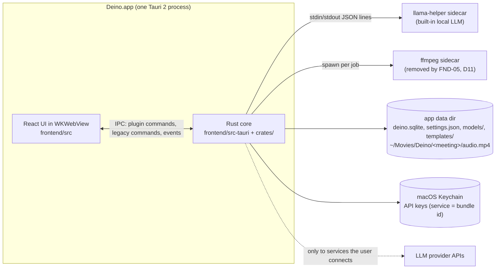
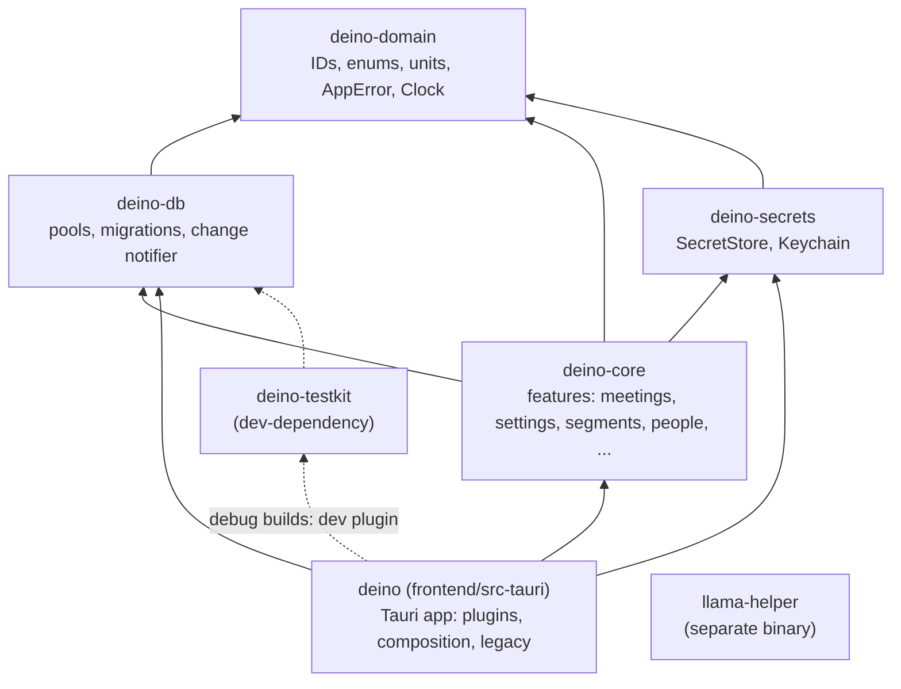
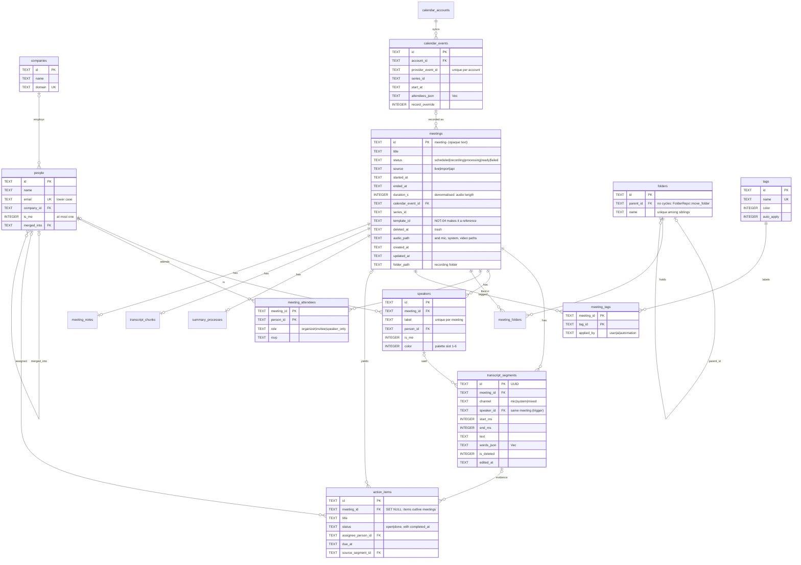

# Deino architecture

The map of the system as it is today (FND-13). PARITY_PLAN §4.0 is the target
it grows towards; this file says where each part lives now and how to extend
it. **Update it in the same PR** whenever a card changes a process, a crate, a
module boundary, the data flow, the schema or an extension point (§3A).

Decisions behind this layout are in [`adr/`](adr/): Tauri + Rust core (0004),
SQLite + sqlx (0005), crate layout (0006), typed IPC (0007), TanStack Query +
`DbChanged` (0008), the error model (0009), cloud LLM for notes with local
transcription (0010), the code-quality limits (0011), the core schema with
its legacy `transcripts` view (0012) and typed settings with Keychain secrets
(0013).

## 1. Processes



- Audio capture, voice activity detection and transcription (Parakeet over
  ONNX Runtime, Whisper over whisper.cpp) run in the app process. Notes and
  chat go to the LLM the user chose, or to the local llama-helper (ADR 0010).
- There is no Deino server and no telemetry. Network calls go only to the
  user's LLM provider and model downloads (FND-12 will put them all behind
  `deino-net`).

## 2. Rust workspace



| Crate | Path | Role |
|---|---|---|
| `deino-domain` | `crates/deino-domain` | The shared vocabulary: typed IDs (`MeetingId`, UUIDv7 IDs), the closed sets the schema stores (`MeetingStatus` with its transitions, `Channel`, `AttendeeRole`, `Rsvp`, ...), `Millis`/`Seconds`, `Email`, `PaletteColor`, `AppError`/`ErrorCode`/`ErrorClass`, the `Clock` port. |
| `deino-db` | `crates/deino-db` | `Database` (WAL, one writer, read pool), `MIGRATOR` over `migrations/`, `DataMigration` (Rust steps between two schema migrations), `ChangeNotifier`, `Table`, `test_db()`. |
| `deino-secrets` | `crates/deino-secrets` | `SecretStore` (set, status, delete, and `get` for Rust only), `KeychainSecretStore` over `keyring`, `InMemorySecretStore` (feature `test-support`). |
| `deino-core` | `crates/deino-core` | Features as Tauri-free modules: `meetings` (list, rename, lifecycle, trash), `settings` (typed `Settings`, `SettingsService`, the atomic `settings.json` store, the legacy-store importers), one module per core-schema aggregate (`segments`, `people`, `companies`, `calendar`, `folders`, `tags`, `action_items`: ports, SQLite repositories, fakes), and `_example` (debug builds). |
| `deino-testkit` | `crates/deino-testkit` | The fixture meetings in `fixtures/` as typed, validated values; `FixtureSeeder` (also behind the debug-only `dev` plugin); fixture audio decoding; re-exported fakes for tests (feature `test-support`). |
| `deino` | `frontend/src-tauri` | The Tauri app: plugins, composition root, legacy modules. Library crate `deino_lib`. |
| `llama-helper` | `llama-helper` | The local LLM sidecar. |

Rules (PARITY_PLAN §4.0): dependencies point down the diagram only; **no crate
under `crates/` depends on `tauri`**; a feature becomes its own crate only when
it gains heavy native dependencies or passes about 3k lines. Each crate's
`README.md` lists what it owns and its invariants.

## 3. The app crate (`frontend/src-tauri/src`)

| Module | What it is |
|---|---|
| `lib.rs` | The builder only: plugins, state, setup, run loop. |
| `composition.rs` | **The composition root.** Builds services from adapters (SQLite repos, `SystemClock`, the settings file, the Keychain, Tauri event adapters) and `app.manage`s them. `attach_settings` runs first at startup; `attach_database` once `deino.sqlite` is open. |
| `paths.rs` | `AppPaths`: every app folder, resolved once from Tauri's resolver and injected (settings file, legacy stores, models, templates). |
| `features.rs`, `features/` | New IPC: one inline Tauri plugin per feature (`system`, `meetings`, `settings`, `secrets`, `db`, and `example` and `dev` in debug builds), each with one `tauri_specta::Builder`. `features/manifest.rs` lists plugins and commands for the ACL; debug-only plugins are in `DEV_FEATURES` and granted by `capabilities/dev/`. |
| `error.rs` | The command boundary: `into_ipc()` logs the error chain and returns `AppError`. |
| `bindings.rs` | Test-only: exports the TypeScript bindings and checks them against the manifest. |
| `legacy_lints.rs` | The one place inherited modules are exempted from the strict lints. |
| `legacy.rs`, `legacy/` | Every inherited command, in one `generate_handler!`; cards port them into plugins. |
| `setup.rs`, `lifecycle.rs`, `state.rs` | Startup steps, window and exit handling, legacy `AppState`. |
| `database/` | Legacy repositories, and `DatabaseManager`, which wraps `deino_db::Database`. |
| `audio/` | Capture (cpal microphone, Core Audio process tap), mixing, VAD, recording, import, retranscription, the transcription worker. |
| `parakeet_engine/`, `whisper_engine/` | Local STT engines and model management. |
| `summary/` | LLM clients, chunk → combine → final summaries, templates, the built-in model (`summary_engine/`). |
| `notifications/`, `tray.rs`, `onboarding.rs`, `updater/` | OS integration. Notification switches and onboarding progress are sections of the typed settings. |
| `anthropic/`, `openai/`, `groq/`, `ollama/`, `openrouter/` | Provider model lists (to be replaced by FND-09's gateway). |

## 4. Frontend (`frontend/src`)

| Path | What it is |
|---|---|
| `main.tsx` | Creates the query client and mounts `IpcQueryProvider` around the router. |
| `routes/` | TanStack Router file routes, thin: each renders one feature screen. |
| `features/<feature>/` | `api.ts` (generated commands, `unwrap`ped), `queries.ts` (keys and hooks with `meta.tables`), `hooks/`, `components/`, `copy.ts`, `types.ts`, `index.ts` (the only import path for other code; `search.ts` for URL params). Today: `meetings`, `settings` (`useSettings`, key status, `SettingsSync`), `_example`, plus `shell`, `record`, `meeting-details` from FND-10a. |
| `lib/ipc/` | `generated/` (tauri-specta output, never edited), `result.ts` (`unwrap`, `IpcError`), `query-client.ts`, `events.ts` (`DbChanged` bridge, `useIpcEvent`), `ipc-query-provider.tsx`. |
| `dev/mock-ipc/` | `pnpm dev:mock` only (never in a production bundle): one mock per generated module (`<feature>.ts`, `satisfies typeof Generated.commands`), an in-memory `MockDatabase` over the fixture meetings that emits `DbChanged`, and a small, shrinking legacy `invoke` shim (`legacy*.ts`). |
| `features/developer/` | Settings → Developer (debug builds only, loaded lazily): seed the fixture meetings through the `dev` plugin. |
| `ui/` | Shared primitives; `icons.ts` is the only icon import (FND-10 moves shadcn here). |
| `components/`, `contexts/`, `hooks/`, `services/`, `lib/*`, `types/` | Legacy code, listed in `legacy-files.mjs`. |

## 5. Data flow

### Record → transcript → notes (today)

```mermaid
sequenceDiagram
  participant Mic as Microphone + system audio
  participant Core as Rust core (audio/, STT)
  participant UI as React UI
  participant DB as deino.sqlite
  Mic->>Core: cpal + Core Audio tap frames
  Core->>Core: mix, VAD, Parakeet/Whisper (audio/pipeline.rs, transcription/worker.rs)
  Core-->>UI: transcript-update events (legacy, untyped)
  UI->>Core: stop: api_save_transcript (legacy)
  Core->>DB: INSERT meetings + transcripts view (writer connection)
  DB-->>Core: commit hook: tables {meetings, transcript_segments}
  Core-->>UI: plugin:db:db-changed
  UI->>Core: plugin:meetings|list (refetch)
  UI->>Core: api_process_transcript (legacy summary)
  Core->>DB: summary_processes rows; UI polls api_get_summary
```

What changes next: FND-05b moves persistence into Rust during the recording:
it creates the meeting through `MeetingLifecycleRepo::create` (`recording`),
appends each batch of finalized segments with `SegmentWriter::append` (one
transaction, one `DbChanged` per batch) and stops through
`MeetingLifecycleService::transition` (`processing`). FND-08 turns everything after "stop" into durable pipeline stages
(`finalize_audio` → … → `enhance_notes` → `index`), and FND-09 routes every LLM
call through one gateway.

### Settings and secrets (FND-06)

```mermaid
sequenceDiagram
  participant UI as React UI (useSettings)
  participant Settings as SettingsService
  participant File as settings.json
  participant Keychain as macOS Keychain
  UI->>Settings: plugin:settings|patch { ui: { theme: "dark" } }
  Settings->>Settings: RFC 7396 merge, parse into Settings, validate
  Settings->>File: temp file, fsync, rename, fsync dir
  Settings-->>UI: plugin:settings:settings-changed (whole document)
  UI->>Keychain: plugin:secrets|set (via the secrets plugin)
  UI->>Keychain: plugin:secrets|status → missing | stored | locked
  Note over UI,Keychain: no command returns a key; LLM clients read it in Rust
```

Settings are one typed, versioned document in `<app_config_dir>/settings.json`
(on macOS the same folder as the data). Every section is `#[serde(default)]`,
so files from older builds load. The UI changes it with merge patches; Rust
changes it with `SettingsService::update`. A key that macOS refuses to hand
over (an ad-hoc build's new signature) reports `locked`, and the settings
screen asks the user to enter it again.

Legacy stores are imported once and removed: the SQLite `settings` and
`transcript_settings` rows by `LegacySqliteImport`, a `DataMigration` that
runs just before the migration that drops both tables (with `secure_delete`,
so no key bytes survive); the tauri-plugin-store JSON files by
`LegacyFileImport` at startup; the UI's localStorage keys by `SettingsSync`.

### Reads and writes in a feature

`commands.rs` → `Service` (rules, `Clock`) → `Repo` port → `SqliteXRepo`
(`query*!` macros, reads on the read pool, writes in one transaction on the
writer) → commit hook → `DbChanged { tables, seq }` → the UI invalidates every
query whose `meta.tables` includes a changed table. Legacy code writes through
the same writer connection, so its writes refresh the new queries too.

## 6. Database schema

`<app_data_dir>/deino.sqlite`, migrations in `crates/deino-db/migrations/`
(append-only; never edit an applied file). Only `deino-db` opens the file.



The core schema is FND-07's one migration (`20261009060435_fnd07_core_schema.sql`):
every new table is `STRICT`, enums are `CHECK`ed and mirror a `deino-domain`
enum, foreign keys have an explicit `ON DELETE`, and every foreign key and
list order has an index that a repository test asserts with `EXPLAIN QUERY
PLAN`. No table is `WITHOUT ROWID`, because the update hook behind `DbChanged`
does not see those. `calendar_accounts`, `meeting_folders` and the legacy
tables are omitted from the diagram's attributes.

- **Legacy transcripts** (ADR 0012): `transcripts` is now a view over
  `transcript_segments` with `INSTEAD OF` insert and delete triggers, so the
  inherited import, re-transcription, save, search, delete and meeting-page
  code works unchanged; their writes reach `DbChanged` as
  `transcript_segments`. The view goes when FND-05b, CAP-08, CAP-11 and TRN-01
  have moved the last legacy caller onto `SegmentWriter`/`SegmentReader`.
- **Links live in one place:** a meeting points at its calendar event
  (`meetings.calendar_event_id`); events do not point back.
- **Denormalised copies:** `transcript_chunks.meeting_name` mirrors
  `meetings.title` (`SqliteMeetingRepo::rename` updates both in one
  transaction; legacy summary code does the same). `meetings.duration_s`
  caches the recorded length; `MeetingLifecycleRepo::set_timing` is its only
  writer.
- **Settings are not tables:** FND-06 dropped the single-row `settings` and
  `transcript_settings` tables (migration `20261009061225`); settings live in
  `settings.json` and API keys in the Keychain (ADR 0013).

## 7. IPC

- **Feature plugins** (`plugin:<feature>|<command>`): typed with tauri-specta,
  checked by the capability ACL, generated into
  `frontend/src/lib/ipc/generated/<feature>.ts` by
  `cargo test -p deino --lib bindings`. IDs are branded strings
  (`MeetingId`). Commands return `Result<T, AppError>`; the UI's `unwrap()`
  throws `IpcError { code, message }` (ADR 0007, ADR 0009).
- **Events:** `plugin:db:db-changed` (`DbChanged`),
  `plugin:settings:settings-changed` (`SettingsChanged`, the whole settings
  document), `plugin:example:note-added` (debug). Legacy code still emits untyped events (`transcript-update`,
  `recording-stopped`, …).
- **Legacy commands** (`invoke('api_…')`): about 150 app commands, not
  ACL-checked, in `legacy.rs`. Never add to them.

## 8. Extension points

| To add | Edit |
|---|---|
| A feature | Copy `crates/deino-core/src/_example*`, `frontend/src-tauri/src/features/_example*` and `frontend/src/features/_example/`; then one line each in `features/manifest.rs`, `lib.rs` (`.plugin`), `capabilities/default.json`, `features::builders()`, and the service in `composition.rs`. |
| A table | A migration in `crates/deino-db/migrations/` (`<UTC timestamp>_<card>_<desc>.sql`), a `Table` variant in `crates/deino-db/src/table.rs`, then `scripts/sqlx-prepare.sh` and the bindings test. |
| A command | The function in `features/<feature>/commands.rs` and its `collect_commands!`, the manifest line, the bindings test, and its mock in `frontend/src/dev/mock-ipc/<feature>.ts` (typecheck fails until the mock matches). |
| A fixture scenario | A file in `fixtures/meetings/` (see `fixtures/README.md`); a new table group gets a `SeedTarget` in `FixtureSeeder::targets()`. |
| A typed event | A `#[derive(tauri_specta::Event)]` type in `features/<feature>/events.rs`, `collect_events!`, an event port in the core service if the core raises it. |
| A query | `features/<feature>/queries.ts` with `meta: { tables: [...] }`. |
| A setting | A field in its section in `crates/deino-core/src/settings/` (with its default and any rule in `validate`); the bindings test; the default in `frontend/src/features/settings/settings-fixture.ts` and `dev/mock-ipc/settings.ts`. |
| A secret | A `SecretName` variant in `crates/deino-secrets/src/name.rs`; the bindings test. |
| A Rust data migration | A `deino_db::DataMigration` whose `runs_before` is the schema migration it precedes, passed to `Database::open_with` (`DatabaseManager::new_from_app_handle`). |
| A pipeline stage | FND-08: one line in `crates/deino-pipeline/src/registry.rs`. |
| An LLM route | FND-09: the `Route` enum in `crates/deino-llm`. |
| An integration | INT-00: a `Destination` implementation. |
| An MCP tool | DEV-02. |
| A sidebar entry or meeting tab | FND-10: `features/shell/nav.ts`, `features/meeting/slots.ts`. |

## 9. Quality gates

`scripts/ci-local.sh` is the gate: `cargo fmt --check`,
`scripts/check-rust-file-size.sh`, `scripts/check-dependency-rules.sh`,
`cargo deny check licenses bans sources`, the frontend's typecheck, lint,
format check, Vitest, Vite build and the Playwright smoke tests
(`pnpm test:e2e` over `pnpm dev:mock`), `scripts/clippy.sh`, nextest plus
doctests, the bindings freshness check and `scripts/sqlx-prepare.sh --check`.
`.github/workflows/ci.yml` runs the same steps by name on Linux for every push
(the macOS job is manual; `docs/setup/self-hosted-runner.md`), and
`release-macos.yml` builds the unsigned DMG by hand. See
[`TESTING.md`](TESTING.md) and [`REVIEW.md`](REVIEW.md).
