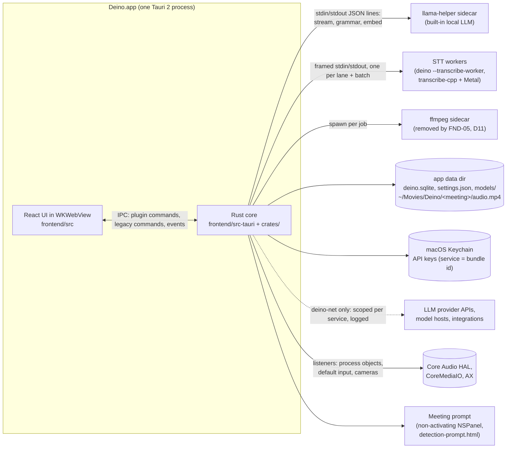
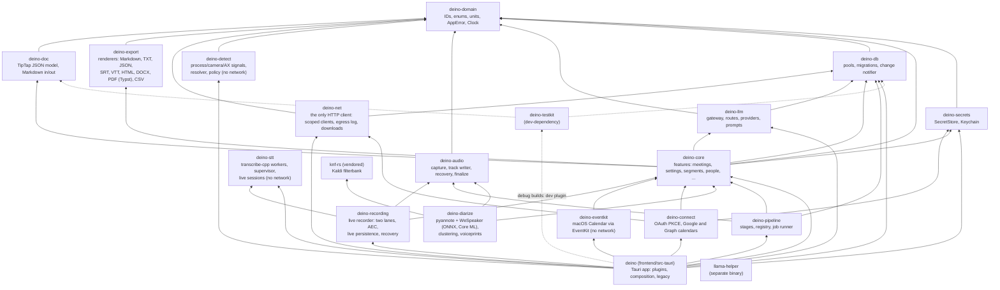
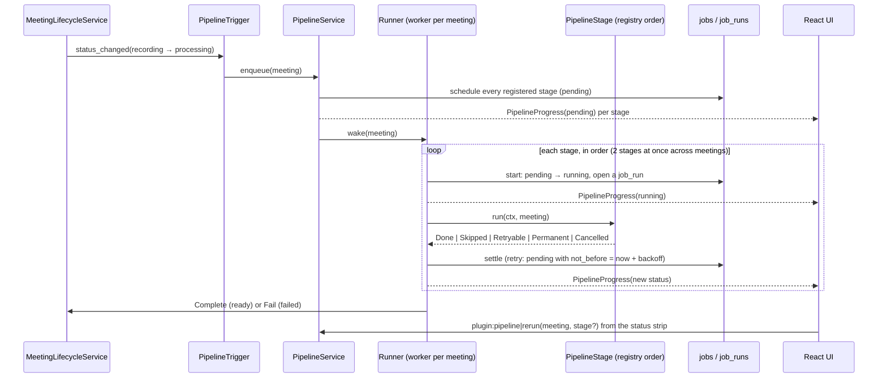
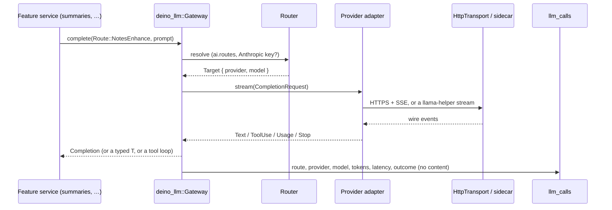
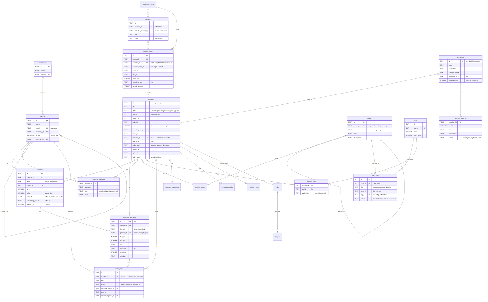

# Deino architecture

The map of the system as it is today (FND-13). PARITY_PLAN §4.0 is the target
it grows towards; this file says where each part lives now and how to extend
it. **Update it in the same PR** whenever a card changes a process, a crate, a
module boundary, the data flow, the schema or an extension point (§3A).

Decisions behind this layout are in [`adr/`](adr/): Tauri + Rust core (0004),
SQLite + sqlx (0005), crate layout (0006), typed IPC (0007), TanStack Query +
`DbChanged` (0008), the error model (0009), cloud LLM for notes with local
transcription (0010), the code-quality limits (0011), the core schema with
its legacy `transcripts` view (0012), typed settings with Keychain secrets
(0013), the native crash-safe recording format (0014), the design tokens
and app shell (0015), speech-to-text in supervised transcribe-cpp worker
processes (0016), the LLM gateway with task routes (0017), and the
post-meeting pipeline's stage model (0018), the network egress policy
(0019), local speaker diarization (0020), note templates in the database
with a versioned built-in catalogue (0021), the note document model:
TipTap JSON with `deino-doc` (0022), meeting detection (0023), and folder
auto-add rules as rows with AI tagging from the user's own tags (0024), and exports as pure renderers with
Typst PDFs (0025).

## 1. Processes



- Audio capture and voice activity detection run in the app process.
  Transcription with Parakeet Unified EN 0.6B (the default) and Whisper runs
  in worker processes: the app executable re-launched with
  `--transcribe-worker`, one per live lane plus one for batch work, supervised
  by `deino-stt` (ADR 0016), so a ggml abort or GPU hang never takes the app
  down. Parakeet TDT (the "Advanced" ONNX engine) still runs in-process.
  Notes and chat go to the LLM the user chose, or to the local llama-helper
  (ADR 0010), always through the `deino-llm` gateway, by task route
  (ADR 0017).
- Meeting detection (CAP-06, ADR 0023) runs on one `deino-detect` thread in
  the app process: Core Audio and CoreMediaIO listeners only wake it, it
  re-reads who captures audio, and its prompt is a second webview in a
  non-activating panel that never takes focus from the call.
- Calendar sync (ORG-01, ADR 0027) reads macOS Calendar on one
  `deino-eventkit` worker thread that owns the `EKEventStore`, every 2
  minutes, on store changes and on wake; the optional Google and Microsoft
  connectors (`deino-connect`) sign in through the default browser and a
  one-shot loopback listener on `127.0.0.1`.
- There is no Deino server and no telemetry. Network calls go only to the
  services the user allows, through `deino-net` (FND-12, ADR 0019): each
  caller holds a client scoped to one service's hosts, every request is
  checked against the user's switches and offline mode, and every attempt
  lands in the egress log (Settings → Privacy → Network). The webview has no
  network of its own (`connect-src 'self' ipc: http://ipc.localhost asset:`).

## 2. Rust workspace



| Crate | Path | Role |
|---|---|---|
| `deino-domain` | `crates/deino-domain` | The shared vocabulary: typed IDs (`MeetingId`, UUIDv7 IDs), the closed sets the schema stores (`MeetingStatus` with its transitions, `Channel`, `AttendeeRole`, `Rsvp`, ...), `Millis`/`Seconds`, `Email`, `PaletteColor`, `AppError`/`ErrorCode`/`ErrorClass`, the `Clock` port. |
| `deino-db` | `crates/deino-db` | `Database` (WAL, one writer, read pool), `MIGRATOR` over `migrations/`, `DataMigration` (Rust steps between two schema migrations), `ChangeNotifier`, `Table`, `test_db()`. |
| `deino-secrets` | `crates/deino-secrets` | `SecretStore` (set, status, delete, and `get` for Rust only), `KeychainSecretStore` over `keyring`, `InMemorySecretStore` (feature `test-support`). |
| `deino-core` | `crates/deino-core` | Features as Tauri-free modules: `models` (the STT model catalog, verified resumable downloads over a `ByteSource` port), `meetings` (list, rename, lifecycle, trash), `settings` (typed `Settings`, `SettingsService`, the atomic `settings.json` store, the legacy-store importers), one module per core-schema aggregate (`segments`, `people`, `companies`, `calendar`, `folders`, `tags`, `action_items`: ports, SQLite repositories, fakes), and `_example` (debug builds). `templates` (NOT-04, ADR 0021): the template model, the 30-template versioned `CATALOG` and `BuiltinSync`, the library (`TemplateService`), per-meeting selection and previews (`MeetingTemplateService` over the pure `RuleEngine` and the `TemplateClassifier` port, with `GatewayTemplateClassifier` on route `tagging`), JSON import/export and the one-time legacy-folder import. `profile` (NOT-05): `ProfileService` (saves Settings → Profile, keeps the `people.is_me` person in step through `MeRepo`), `render_profile_context` and `ProfileContext` (the gateway's system context), and `InternalDomains` (internal vs external by email domain). `notes` (NOT-01): `NoteService` saves a meeting's TipTap document whole into `meeting_notes` (with its Readable Markdown), stores pasted and dropped images in the meeting's folder (`FsNoteImages`, content-checked, generated names), creates `scheduled` meetings for notes written ahead, (the record screen writes into the meeting being recorded, which the recorder creates at start); `people::PeopleService::search` feeds @mentions; the legacy summary's user context is the meeting's notes. Also `summaries` (`SummaryGenerator` over the gateway) and `settings::LlmAccess` (credentials, endpoints and route choices for the gateway). `folders` (ORG-05, ADR 0024): `FolderService` (create, rename, icon, description, cycle-safe moves, deletion that keeps every meeting, the tree with counts), `FilingService` (a meeting in many folders, the "Unfiled" smart folder, the series offer, each folder's rules), the typed `FolderRule` (series, tag, attendee domain) with the pure `folders_matching`, and `AutoFileService` behind the `auto_folder` stage. `tags` (ORG-06): `TagService` (CRUD with palette colours and descriptions, apply/remove with a `TagSource`, the `MeetingTagged` event) and `AutoTagService` behind the `auto_tag` stage (existing tags only, on route `tagging`, skipped when the user tagged the meeting or Settings → organize turns it off; `NoModelAutoTagger` when no gateway could be wired). `calendar` (ORG-01, ADR 0027): the `CalendarSource` port, the conference-link parser, the filters (declined, out of office, Focus, working location, duplicates), the mapping into `SyncBatch` (internal vs external through `InternalDomains`, the user's RSVP), `CalendarSyncRepo::apply` (one transaction, change-only upserts, per-provider pruning), `AttendeeDirectory` (people and companies from attendees), `CalendarService` (status, switch, connectors, calendars and their visibility, `upcoming`, `events_near`) and `SyncScheduler`. `diarization` holds the `diarize` stage's rules (CAP-03): `DiarizeService` over the `TrackDiarizer` port, `plan_channels` (Me on the microphone, the system track diarized, the in-person shared-microphone rule) and `attribute` (segments to speakers by overlap, split at speaker changes). `export` (EXP-01/02, ADR 0025) assembles a meeting into `deino_export::MeetingExport` and runs previews, saves, copies, email drafts, the `auto_export` stage's `AutoExportService` and the account export, over OS ports the app implements. |
| `deino-doc` | `crates/deino-doc` | The note document (NOT-01, ADR 0022), ported from anarlog's `crates/tiptap`: TipTap/ProseMirror JSON as typed Rust (`Doc`, `Block`, `Inline`, `Mark`), with the NOT-02/NOT-03 extensions (`origin` provenance mark, `citation` nodes, person `mention`s), `from_markdown` (CommonMark + GFM via markdown-rs), `to_markdown` (`Lossless`, which round-trips, and `Readable`, for people and LLMs), `validate` (the schema rules) and `normalize`. Pure: no I/O, no Tauri. |
| `deino-stt` | `crates/deino-stt` | Speech-to-text (CAP-01): the worker process and its protocol, `EngineSupervisor` (deadlines, GPU→CPU fallback, kill-to-cancel), `LiveSession` (continuous feeds, segments, batch fallback, rotation), `EnginePool` (a worker per lane), `StreamPerf`, the benchmark. Depends on no HTTP client. |
| `deino-llm` | `crates/deino-llm` | The LLM gateway (FND-09, ADR 0017): `Gateway` (`stream`, `complete`, `structured::<T>()`, `with_tools`, `embed`), task `Route`s and the `Router` (user choices over the §4.3 defaults), provider adapters (Anthropic, OpenAI-compatible, Ollama, built-in), the shared SSE parser, `LlmError`, usage metering into `llm_calls`, the `SystemContext` port that puts the user's profile in front of every system prompt, askama prompts and minijinja user templates, `LlmAdmin` (Settings → AI), `MockProvider` (feature `test-support`) and the eval harness (`tests/llm_eval`). Reaches the world only through ports the app wires. |
| `deino-net` | `crates/deino-net` | The only HTTP client (FND-12, ADR 0019): `NetClient` (send, body, JSON and SSE helpers), `ReqwestNetClient`, the `ServiceId` host registry, `Net::scoped` → `ScopedClient` (host checks, redirects hop by hop, the `ServicePolicy` port, offline mode), the egress log (ring, persister, `SqliteEgressLog`), `HttpDownloader` (resume, size cap, stall timeout, SHA-256), `NetworkControls`. `deino-audio` and `deino-stt` never depend on it (`scripts/check-dependency-rules.sh`). |
| `deino-diarize` | `crates/deino-diarize` | Local speaker diarization (CAP-03, ADR 0020), ported from anarlog: `Diarizer` (batched pyannote segmentation on the CPU, WeSpeaker ResNet34-LM embeddings on Core ML, centroid-linkage clustering under calendar bounds), `policy` (parameters by meeting length), `prune` (phantom speakers), `models` (pinned files downloaded through `deino-core`'s verified downloader), `track::OnnxTrackDiarizer` (the core's `TrackDiarizer` port), `voiceprint` (CAP-04), `online` (live clustering for CAP-02), DER `metrics` and the `diarize-bench` harness. No `tauri`, no `deino-net`. |
| `knf-rs` | `crates/third_party/knf-rs` | Vendored knf-rs 0.3.2 (MIT) over kaldi-native-fbank 1.20.1 (Apache-2.0): the filterbank features the speaker-embedding model reads, built with `cc`. |
| `deino-testkit` | `crates/deino-testkit` | The fixture meetings in `fixtures/` as typed, validated values; `FixtureSeeder` (also behind the debug-only `dev` plugin); fixture audio decoding; re-exported fakes for tests (feature `test-support`). |
| `deino-audio` | `crates/deino-audio` | Crash-safe two-track recording (FND-05a, ADR 0014): the `AudioSource` port and `MockAudioSource`, the real-time ring, `TrackTimeline` (the sample index is time), the writer thread and `AVAssetWriter` CMAF encoder, the persister and `recording.json`, `recover_recording`, `finalize_recording`, health events. `capture` (CAP-02, ADR 0026): the cpal microphone (own thread, start timeout, device ranking, Bluetooth call-mode handling) and the Core Audio process tap (own PID excluded, stable aggregate UID), RT-safe callbacks into SPSC rings with Mach host stamps, a conditioner per track (native → 48 kHz, pause ledger), and the supervisor thread (device and power listeners, 1 s debounce, stall watchdog with backoff, sleep tick-gap check, speakers/headphones route probe). |
| `deino-recording` | `crates/deino-recording` | The live recorder (FND-05b, CAP-02, ADR 0026): `RecordingService` (start creates the meeting and its Me/Them speakers; stop closes both tracks, sets the timing and moves the meeting to `processing`), the live pipeline thread (placed audio → 16 kHz pairs → `SonoraAec` (WebRTC AEC3) on speakers → per-lane earshot VAD), the Me and Them lanes (`deino-stt` live sessions, or utterance lanes for the "Advanced" engines), the transcript router (OpenWhispr's text holdback, drafts saved about once a second, batched final saves, `SegmentUpdate` events), `recover_interrupted` at launch, `MockCapture` for `DEINO_MOCK_AUDIO`. No `tauri`, no `deino-net`. |
| `deino-detect` | `crates/deino-detect` | Meeting detection (CAP-06, ADR 0023): the `Sensor` ports and their macOS adapters (Core Audio process objects with per-object listeners, the default input, CoreMediaIO cameras through a small safe FFI layer, `NSWorkspace`, Accessibility browser URLs), attribution to the outermost `.app`, the bundle tables and meeting-URL normaliser, Muesli's resolver, the Clock-driven `DetectionPolicy`, `DetectionService` (answers, auto-start countdown, the `DetectionEvent` stream) and the `Detector` thread. No `tauri`, no `deino-net`. |
| `deino-eventkit` | `crates/deino-eventkit` | macOS Calendar (ORG-01, ADR 0027) through `objc2-event-kit`: `EventKitSource` (the core's `CalendarSource` for `apple`: access, the macOS 14 full-access prompt, a snapshot of every account, calendar and event in the window), the worker thread that owns the `EKEventStore`, the store-changed and wake observers that nudge the scheduler, and pure conversions of EventKit codes. No `tauri`, no network. |
| `deino-connect` | `crates/deino-connect` | Connections to online accounts (ORG-01, ADR 0027): `oauth` (RFC 8252 loopback redirect, PKCE S256, `OAuthClient`, `sign_in`, the `BrowserOpener` port; INT-00 reuses it) and `calendar` (`ConnectorSource` over `GoogleCalendar` and `MicrosoftCalendar`, refresh tokens in the Keychain, requests through `deino-net` scoped clients). Keeps `deino-core` free of a network client. |
| `deino-export` | `crates/deino-export` | Meeting exports as pure renderers (EXP-01/02, ADR 0025): `MeetingExport` (the DTO `deino-core::export` assembles) and `render(format, export, options)` for Markdown (YAML frontmatter Obsidian reads as properties, Obsidian `[[links]]`/`#tags`, transcript sidecars and people pages, `owner()` to recognise Deino's own files), TXT, JSON (`deino.meeting` v1), SRT, WebVTT, the rich-text HTML fragment, DOCX (`docx-rs`, re-deflated) and PDF (Typst with `pdf/template.typ` and bundled Inter); `doc` (notes Markdown as typed blocks), `naming` (`{date} {title}.md`, `{yyyy}/{mm}` templates, safe names), `csv`, `mailto`. No I/O, no clock, no system fonts. |
| `deino-pipeline` | `crates/deino-pipeline` | The post-meeting pipeline (FND-08, ADR 0018): the `PipelineStage` contract, `registry.rs` (the one list of stages: `finalize_audio` at 10 (FND-05b: repair, then `finalize_recording`, then `set_audio` with the mic, system and mixed paths `diarize` reads), `diarize` at 30, `legacy_summary` at 50, `auto_tag` at 70, `auto_folder` at 75, `auto_export` at 99), the durable `jobs`/`job_runs` queue (`SqliteJobRepo`), the runner (one worker per meeting, 2 stages at once, clock-driven retries, cancellation, `TaskTracker`), startup reconciliation, `PipelineService` and `PipelineTrigger` (enqueues meetings entering `processing`). |
| `deino` | `frontend/src-tauri` | The Tauri app: plugins, composition root, legacy modules. Library crate `deino_lib`. |
| `llama-helper` | `llama-helper` | The local LLM sidecar: `generate` (legacy), `stream`, `grammar` (a JSON schema turned into a GBNF grammar) and `embed` requests over JSON lines. |

Rules (PARITY_PLAN §4.0): dependencies point down the diagram only; **no crate
under `crates/` depends on `tauri`**; a feature becomes its own crate only when
it gains heavy native dependencies or passes about 3k lines. Each crate's
`README.md` lists what it owns and its invariants.

## 3. The app crate (`frontend/src-tauri/src`)

| Module | What it is |
|---|---|
| `lib.rs` | The builder only: plugins, state, setup, run loop. |
| `composition.rs` | **The composition root.** Builds services from adapters (SQLite repos, `SystemClock`, the settings file, the Keychain, Tauri event adapters) and `app.manage`s them. `attach_settings` runs first at startup, then `attach_network` (the one `deino_net::Net` and its policy over the settings, `composition/network.rs`); `attach_database` once `deino.sqlite` is open, which also starts persisting the egress log. |
| `paths.rs` | `AppPaths`: every app folder, resolved once from Tauri's resolver and injected (settings file, legacy stores, models, live recordings, the pre-NOT-04 templates folder to import). |
| `llm.rs`, `llm/` | The gateway's wiring: builds `Gateway`, `LlmAdmin` and `SummaryGenerator` over the app's adapters: `NetTransport` (`llm/http.rs`: one `deino-net` scoped client per provider) and `SidecarLocalModels` (`llm/local.rs`, the built-in models over llama-helper). |
| `features.rs`, `features/` | New IPC: one inline Tauri plugin per feature (`system`, `meetings`, `settings`, `secrets`, `llm`, `network`, `pipeline`, `recording`, `templates`, `profile`, `detection`, `calendar`, `folders`, `tags`, `export`, `db`, and `example` and `dev` in debug builds), each with one `tauri_specta::Builder`. `features/manifest.rs` lists plugins and commands for the ACL; debug-only plugins are in `DEV_FEATURES` and granted by `capabilities/dev/`. |
| `error.rs` | The command boundary: `into_ipc()` logs the error chain and returns `AppError`. |
| `bindings.rs` | Test-only: exports the TypeScript bindings and checks them against the manifest. |
| `legacy_lints.rs` | The one place inherited modules are exempted from the strict lints. |
| `legacy.rs`, `legacy/` | Every inherited command, in one `generate_handler!`; cards port them into plugins. |
| `setup.rs`, `lifecycle.rs`, `state.rs` | Startup steps, window and exit handling, legacy `AppState`. |
| `database/` | Legacy repositories, and `DatabaseManager`, which wraps `deino_db::Database`. |
| `audio/` | Legacy: device listing and level meters for the device picker, permissions (the tap probe), import, retranscription, the legacy engines' VAD and decoder. Live recording is `deino-recording`. |
| `features/recording*`, `composition/recording.rs` | The `recording` plugin (FND-05b, CAP-02): `start`, `stop`, `pause`, `resume`, `state`, `transcript`; events `RecordingState`, `LiveSegment`, `Health` (`TauriRecordingEvents` also refreshes the tray and shows the start/stop notifications). `attach_recording` builds `RecordingService` over the SQLite repos, the pipeline's lifecycle service, `SttLanes`, `DeviceCapture` (or `MockCapture` for `DEINO_MOCK_AUDIO`), `CmafEncoderFactory` and the typed settings, then recovers interrupted recordings in the background. `tray.rs` starts, pauses and stops it directly. |
| `stt.rs`, `stt/` | Parakeet Unified in the app: `SttRuntime` (Tauri state: engine pool, activity), `SttLanes` (the recorder's `LaneEngines`: a streaming lane per Me/Them worker for Parakeet Unified, utterance lanes over the legacy engines otherwise; engine from `Settings::transcription`), the batch `TranscriptionProvider`, `NetByteSource` (the model `ByteSource` over `deino-net`'s model-download client), the worker entry and the `--transcribe-file` benchmark. |
| `features/detection*`, `composition/detection.rs` | The `detection` plugin (CAP-06): `current`, `take_notes`, `dismiss`, `ignore_app`, `settings`; events `MeetingDetected`, `MeetingEnded`, `PromptClosed`, `RecordingRequested`. `prompt.rs` builds the prompt window (a `tauri-nspanel` panel on macOS, `capabilities/detection-prompt.json`), `adapters.rs` implements the event, window and settings ports; `recorder.rs` starts the live recorder (titled after the linked event or the app) and reports whether it is busy. `attach_detection` starts the detector at launch. |
| `features/calendar*`, `composition/calendar.rs`, `composition/browser.rs` | The `calendar` plugin (ORG-01): `status`, `enable`, `disable`, `refresh`, `open_access_settings`, `list_calendars`, `set_calendar_visible`, `upcoming`, `event`, `connect`, `disconnect`; event `CalendarChanged`. `lookup.rs` is `SyncedCalendar`, detection's `CalendarLookup`. `attach_calendar` builds `CalendarService` over EventKit and the connectors (`ConnectorKit`: `deino-net`, the Keychain, the network switches) and starts `SyncScheduler`; `SystemBrowser` opens sign-in pages with `NSWorkspace`. `Info.plist` carries the Calendars usage descriptions and the entitlements the calendars entitlement. |
| `features/transcription*` | The `transcription` plugin: model list, download, cancel, delete; events `ModelChanged`, `ModelDownloadProgress`. |
| `parakeet_engine/`, `whisper_engine/` | The "Advanced" engines: Parakeet TDT (ONNX) and Whisper (`.bin` models, now run through `deino-stt` workers), with their legacy model management. Their downloads, and the built-in model's, take a `deino-net` client per call (`composition::model_downloads`); no engine holds one. |
| `summary/` | The legacy summary commands and `summary_processes` lifecycle (`service.rs`, generation through `deino_core::summaries`, templates from the database through `features/templates/summary_bridge.rs`), and the built-in model manager and sidecar process (`summary_engine/`). |
| `features/templates*`, `features/profile*` | The `templates` plugin (library, import/export, preview, a meeting's template and its reason) and the `profile` plugin (save the profile, read the AI context); `composition/notes.rs` builds both services and, at startup, syncs the built-in catalogue, imports the legacy templates folder and makes sure the "Me" person exists. |
| `features/folders*`, `features/tags*`, `composition/organize.rs` | The `folders` plugin (the tree, folder edits, filing, rules) and the `tags` plugin (CRUD, a meeting's tags, apply/remove; event `MeetingTagged`). `Organize` builds both services and the auto-tagger over the gateway; `composition/pipeline.rs` wires the pipeline's `StagePorts`, including the auto-filer. |
| `notifications/`, `tray.rs`, `onboarding.rs`, `updater/` | OS integration. Notification switches and onboarding progress are sections of the typed settings. |

## 4. Frontend (`frontend/src`)

| Path | What it is |
|---|---|
| `main.tsx` | Applies the saved theme, creates the query client and the router (`router.tsx`, which passes `{ queryClient }` to every route's context for loaders) and mounts them. |
| `routes/` | TanStack Router file routes, thin: each renders one feature screen. `/design` (dev builds only) shows every token and primitive in both themes. |
| `styles/` | `tokens.css` (the `ui.md` §2 design tokens for light and dark, mapped to Tailwind utilities with `@theme inline`; ADR 0015), `globals.css` (base layer, focus mode), `notes.css` (the note typography shared by the notepad and the summary: headings, lists, checklists, person chips, citations, AI vs user text). |
| `features/<feature>/` | `api.ts` (generated commands, `unwrap`ped), `queries.ts` (keys and hooks with `meta.tables`), `hooks/`, `components/`, `copy.ts`, `types.ts`, `index.ts` (the only import path for other code; `search.ts` for URL params). Today: `meetings` (data and the Meetings page), `meeting` (the meeting page and its slots), `pipeline` (the processing-status strip in the meeting header: stage statuses, retry, `PipelineProgress` refresh), `shell` (sidebar, title bar, ⌘K palette, ⌘J chat bar, shortcuts, layout store), `appearance` (theme), `settings` (`useSettings`, key status, `SettingsSync`, which also applies the saved theme; the sectioned screen), `network` (Settings → Privacy → Network: offline mode, services, the egress log), `llm` (Settings → AI: providers with masked keys, the per-route model table with a streamed Test, and the model lists the inherited pickers use), `templates` (Settings → Templates: library, editor with reorderable sections, auto rules and a prompt preview; the Notes tab's template picker with its reason and regenerate prompt; the notepad's `/template` TipTap suggestion), `profile` (Settings → Profile and the "What the AI sees" preview), `notepad` (NOT-01: the TipTap 3 editor, lazily loaded; "My notes" on the meeting page and on the record screen (the meeting being recorded), `NotepadWindow`, the summary document, autosave, @mentions, images, the `/template` command), `recording` (FND-05b, CAP-02: `RecordingSync` keeps the cached state current from events, opens the meeting page when a stop finishes, shows health toasts and the "tell participants" notice; `RecordingControls`, `LiveTranscript` (saved segments overlaid with `LiveSegment` events, Me/Them labels), `useRecordingState`, `startRecording`), `record` (the record screen: the meeting's notes beside its live transcript), `folders` (ORG-05: the sidebar tree under Folders with drag and drop and keyboard moves, the folder page with its description and auto-add rules, Unfiled, "Add to folder" menus, the series toast), `tags` (ORG-06: the Tags page, the meeting header's tag chips and "Add tag" combobox, the Meetings page tag filter, the auto-tag switch), `export` (EXP-01/02: the meeting title bar's Share menu, the export dialog with format list, section toggles and a live preview, and Settings → Export: auto-export and the account export with progress), `developer`, `design-system` (dev only), `_example`. |
| `lib/ipc/` | `generated/` (tauri-specta output, never edited), `result.ts` (`unwrap`, `IpcError`), `query-client.ts`, `events.ts` (`DbChanged` bridge, `useIpcEvent`), `ipc-query-provider.tsx`. |
| `dev/mock-ipc/` | `pnpm dev:mock` only (never in a production bundle): one mock per generated module (`<feature>.ts`, `satisfies typeof Generated.commands`), an in-memory `MockDatabase` over the fixture meetings that emits `DbChanged`, and a small, shrinking legacy `invoke` shim (`legacy*.ts`). |
| `features/developer/` | Settings → Developer (debug builds only, loaded lazily): seed the fixture meetings through the `dev` plugin. |
| `ui/` | Shared primitives on the tokens (shadcn/Radix restyled: button, icon button, input, select, switch, popover, menu, dialog, tooltip with shortcut, tabs, segmented control, chips, kbd, skeleton, empty state, page header, scroll area, toaster, level bars); `icons.ts` is the only icon import; `cn.ts` merges classes. |
| `components/`, `contexts/`, `hooks/`, `services/`, `lib/*`, `types/` | Legacy code, listed in `legacy-files.mjs`. |

## 5. Data flow

### Record → transcript → notes (FND-05b, CAP-02, ADR 0026)

```mermaid
sequenceDiagram
  participant Dev as Microphone + process tap
  participant Rec as deino-recording
  participant STT as deino-stt workers (Me, Them)
  participant DB as deino.sqlite
  participant UI as React UI
  UI->>Rec: plugin:recording|start (or tray, ⌘⇧R, detection)
  Rec->>DB: meeting (recording, live) + Me/Them speakers
  Rec-->>UI: RecordingState(recording, meetingId)
  Dev->>Rec: RT callbacks → rings → conditioners (48 kHz) → track writers (mic/system .m4a.part)
  Rec->>Rec: placed audio → 16 kHz pairs → AEC3 on speakers → VAD per lane
  Rec->>STT: continuous audio per lane
  STT-->>Rec: committed text, segments
  Rec->>Rec: router: holdback (speakers), drafts ~1 s, batches
  Rec->>DB: save_live / batched saves (transcript_segments, channel + speaker)
  Rec-->>UI: LiveSegment (open / final / discarded); DbChanged refreshes the saved lines
  UI->>DB: plugin:notes|save every ~1 s into the same meeting
  UI->>Rec: plugin:recording|stop
  Rec->>Rec: capture stop → tracks end together → lanes flush
  Rec->>DB: set_timing; transition StopRecording → processing
  Rec-->>UI: RecordingState(stopping → idle); the meeting page opens
```

`processing` enqueues the post-meeting pipeline below. At launch,
`recover_interrupted` repairs every meeting a crash left in `recording`
(tracks cut to the last whole second, timing from the durable audio) and
moves it to `processing`; a meeting without audio moves to `failed`.

### Post-meeting pipeline (FND-08, ADR 0018)



At startup `PipelineService::start` reconciles the queue before any worker
runs: it deletes jobs of unregistered stages, settles `running` rows a crash
left (back to `pending`, or `failed` once a crash ate the last attempt),
schedules `processing` meetings without jobs and wakes every meeting with
pending work. On exit `lifecycle.rs` calls `shutdown`, which leaves an
interrupted stage pending for the next start. `legacy_summary` (order 50)
runs the legacy summary job (`summary/service.rs`, over
`deino_core::summaries::SummaryGenerator`) through the `Summarizer` port,
adapted in `features/pipeline/legacy_summary.rs`, until NOT-02's
`enhance_notes` replaces it.

### An LLM call (FND-09)



The legacy summaries (`api_process_transcript`) pin the provider and model
chosen in their UI on the `notes.enhance` route; Settings → AI tests any
route and streams the reply over a per-request `Channel<LlmStreamEvent>`.
Before every call the gateway asks its `SystemContext` (the app wires
`ProfileContext`, NOT-05) and puts the user's profile in front of the system
prompt, so every route writes for this user.

### A meeting's template (NOT-04, ADR 0021)

The Notes tab asks `plugin:templates|meeting_template`. `MeetingTemplateService`
reads the meeting's facts (title, attendees' emails, calendar description)
and every template, then takes the first that applies: the template chosen
for the meeting; the most specific matching auto rule (`RuleEngine`, with
internal/external from the profile's email domains); the default template in
Settings; only in the post-meeting pipeline (`auto_choice`) and only when the
default is "Auto", the LLM classifier on `tagging`; else General. The answer
carries a `ChoiceReason` the picker shows. The `legacy_summary` stage uses
`auto_choice` for meetings without a chosen template, and the legacy summary
reads the template's instructions and skeleton from the database.

### Folders and tags (ORG-05, ORG-06, ADR 0024)

A folder is a node in one tree (`folders.parent_id`; `FolderRepo::move_folder`
refuses cycles); a meeting can sit in many folders (`meeting_folders`), and
"Unfiled" is the smart folder of meetings in none. Deleting a folder deletes
its subfolders and rules and keeps every meeting. Auto-add rules are rows in
`folder_rules`, one per rule, typed in Rust as `FolderRule`:

- `series`: future meetings of a recurring calendar series. Adding a meeting
  from a series to a folder by hand offers "Auto-add future meetings in this
  series?" (the response's `seriesOffer`); removing it again drops the rule.
- `tag`: meetings carrying a tag (the rule goes with the tag).
- `attendee_domain`: meetings with an attendee at an email domain.

After a meeting is processed, `auto_tag` (order 70) asks the `tagging` route
which of the user's existing tags fit, from each tag's description and up to
three recent tagged examples, and applies them as `ai`; it skips when the
user tagged the meeting by hand, when Settings → organize turns it off, or
when there is nothing to read. `auto_folder` (order 75) then evaluates every
rule against the meeting's series, tags (including those just applied) and
attendee domains, and files it into each matching folder. Neither stage ever
removes a filing or a tag.

### Settings and secrets (FND-06)

```mermaid
sequenceDiagram
  participant UI as React UI (useSettings)
  participant Settings as SettingsService
  participant File as settings.json
  participant Keychain as macOS Keychain
  UI->>Settings: plugin:settings|patch { ui: { theme: "dark" } }
  Settings->>Settings: RFC 7396 merge, parse into Settings, validate
  Settings->>File: temp file, fsync, rename, fsync dir
  Settings-->>UI: plugin:settings:settings-changed (whole document)
  UI->>Keychain: plugin:secrets|set (via the secrets plugin)
  UI->>Keychain: plugin:secrets|status → missing | stored | locked
  Note over UI,Keychain: no command returns a key; LLM clients read it in Rust
```

Settings are one typed, versioned document in `<app_config_dir>/settings.json`
(on macOS the same folder as the data). Every section is `#[serde(default)]`,
so files from older builds load. The UI changes it with merge patches; Rust
changes it with `SettingsService::update`. A key that macOS refuses to hand
over (an ad-hoc build's new signature) reports `locked`, and the settings
screen asks the user to enter it again.

Legacy stores are imported once and removed: the SQLite `settings` and
`transcript_settings` rows by `LegacySqliteImport`, a `DataMigration` that
runs just before the migration that drops both tables (with `secure_delete`,
so no key bytes survive); the tauri-plugin-store JSON files by
`LegacyFileImport` at startup; the UI's localStorage keys by `SettingsSync`.

### Recording files (`deino-audio`, wired in by FND-05b)

```text
capture callback ─▶ RtSink ═ rtrb ═▶ writer thread (per track, polls 10 ms)
                                     TrackTimeline → Backlog (≤ 64 MiB) → AVAssetWriter (CMAF, 1 s)
                                                                          └─▶ audio/<track>.NNN.m4a.part
persister thread, every 5 s: snapshot frames → F_FULLFSYNC → recording.json (atomic)
stop:    pad both tracks to the stop time → finish → rename .part → .m4a → status closed
launch:  find_unclosed → recover_recording (truncate_to_playable, rename, status recovered)
finalize_recording: mic.m4a, system.m4a (passthrough) + audio.mp4 (−6 dB mix) → status finalized
```

`kill -9` keeps every whole one-second segment (≤ 1 s lost); power loss keeps
what the last 5 s sync covered. Health events (`Stalled`, `FramesDropped`,
`DiskLow`, `Recovering`, `DeviceLost`, `Asleep`, ...) go to a bounded channel; the recorder turns them into `Health` events (toasts today, CAP-10's record pill later).

### An outgoing request (FND-12)

```mermaid
sequenceDiagram
  participant Caller as LLM provider, model download, integration
  participant Scoped as ScopedClient (one ServiceId)
  participant Policy as ServicePolicy (network settings)
  participant Root as ReqwestNetClient
  participant Log as EgressLog → egress_log
  Caller->>Scoped: send(Request)
  Scoped->>Policy: grant(service): enabled? offline? custom host?
  alt host not registered, service off, or offline
    Scoped->>Log: entry (blocked, 0 bytes)
    Scoped-->>Caller: NetError (permission_denied)
  else allowed
    Scoped->>Root: send (no automatic redirects)
    Root-->>Scoped: status, headers, body stream
    Note over Scoped: a 3xx is followed here: each hop re-checked, credentials dropped across origins
    Scoped-->>Caller: Response (metered body)
    Scoped->>Log: entry when the body ends: status, bytes up/down
  end
  Log-->>Log: persister writes batches; DbChanged {egress_log} refreshes the Network page
```

Model files come through `net.approved_download(ServiceId::HfModels)`,
which works in offline mode because the user starts every download;
`deino_net::HttpDownloader` adds `.part` resume, a size cap, a stall timeout
and SHA-256 for new model managers.

### Diarization (CAP-03, pipeline stage `diarize`, order 30)

```text
DiarizeService::run(meeting)
  plan_channels(segments, attendees):  call → system track (attendees − 1), mic = "Me"
                                       in person (≥ 2 expected, ≤ 3 s system speech) → mic track (all)
                                       mixed (legacy) → audio.mp4 (all)
  TrackDiarizer (deino-diarize::OnnxTrackDiarizer):
      ModelStore::ensure (deino-net hf_models, SHA-256) → read_mono(track, 16 kHz) → policy
      → Diarizer (segmentation batch → shared filterbank → embedding batch → clusters → votes)
      → prune → { turns, voices (centroid, speech) }
  SpeakerRepo::replace_speakers   "Speaker 1..N" + centroid, one transaction (keeps "Me")
  attribute(segment, turns)       words by overlap, split at speaker changes
  SegmentWriter::reattribute      one transaction; the first piece keeps the segment's ID
```

### Meeting detection (CAP-06, ADR 0023)

```text
Core Audio / CMIO listener ─wake─▶ Detector thread (also: next deadline, 5 s heartbeat, 1 s poll fallback)
  SignalReader: process objects → attribute (outermost .app, call daemons) → MicClients (full duplex)
                + default input running + camera running + frontmost app
                + browser rooms (AX kAXDocumentAttribute → url::normalize, only while capturing)
                + CalendarLookup (SyncedCalendar: CalendarService::events_near, in memory)
  resolve: room in a capturing browser → focused room → meeting app (weak = full duplex)
           → frontmost meeting app with camera → browser audio (15 s) → other app (15 s)
  DetectionPolicy: dwell 2.5 s / 15 s → Prompt; 30 s → Close; gone 2 s → End;
                   Ignore → 10 min cooldown; recording or off → Close, meeting handled
  DetectionService → DetectionSink (plugin events + prompt panel)
                   → RecordingStarter on Take notes / countdown (the live recorder, CAP-02)
```

### Exports (EXP-01, EXP-02, ADR 0025)

```text
ExportAssembler::assemble(meeting)            repositories + NoteRenderer (DocNoteRenderer:
  → deino_export::MeetingExport               notepad Doc → deino-doc Readable Markdown;
                                              summary Markdown) + LocalZone
plugin:export|preview  → render / html::render                       → ExportPreview
plugin:export|save     → SaveDialog (Rust, tauri-plugin-dialog) → render → Vault (atomic)
plugin:export|copy     → html + text (rich) / Markdown / transcript → Clipboard (arboard)
plugin:export|email    → mailto::url → UrlOpener (open)
auto_export (stage 99) → Settings::export → NameTemplate paths → claim a name
                         (free, or ours by deino-id) → note (+ transcript sidecar,
                         + People/<Name>.md when missing, Obsidian mode)
plugin:export|start_full_export → SaveDialog → TaskTracker task:
    assemble each meeting → bounded channel → blocking zip writer (Markdown, JSON,
    recordings stored) → CSV tables → rename into place; FullExportProgress events
```

No command takes a path: dialogs open in Rust, and `export.folder` can only
be set through `plugin:export|choose_folder` (a settings patch that sets it
is refused).

### Calendar sync (ORG-01, ADR 0027)

```text
SyncScheduler: every 2 min + EKEventStoreChanged + wake (1 s settle) + refresh/enable/connect
  CalendarService::sync_now, for each active source (macOS Calendar when the switch is on,
  Google / Microsoft when connected), one at a time:
    CalendarSource::fetch(30 days back, 14 ahead) → SourceSnapshot (plain accounts, calendars, events)
      EventKitSource: worker thread → EKEventStore (no network)
      ConnectorSource: Keychain refresh token → OAuth → ScopedClient (Google Calendar / Graph)
    mapping: filters, conference link, external (InternalDomains), my RSVP, series → SyncBatch
    CalendarSyncRepo::apply: one transaction; upsert only what changed; prune this provider only
      → DbChanged (calendar_accounts, calendars, calendar_events) only when something changed
    AttendeeDirectory: people and companies from attendees (best effort)
    events_near cache (CAP-06's SyncedCalendar) + CalendarChanged { status }
```

### Reads and writes in a feature

`commands.rs` → `Service` (rules, `Clock`) → `Repo` port → `SqliteXRepo`
(`query*!` macros, reads on the read pool, writes in one transaction on the
writer) → commit hook → `DbChanged { tables, seq }` → the UI invalidates every
query whose `meta.tables` includes a changed table. Legacy code writes through
the same writer connection, so its writes refresh the new queries too.

## 6. Database schema

`<app_data_dir>/deino.sqlite`, migrations in `crates/deino-db/migrations/`
(append-only; never edit an applied file). Only `deino-db` opens the file.



The core schema is FND-07's one migration (`20261009060435_fnd07_core_schema.sql`):
every new table is `STRICT`, enums are `CHECK`ed and mirror a `deino-domain`
enum, foreign keys have an explicit `ON DELETE`, and every foreign key and
list order has an index that a repository test asserts with `EXPLAIN QUERY
PLAN`. No table is `WITHOUT ROWID`, because the update hook behind `DbChanged`
does not see those. `calendar_accounts`, `meeting_folders` and the legacy
tables are omitted from the diagram's attributes.

- **Legacy transcripts** (ADR 0012): `transcripts` is now a view over
  `transcript_segments` with `INSTEAD OF` insert and delete triggers, so the
  inherited import, re-transcription, save, search, delete and meeting-page
  code works unchanged; their writes reach `DbChanged` as
  `transcript_segments`. The view goes when FND-05b, CAP-08, CAP-11 and TRN-01
  have moved the last legacy caller onto `SegmentWriter`/`SegmentReader`.
- **Links live in one place:** a meeting points at its calendar event
  (`meetings.calendar_event_id`); events do not point back.
- **Denormalised copies:** `transcript_chunks.meeting_name` mirrors
  `meetings.title` (`SqliteMeetingRepo::rename` updates both in one
  transaction; legacy summary code does the same). `meetings.duration_s`
  caches the recorded length; `MeetingLifecycleRepo::set_timing` is its only
  writer.
- **`llm_calls`** (FND-09): one row per provider call (route, provider,
  model, tokens, latency, outcome, error kind), never prompt or answer
  content; written by `SqliteLlmCallRepo` through a usage channel.
- **Pipeline queue** (FND-08, migration `20261009071429`): `jobs` has one
  row per (meeting, stage), keyed by both, with the stage's status in the
  current run, its attempts, retry time and user-safe message; `job_runs`
  keeps every attempt (an `INTEGER` rowid key: history rows are never
  referenced). Stage IDs come from the code's registry, not a table;
  startup deletes the jobs of stages that are no longer registered.
- **The egress log** (`egress_log`, FND-12): one append-only row per request
  or redirect hop: `at`, `service`, `host` (with a non-default port),
  `method`, `status`, `outcome` (`sent`/`failed`/`blocked`), `bytes_up`,
  `bytes_down`. There is no column for a URL, query, header or body, and a
  `CHECK` refuses a host with `/` or `?`. The INTEGER rowid orders it;
  `SqliteEgressLog::append` keeps the newest 10,000 rows.
- **Templates** (NOT-04, ADR 0021): `templates` (built-ins carry the
  catalogue `builtin_version` they were written from; the user's have NULL)
  and their ordered `template_sections` (`PRIMARY KEY (template_id,
  position)`). Auto rules are a typed JSON column, evaluated in Rust only.
  `meetings.template_id` references `templates` with `ON DELETE SET NULL`.
- **`meeting_notes` (NOT-01):** `notes_json` is the user's TipTap document,
  an opaque payload never queried by field (§3A), parsed into
  `deino_doc::Doc` by `SqliteNotesRepo`; `notes_markdown` is derived from it
  (Readable Markdown) by `NoteService` in the same write, the one writer
  besides the fixture seeder. Note images are files in
  `<app data>/meetings/<meeting id>/images/`, referenced from the document
  as `images/<uuid>.<ext>`.
- **Calendars** (ORG-01, migration `20261011090000`): `calendars` per
  account (`UNIQUE (account_id, provider_calendar_id)`), and
  `calendar_events.calendar_id` / `is_all_day`. Sync upserts write only when
  a field changed, so an unchanged sync raises no `DbChanged`;
  `record_override` is the user's and no sync writes it. Which calendars
  are hidden is a setting (`calendar.hiddenCalendars`), not a column.
- **Settings are not tables:** FND-06 dropped the single-row `settings` and
  `transcript_settings` tables (migration `20261009061225`); settings live in
  `settings.json` and API keys in the Keychain (ADR 0013).

## 7. IPC

- **Feature plugins** (`plugin:<feature>|<command>`): typed with tauri-specta,
  checked by the capability ACL, generated into
  `frontend/src/lib/ipc/generated/<feature>.ts` by
  `cargo test -p deino --lib bindings`. IDs are branded strings
  (`MeetingId`). Commands return `Result<T, AppError>`; the UI's `unwrap()`
  throws `IpcError { code, message }` (ADR 0007, ADR 0009).
- **Events:** `plugin:db:db-changed` (`DbChanged`),
  `plugin:notes:notes-saved` (`NotesSaved`, every autosave, for other windows),
  `plugin:settings:settings-changed` (`SettingsChanged`, the whole settings
  document), `plugin:llm:ollama-pull` (Ollama download progress), `plugin:pipeline:pipeline-progress` (`PipelineProgress { meetingId, stage,
  status }`, every stage status change), `plugin:detection:meeting-detected` / `meeting-ended` / `prompt-closed` (the prompt window) and `recording-requested` (the main window's shell starts recording), `plugin:calendar:calendar-changed` (`CalendarChanged { status }`: the sync switch, macOS access, connectors and the last sync), `plugin:tags:meeting-tagged` (`MeetingTagged { meetingId, tagId, appliedBy }`, a tag newly applied by the user, the AI or an automation), `plugin:example:note-added` (debug). Legacy code still emits untyped events (`transcript-update`,
  `recording-stopped`, …).
- **Legacy commands** (`invoke('api_…')`): about 150 app commands, not
  ACL-checked, in `legacy.rs`. Never add to them.

## 8. Extension points

| To add | Edit |
|---|---|
| A feature | Copy `crates/deino-core/src/_example*`, `frontend/src-tauri/src/features/_example*` and `frontend/src/features/_example/`; then one line each in `features/manifest.rs`, `lib.rs` (`.plugin`), `capabilities/default.json`, `features::builders()`, and the service in `composition.rs`. |
| A table | A migration in `crates/deino-db/migrations/` (`<UTC timestamp>_<card>_<desc>.sql`), a `Table` variant in `crates/deino-db/src/table.rs`, then `scripts/sqlx-prepare.sh` and the bindings test. |
| A command | The function in `features/<feature>/commands.rs` and its `collect_commands!`, the manifest line, the bindings test, and its mock in `frontend/src/dev/mock-ipc/<feature>.ts` (typecheck fails until the mock matches). |
| A fixture scenario | A file in `fixtures/meetings/` (see `fixtures/README.md`); a new table group gets a `SeedTarget` in `FixtureSeeder::targets()`. |
| A typed event | A `#[derive(tauri_specta::Event)]` type in `features/<feature>/events.rs`, `collect_events!`, an event port in the core service if the core raises it. |
| A query | `features/<feature>/queries.ts` with `meta: { tables: [...] }`. |
| A note node or mark | Its type in `crates/deino-doc/src/model/` (TipTap's name and attributes), its Markdown in `parse/` and `write/` (inline HTML in `html.rs` when Markdown has no syntax), its rules in `validate.rs`, a round-trip test; then the TipTap extension in `frontend/src/features/notepad/editor/`, its zod schema in `doc-schema.ts`, its style in `styles/notes.css`, and the mock converter in `dev/mock-ipc/mock-markdown.ts`. |
| A setting | A field in its section in `crates/deino-core/src/settings/` (with its default and any rule in `validate`); the bindings test; the default in `frontend/src/features/settings/settings-fixture.ts` and `dev/mock-ipc/settings.ts`. |
| A secret | A `SecretName` variant in `crates/deino-secrets/src/name.rs`; the bindings test. |
| An outside service (an integration, a provider) | A `ServiceId` variant in `crates/deino-domain/src/service.rs`, its hosts in `crates/deino-net/src/registry.rs`, a migration that rebuilds `egress_log` with the new name in its `CHECK`, and a label in `frontend/src/features/network/copy.ts`. The code that calls it receives `net.scoped(ServiceId::…)` from the composition root, never `reqwest`. |
| A Rust data migration | A `deino_db::DataMigration` whose `runs_before` is the schema migration it precedes, passed to `Database::open_with` (`DatabaseManager::new_from_app_handle`). |
| A downloadable model (file) | An entry in `crates/deino-core/src/models/catalog.json` with its pinned revision, exact size and SHA-256. |
| A transcription lane | `deino_stt::Lane` + `EngineSlot::Live(lane)` (one worker each); start a `LiveSession` per lane from `stt/runtime.rs` (CAP-02 adds the microphone and system lanes). |
| A transcription engine family | A `deino_stt::engine::Engine` implementation served by `worker::run` (transcribe-cpp covers Parakeet and Whisper GGUF/`.bin`). |
| A meeting app, browser or denied app | `crates/deino-detect/src/classify/tables.rs` (bundle ID, platform, weak or strong); a meeting URL shape in `url.rs`; both are table-tested. |
| An export format | An `ExportFormat` variant (extension, media type, label) and its renderer module in `crates/deino-export/src/`, its arm in `render.rs`, a golden test; its label in `frontend/src/features/export/copy.ts` and the format list in `components/format-list.tsx`. |
| A pipeline stage | A `PipelineStage` in `crates/deino-pipeline/src/stages/<stage>.rs` (idempotent; user-safe messages), one line in `registry::stages` (plus a `StagePorts` field and its adapter in `composition/pipeline.rs` if it needs a new port), and its label in `frontend/src/features/pipeline/copy.ts`. |
| A diarization model or parameter | `crates/deino-diarize/src/models.rs` (pinned URL, size, SHA-256; a new embedding model needs a new `EMBEDDING_MODEL_ID`) or `policy.rs`; re-run `diarize-bench` (`docs/perf/diarization.md`). |
| A built-in note template | A `BuiltinTemplate` in `crates/deino-core/src/templates/builtin/*.rs` and its line in `CATALOG`; bump `version` whenever an existing one changes, so `BuiltinSync` upgrades installs (user copies are never touched). `builtin_tests.rs` validates every entry. |
| An LLM route | A `Route` variant (name, tier) in `crates/deino-llm/src/route.rs`, a migration widening the `llm_calls.route` CHECK, its label in `frontend/src/features/llm/copy.ts`; then call `Gateway` with it. |
| An LLM provider | An adapter in `crates/deino-llm/src/providers/` implementing `LlmProvider` (and `ModelCatalog`), a `ProviderId` variant (and the `llm_calls.provider` CHECK), and one registration in `frontend/src-tauri/src/llm.rs`. |
| A built-in prompt | A `prompts/<name>.<role>.md.jinja` template and its struct and snapshot test in `crates/deino-llm/src/prompts.rs`. |
| An LLM eval | A case in `crates/deino-llm/tests/llm_eval/cases.rs`; run with `DEINO_EVAL=1 pnpm eval <route>`. |
| A calendar provider | A `CalendarSource` adapter returning a `SourceSnapshot` (a web API: a `CalendarApi` in `crates/deino-connect/src/calendar/`, its `OAuthProvider`, `ServiceId` and `SecretName`), passed to `CalendarDeps::connectors` in `composition/calendar.rs`; the rules, storage and UI do not change. |
| A video-call service | A `MeetingService` row in `crates/deino-core/src/calendar/conference/services.rs` (host, path, platform); `conference_tests.rs` is the table test. |
| An integration | INT-00: a `Destination` implementation (OAuth sign-in: `deino_connect::oauth`). |
| An MCP tool | DEV-02. |
| A sidebar entry | `features/shell/nav.ts` plus its route file; set `comingSoon` until the screen exists. |
| A meeting tab, right-panel section or player | `features/meeting/slots.ts` (and the `?tab=` enum in `features/meeting/search.ts` for a tab). |
| ⌘K palette results | A provider component in `features/shell/command-palette/`, appended to `providers.ts`. |
| A global shortcut | `features/shell/shortcuts.ts` and its action in `hooks/use-global-shortcuts.ts`. |
| A settings page | `features/settings/sections.tsx` plus the `?section=` enum in `search.ts` and its copy. |
| A colour or other design token | `styles/tokens.css` (both themes; `tokens.test.ts` checks parity and contrast), then the `/design` gallery. |

## 9. Quality gates

`scripts/ci-local.sh` is the gate: `cargo fmt --check`,
`scripts/check-rust-file-size.sh`, `scripts/check-dependency-rules.sh` (Tauri-free
crates; only `deino-net` has an HTTP client; audio and STT have none),
`cargo deny check licenses bans sources`, the frontend's typecheck, lint,
format check, Vitest, Vite build and the Playwright smoke tests
(`pnpm test:e2e` over `pnpm dev:mock`), `scripts/clippy.sh`, nextest plus
doctests, the bindings freshness check and `scripts/sqlx-prepare.sh --check`.
`.github/workflows/ci.yml` runs the same steps by name on Linux for every push
(the macOS job is manual; `docs/setup/self-hosted-runner.md`), and
`release-macos.yml` builds the unsigned DMG by hand. See
[`TESTING.md`](TESTING.md) and [`REVIEW.md`](REVIEW.md).
