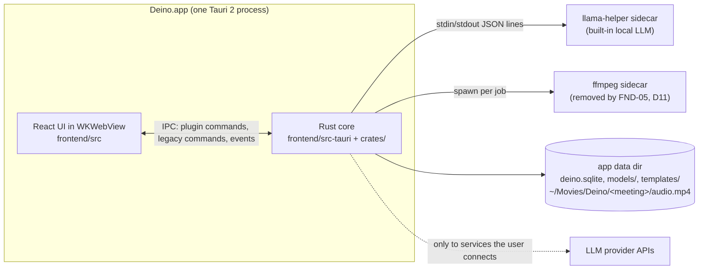
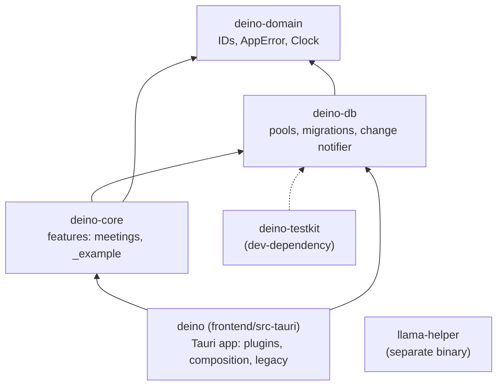
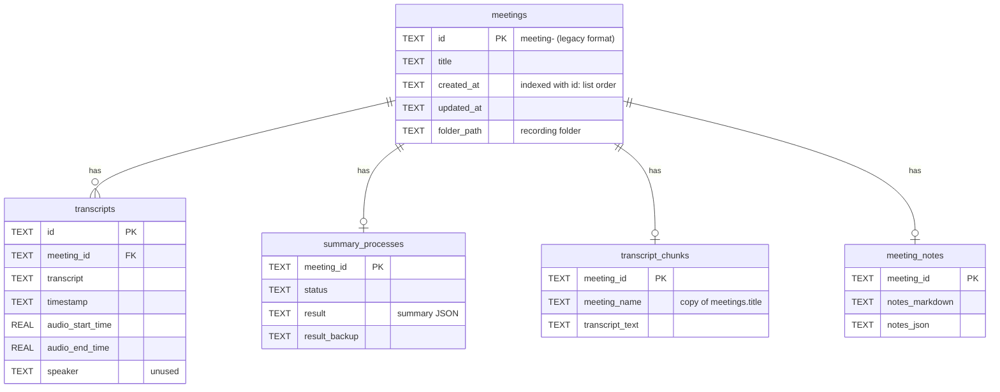

# Deino architecture

The map of the system as it is today (FND-13). PARITY_PLAN §4.0 is the target
it grows towards; this file says where each part lives now and how to extend
it. **Update it in the same PR** whenever a card changes a process, a crate, a
module boundary, the data flow, the schema or an extension point (§3A).

Decisions behind this layout are in [`adr/`](adr/): Tauri + Rust core (0004),
SQLite + sqlx (0005), crate layout (0006), typed IPC (0007), TanStack Query +
`DbChanged` (0008), the error model (0009), cloud LLM for notes with local
transcription (0010) and the code-quality limits (0011).

## 1. Processes



- Audio capture, voice activity detection and transcription (Parakeet over
  ONNX Runtime, Whisper over whisper.cpp) run in the app process. Notes and
  chat go to the LLM the user chose, or to the local llama-helper (ADR 0010).
- There is no Deino server and no telemetry. Network calls go only to the
  user's LLM provider and model downloads (FND-12 will put them all behind
  `deino-net`).

## 2. Rust workspace



| Crate | Path | Role |
|---|---|---|
| `deino-domain` | `crates/deino-domain` | The shared vocabulary: typed IDs (`MeetingId`, UUIDv7 IDs), `AppError`/`ErrorCode`/`ErrorClass`, the `Clock` port. |
| `deino-db` | `crates/deino-db` | `Database` (WAL, one writer, read pool), `MIGRATOR` over `migrations/`, `ChangeNotifier`, `Table`, `test_db()`. |
| `deino-core` | `crates/deino-core` | Features as Tauri-free modules: `meetings`, and `_example` (debug builds). |
| `deino-testkit` | `crates/deino-testkit` | Fixtures and re-exported fakes for tests. |
| `deino` | `frontend/src-tauri` | The Tauri app: plugins, composition root, legacy modules. Library crate `deino_lib`. |
| `llama-helper` | `llama-helper` | The local LLM sidecar. |

Rules (PARITY_PLAN §4.0): dependencies point down the diagram only; **no crate
under `crates/` depends on `tauri`**; a feature becomes its own crate only when
it gains heavy native dependencies or passes about 3k lines. Each crate's
`README.md` lists what it owns and its invariants.

## 3. The app crate (`frontend/src-tauri/src`)

| Module | What it is |
|---|---|
| `lib.rs` | The builder only: plugins, state, setup, run loop. |
| `composition.rs` | **The composition root.** Builds services from adapters (SQLite repos, `SystemClock`, Tauri event adapters) and `app.manage`s them. |
| `features.rs`, `features/` | New IPC: one inline Tauri plugin per feature (`system`, `meetings`, `db`, and `example` in debug builds), each with one `tauri_specta::Builder`. `features/manifest.rs` lists plugins and commands for the ACL. |
| `error.rs` | The command boundary: `into_ipc()` logs the error chain and returns `AppError`. |
| `bindings.rs` | Test-only: exports the TypeScript bindings and checks them against the manifest. |
| `legacy_lints.rs` | The one place inherited modules are exempted from the strict lints. |
| `legacy.rs`, `legacy/` | Every inherited command, in one `generate_handler!`; cards port them into plugins. |
| `setup.rs`, `lifecycle.rs`, `state.rs` | Startup steps, window and exit handling, legacy `AppState`. |
| `database/` | Legacy repositories, and `DatabaseManager`, which wraps `deino_db::Database`. |
| `audio/` | Capture (cpal microphone, Core Audio process tap), mixing, VAD, recording, import, retranscription, the transcription worker. |
| `parakeet_engine/`, `whisper_engine/` | Local STT engines and model management. |
| `summary/` | LLM clients, chunk → combine → final summaries, templates, the built-in model (`summary_engine/`). |
| `notifications/`, `tray.rs`, `onboarding.rs`, `updater/` | OS integration. |
| `anthropic/`, `openai/`, `groq/`, `ollama/`, `openrouter/` | Provider model lists (to be replaced by FND-09's gateway). |

## 4. Frontend (`frontend/src`)

| Path | What it is |
|---|---|
| `main.tsx` | Creates the query client and mounts `IpcQueryProvider` around the router. |
| `routes/` | TanStack Router file routes, thin: each renders one feature screen. |
| `features/<feature>/` | `api.ts` (generated commands, `unwrap`ped), `queries.ts` (keys and hooks with `meta.tables`), `hooks/`, `components/`, `copy.ts`, `types.ts`, `index.ts` (the only import path for other code; `search.ts` for URL params). Today: `meetings`, `_example`, plus `shell`, `record`, `meeting-details`, `settings` from FND-10a. |
| `lib/ipc/` | `generated/` (tauri-specta output, never edited), `result.ts` (`unwrap`, `IpcError`), `query-client.ts`, `events.ts` (`DbChanged` bridge, `useIpcEvent`), `ipc-query-provider.tsx`. |
| `ui/` | Shared primitives; `icons.ts` is the only icon import (FND-10 moves shadcn here). |
| `components/`, `contexts/`, `hooks/`, `services/`, `lib/*`, `types/` | Legacy code, listed in `legacy-files.mjs`. |

## 5. Data flow

### Record → transcript → notes (today)

```mermaid
sequenceDiagram
  participant Mic as Microphone + system audio
  participant Core as Rust core (audio/, STT)
  participant UI as React UI
  participant DB as deino.sqlite
  Mic->>Core: cpal + Core Audio tap frames
  Core->>Core: mix, VAD, Parakeet/Whisper (audio/pipeline.rs, transcription/worker.rs)
  Core-->>UI: transcript-update events (legacy, untyped)
  UI->>Core: stop: api_save_transcript (legacy)
  Core->>DB: INSERT meetings + transcripts (writer connection)
  DB-->>Core: commit hook: tables {meetings, transcripts}
  Core-->>UI: plugin:db:db-changed
  UI->>Core: plugin:meetings|list (refetch)
  UI->>Core: api_process_transcript (legacy summary)
  Core->>DB: summary_processes rows; UI polls api_get_summary
```

What changes next: FND-05 moves transcript persistence into Rust during the
recording, FND-08 turns everything after "stop" into durable pipeline stages
(`finalize_audio` → … → `enhance_notes` → `index`), and FND-09 routes every LLM
call through one gateway.

### Reads and writes in a feature

`commands.rs` → `Service` (rules, `Clock`) → `Repo` port → `SqliteXRepo`
(`query*!` macros, reads on the read pool, writes in one transaction on the
writer) → commit hook → `DbChanged { tables, seq }` → the UI invalidates every
query whose `meta.tables` includes a changed table. Legacy code writes through
the same writer connection, so its writes refresh the new queries too.

## 6. Database schema

`<app_data_dir>/deino.sqlite`, migrations in `crates/deino-db/migrations/`
(append-only; never edit an applied file). Only `deino-db` opens the file.



`settings` (LLM provider, model and API keys, in plaintext until FND-06) and
`transcript_settings` (STT engine) are single-row tables. Denormalised copy:
`transcript_chunks.meeting_name` mirrors `meetings.title`;
`SqliteMeetingRepo::rename` updates both in one transaction (legacy summary
code does the same). FND-07 adds the core schema of §4.1.

## 7. IPC

- **Feature plugins** (`plugin:<feature>|<command>`): typed with tauri-specta,
  checked by the capability ACL, generated into
  `frontend/src/lib/ipc/generated/<feature>.ts` by
  `cargo test -p deino --lib bindings`. IDs are branded strings
  (`MeetingId`). Commands return `Result<T, AppError>`; the UI's `unwrap()`
  throws `IpcError { code, message }` (ADR 0007, ADR 0009).
- **Events:** `plugin:db:db-changed` (`DbChanged`), `plugin:example:note-added`
  (debug). Legacy code still emits untyped events (`transcript-update`,
  `recording-stopped`, …).
- **Legacy commands** (`invoke('api_…')`): about 150 app commands, not
  ACL-checked, in `legacy.rs`. Never add to them.

## 8. Extension points

| To add | Edit |
|---|---|
| A feature | Copy `crates/deino-core/src/_example*`, `frontend/src-tauri/src/features/_example*` and `frontend/src/features/_example/`; then one line each in `features/manifest.rs`, `lib.rs` (`.plugin`), `capabilities/default.json`, `features::builders()`, and the service in `composition.rs`. |
| A table | A migration in `crates/deino-db/migrations/` (`<UTC timestamp>_<card>_<desc>.sql`), a `Table` variant in `crates/deino-db/src/table.rs`, then `scripts/sqlx-prepare.sh` and the bindings test. |
| A command | The function in `features/<feature>/commands.rs` and its `collect_commands!`, the manifest line, the bindings test. |
| A typed event | A `#[derive(tauri_specta::Event)]` type in `features/<feature>/events.rs`, `collect_events!`, an event port in the core service if the core raises it. |
| A query | `features/<feature>/queries.ts` with `meta: { tables: [...] }`. |
| A pipeline stage | FND-08: one line in `crates/deino-pipeline/src/registry.rs`. |
| An LLM route | FND-09: the `Route` enum in `crates/deino-llm`. |
| An integration | INT-00: a `Destination` implementation. |
| An MCP tool | DEV-02. |
| A sidebar entry or meeting tab | FND-10: `features/shell/nav.ts`, `features/meeting/slots.ts`. |

## 9. Quality gates

One command each, run locally and in CI (FND-03): `scripts/clippy.sh`,
`cargo fmt --check`, `cargo test --workspace` (or `cargo nextest run
--workspace`), `scripts/check-rust-file-size.sh`, `scripts/sqlx-prepare.sh
--check`, `cargo deny check`, and in `frontend/`: `pnpm typecheck`,
`pnpm lint`, `pnpm test`, `pnpm format:check`, `pnpm build`. See
[`TESTING.md`](TESTING.md) and [`REVIEW.md`](REVIEW.md).
