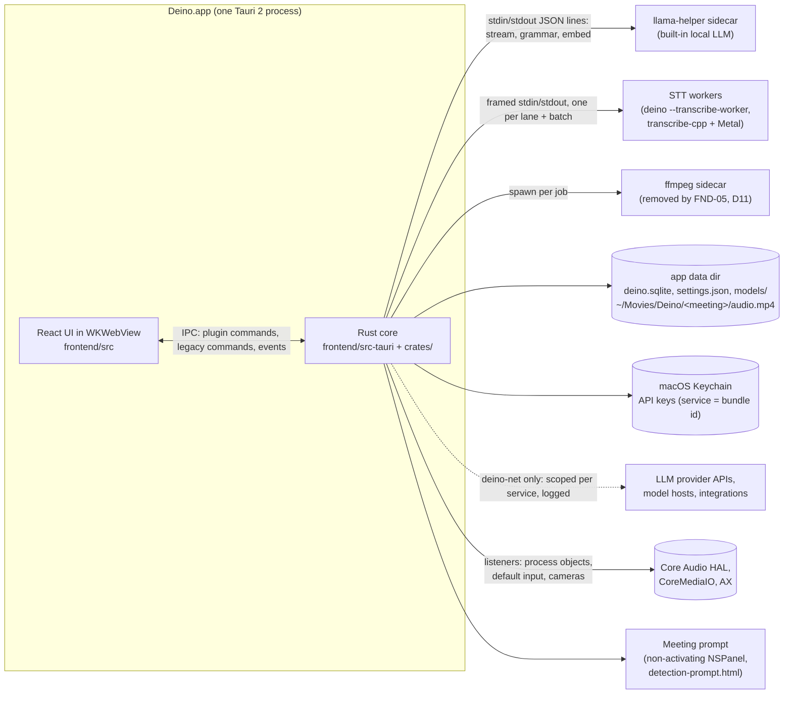
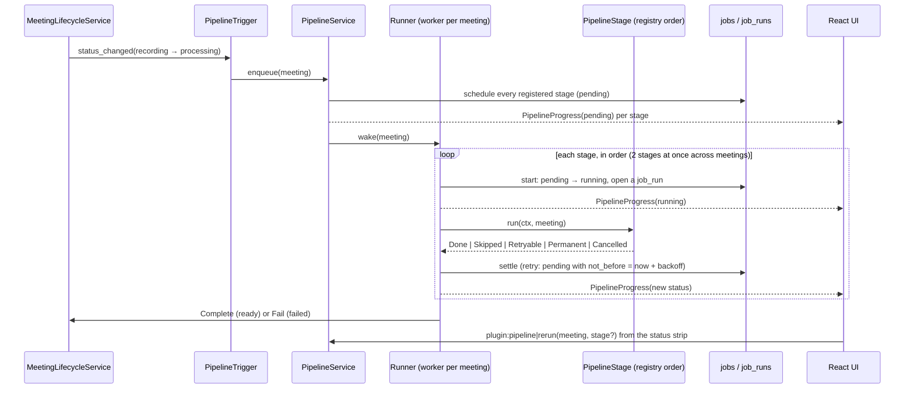
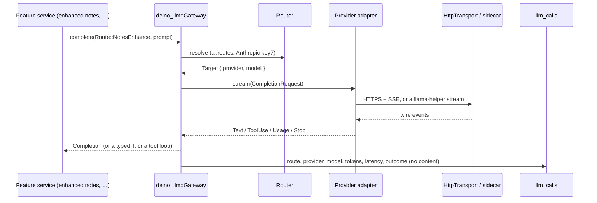

# Deino architecture

The map of the system as it is today (FND-13). PARITY_PLAN §4.0 is the target
it grows towards; this file says where each part lives now and how to extend
it. **Update it in the same PR** whenever a card changes a process, a crate, a
module boundary, the data flow, the schema or an extension point (§3A).

Decisions behind this layout are in [`adr/`](adr/): Tauri + Rust core (0004),
SQLite + sqlx (0005), crate layout (0006), typed IPC (0007), TanStack Query +
`DbChanged` (0008), the error model (0009), cloud LLM for notes with local
transcription (0010), the code-quality limits (0011), the core schema with
its legacy `transcripts` view (0012), typed settings with Keychain secrets
(0013), the native crash-safe recording format (0014), the design tokens
and app shell (0015), speech-to-text in supervised transcribe-cpp worker
processes (0016), the LLM gateway with task routes (0017), and the
post-meeting pipeline's stage model (0018), the network egress policy
(0019), local speaker diarization (0020), note templates in the database
with a versioned built-in catalogue (0021), the note document model:
TipTap JSON with `deino-doc` (0022), meeting detection (0023), folder
auto-add rules as rows with AI tagging from the user's own tags (0024),
exports as pure renderers with Typst PDFs (0025), the Rust-owned two-lane
live recorder (0026), calendar sync through EventKit (0027), action
items' local due days, saved views and Rust-resolved extraction (0028),
naming speakers by mutual-best voiceprint matches enrolled only from
confirmed renames (0029), search: an FTS5 index kept by triggers with an
in-memory vector index fused by reciprocal rank (0032), the transcript
view's in-UI search over virtual rows of one line each (0033), and event
linking: one nearest-event rule for detection and recording, related
meetings by series or by title and people, and the start observer (0034), the read-only `deino` CLI with its
stdio MCP server over the database (0035), and one entity service for
people and companies, with merges kept as aliases and meeting counts
computed on read (0036).

## 1. Processes



- Audio capture and voice activity detection run in the app process.
  Transcription with Parakeet Unified EN 0.6B (the default) and Whisper runs
  in worker processes: the app executable re-launched with
  `--transcribe-worker`, one per live lane plus one for batch work, supervised
  by `deino-stt` (ADR 0016), so a ggml abort or GPU hang never takes the app
  down. Parakeet TDT (the "Advanced" ONNX engine) still runs in-process.
  Notes and chat go to the LLM the user chose, or to the local llama-helper
  (ADR 0010), always through the `deino-llm` gateway, by task route
  (ADR 0017).
- Meeting detection (CAP-06, ADR 0023) runs on one `deino-detect` thread in
  the app process: Core Audio and CoreMediaIO listeners only wake it, it
  re-reads who captures audio, and its prompt is a second webview in a
  non-activating panel that never takes focus from the call.
- Speaker tags (CAP-05, ADR 0045) run on one `deino-speaker-tags` thread
  per recording: every 250 ms it asks the recorder's playhead where the
  recording is and reads the Zoom, Teams or Meet call window through
  Accessibility (never on an audio thread, each request capped at 100 ms),
  saving active-speaker spans every 10 s of recording time.
- Calendar sync (ORG-01, ADR 0027) reads macOS Calendar on one
  `deino-eventkit` worker thread that owns the `EKEventStore`, every 2
  minutes, on store changes and on wake; the optional Google and Microsoft
  connectors (`deino-connect`) sign in through the default browser and a
  one-shot loopback listener, with `deino-integrations`' OAuth.
- Integrations (INT-00, ADR 0031) talk from this Mac straight to the
  provider's API with the user's own sign-in: OAuth with PKCE over a
  loopback redirect (or a pasted token), one Keychain item per
  connection, and every request through a `deino-net` client scoped to
  the provider. D12 deprioritised the providers themselves; debug builds
  connect the sandbox.
- The `deino` command (DEV-02/04, ADR 0035) is a separate process: the
  `cli` sidecar inside the bundle, installed as `deino` from Settings →
  Developer. Claude Code or Claude Desktop starts `deino mcp` and talks MCP
  to it over stdio; it opens `deino.sqlite` read-only (`mode=ro`, WAL) beside
  the app, whether or not the app is running, and never writes it.
- There is no Deino server and no telemetry. Network calls go only to the
  services the user allows, through `deino-net` (FND-12, ADR 0019): each
  caller holds a client scoped to one service's hosts, every request is
  checked against the user's switches and offline mode, and every attempt
  lands in the egress log (Settings → Privacy → Network). The webview has no
  network of its own (`connect-src 'self' ipc: http://ipc.localhost asset:`).

## 2. Rust workspace

```mermaid
flowchart BT
  domain["deino-domain<br/>IDs, enums, units, AppError, Clock"]
  db["deino-db<br/>pools, migrations, change notifier"]
  core["deino-core<br/>features: meetings, settings, segments, people, ..."]
  secrets["deino-secrets<br/>SecretStore, Keychain"]
  pipeline["deino-pipeline<br/>stages, registry, job runner"]
  testkit["deino-testkit<br/>(dev-dependency)"]
  stt["deino-stt<br/>transcribe-cpp workers, supervisor,<br/>live sessions (no network)"]
  app["deino (frontend/src-tauri)<br/>Tauri app: plugins, composition, legacy"]
  helper["llama-helper<br/>(separate binary)"]
  audio["deino-audio<br/>capture, track writer, recovery, finalize"]
  recording["deino-recording<br/>live recorder: two lanes, AEC,<br/>live persistence, recovery"]
  recording --> audio
  recording --> stt
  recording --> core
  app --> recording
  pipeline --> audio
  llm["deino-llm<br/>gateway, routes, providers, prompts"]
  doc["deino-doc<br/>TipTap JSON model, Markdown in/out"]
  doc --> domain
  core --> doc
  export["deino-export<br/>renderers: Markdown, TXT, JSON,<br/>SRT, VTT, HTML, DOCX, PDF (Typst), CSV"]
  export --> domain
  core --> export
  testkit -.-> doc
  net["deino-net<br/>the only HTTP client: scoped clients, egress log, downloads"]
  net --> db
  net --> domain
  app --> net
  diarize["deino-diarize<br/>pyannote + WeSpeaker (ONNX, Core ML),<br/>clustering, voiceprints"]
  detect["deino-detect<br/>process/camera/AX signals,<br/>resolver, policy (no network)"]
  detect --> domain
  app --> detect
  tags["deino-speaker-tags<br/>AX call windows, per-app adapters,<br/>speaker timeline (no network)"]
  tags --> domain
  app --> tags
  eventkit["deino-eventkit<br/>macOS Calendar via EventKit (no network)"]
  connect["deino-connect<br/>Google and Graph calendars"]
  integrations["deino-integrations<br/>providers, OAuth PKCE, connections, deliveries"]
  integrations --> net
  integrations --> db
  integrations --> secrets
  connect --> integrations
  app --> integrations
  eventkit --> core
  connect --> core
  connect --> net
  connect --> secrets
  app --> eventkit
  app --> connect
  knf["knf-rs (vendored)<br/>Kaldi filterbank"]
  diarize --> core
  diarize --> audio
  diarize --> knf
  audio --> domain
  llm --> db
  llm --> domain
  core --> llm
  app --> llm
  db --> domain
  core --> db
  core --> domain
  core --> secrets
  secrets --> domain
  pipeline --> core
  pipeline --> db
  app --> pipeline
  app --> core
  app --> db
  app --> secrets
  app --> stt
  app -. "debug builds: dev plugin" .-> testkit
  testkit -.-> db
  cli["deino-cli<br/>the deino command:<br/>CLI + stdio MCP (read-only)"]
  cli --> core
  cli --> db
  cli --> export
  core -. "test-support: sample library" .-> testkit
```



| Crate | Path | Role |
|---|---|---|
| `deino-domain` | `crates/deino-domain` | The shared vocabulary: typed IDs (`MeetingId`, UUIDv7 IDs), the closed sets the schema stores (`MeetingStatus` with its transitions, `Channel`, `AttendeeRole`, `Rsvp`, ...), `Millis`/`Seconds`, `Email`, `PaletteColor`, `AppError`/`ErrorCode`/`ErrorClass`, the `Clock` port. |
| `deino-db` | `crates/deino-db` | `Database` (WAL, one writer, read pool), `MIGRATOR` over `migrations/`, `DataMigration` (Rust steps between two schema migrations), `ChangeNotifier`, `Table`, `test_db()`; encryption at rest (PRV-02, ADR 0041): SQLCipher (CommonCrypto on macOS), `DbKey`, `FileFormat`, `open_keyed`/`open_read_only_keyed`, `convert`/`recover` (verified copy, atomic swap), `Fingerprint`. |
| `deino-secrets` | `crates/deino-secrets` | `SecretStore` (set, status, delete, and `get` for Rust only), `KeychainSecretStore` over `keyring`, `InMemorySecretStore` (feature `test-support`); `DatabaseKeyStore` holds the database key (PRV-02). |
| `deino-core` | `crates/deino-core` | Features as Tauri-free modules: `models` (the STT model catalog, verified resumable downloads over a `ByteSource` port), `meetings` (list, rename, lifecycle, trash), `settings` (typed `Settings`, `SettingsService`, the atomic `settings.json` store, the legacy-store importers), one module per core-schema aggregate (`segments`, `people`, `companies`, `calendar`, `folders`, `tags`: ports, SQLite repositories, fakes), and `_example` (debug builds). `templates` (NOT-04, ADR 0021): the template model, the 30-template versioned `CATALOG` and `BuiltinSync`, the library (`TemplateService`), per-meeting selection and previews (`MeetingTemplateService` over the pure `RuleEngine` and the `TemplateClassifier` port, with `GatewayTemplateClassifier` on route `tagging`), JSON import/export and the one-time legacy-folder import. `profile` (NOT-05): `ProfileService` (saves Settings → Profile, keeps the `people.is_me` person in step through `MeRepo`), `render_profile_context` and `ProfileContext` (the gateway's system context), and `InternalDomains` (internal vs external by email domain). `notes` (NOT-01): `NoteService` saves a meeting's TipTap document whole into `meeting_notes` (with its Readable Markdown), stores pasted and dropped images in the meeting's folder (`FsNoteImages`, content-checked, generated names), creates `scheduled` meetings for notes written ahead, (the record screen writes into the meeting being recorded, which the recorder creates at start); `people::PeopleService::search` feeds @mentions; the enhanced notes read them. `enhance` (NOT-02, ADR 0030): `EnhanceService` writes a meeting's enhanced notes from its transcript, the user's notes, the calendar event, the profile, the template, the vocabulary and the series' previous notes (`MaterialSources`), through `notes.enhance` as a structured `EnhancedDoc` (map-reduce over ~20-minute parts past 30 minutes); `assemble` (the provenance guard: user lines verbatim from their own notes, references resolved by `SegmentIndex`), `to_doc` (origin marks and citations), versions in `enhanced_notes` (`SqliteEnhancedNotesRepo`, `EnhancedNotesReader` for exports and digests), edit protection, regenerate reasons from an `EnhanceBasis`, the cited excerpts, `AutoTitler` (the `auto_title` stage) and `LegacySummaryImport` (the old summaries as version 1). Also `settings::LlmAccess` (credentials, endpoints and route choices for the gateway). `folders` (ORG-05, ADR 0024): `FolderService` (create, rename, icon, description, cycle-safe moves, deletion that keeps every meeting, the tree with counts), `FilingService` (a meeting in many folders, the "Unfiled" smart folder, the series offer, each folder's rules), the typed `FolderRule` (series, tag, attendee domain) with the pure `folders_matching`, and `AutoFileService` behind the `auto_folder` stage. `tags` (ORG-06): `TagService` (CRUD with palette colours and descriptions, apply/remove with a `TagSource`, the `MeetingTagged` event) and `AutoTagService` behind the `auto_tag` stage (existing tags only, on route `tagging`, skipped when the user tagged the meeting or Settings → organize turns it off; `NoModelAutoTagger` when no gateway could be wired). `calendar` (ORG-01, ADR 0027): the `CalendarSource` port, the conference-link parser, the filters (declined, out of office, Focus, working location, duplicates), the mapping into `SyncBatch` (internal vs external through `InternalDomains`, the user's RSVP), `CalendarSyncRepo::apply` (one transaction, change-only upserts, per-provider pruning), `AttendeeDirectory` (attendees' people and companies through `entities::EntityDirectory`), `CalendarService` (status, switch, connectors, calendars and their visibility, `upcoming`, `events_near`) and `SyncScheduler`. `calendar::linking` (ORG-03, ADR 0034): the pure rules (`nearest_event`: timed, not declined, under way or starting within 15 minutes, closest start first; `rank_suggestions` over the day before a meeting), `EventLinkService` (auto-link on start, link, re-link and unlink at any point of a meeting's life, over the `EventAgenda` port that `CalendarService` implements), `EventAttendance` (invitees into `meeting_attendees` through `AttendeeDirectory::person_for`, the user as "Me", broadcasts add no new people, re-linking removes the previous event's invitees but not who only spoke) and `RelatedService` over `SqliteRelatedRepo` (same series, or the same title and the same people besides the user; "Previous in series"). `insights` (AI-06, ADR 0038): `InsightService` (definitions with revisions, the twelve-template gallery, a meeting's Insights tab, one insight's table, run candidates, runs on past meetings as pending rows plus the `RunScheduler` port, CSV through `deino_export::csv::insight_table`), `GenerateService` behind the `insights` stage (requested runs, else matching automatic insights over `deino_domain::ConditionGroups`; `GatewayInsightModel` on route `extract.insights` with a schema built from the fields; `validate` types every value; `Attribution` resolves `s12` references to speaker, time and segment), `SqliteInsightRepo` (`insight_defs`, `insight_results`, current speaker names, meeting facts, past meetings) and `InsightExports` (the exports' Insights section). `action_items` (AI-05, ADR 0028): `ActionItemService` (list by `ActionItemFilter` resolved into an `ItemQuery` against the clock, the `LocalZone` and "Me"; the "Today" digest; create; one `ActionItemEdit` or a bulk one; delete; "mark all mine done"; the filter options), `SavedViewService` (`action_item_views`), the `ActionItemEvents` port, `DailyReminder` (09:00 local, catch-up until noon, the `Notifier` and `ReminderSwitch` ports), and `extraction` behind the `extract_action_items` stage (`ContextSources` gathers the meeting's local day, attendees, the user's notes and the numbered transcript; `GatewayActionItemModel` on route `extract.action_items`; `resolve_due`, `Roster` and `Transcript::locate` resolve phrases to days, names to people and citations to segments; regeneration replaces only untouched AI items). `search` (ORG-08, AI-01, ADR 0032): the query parser, `SqliteSearchIndex` (FTS5 keyword search, filter scopes, `@` filter names, reindex), `SearchService` (`search` for the palette and results page, `search_hybrid` for chat), `Retriever` (read-only hybrid search for the `deino` CLI and MCP server; keyword-only without an embedder), reciprocal rank fusion (`hybrid`), and `semantic` (chunking, the `Embedder` port over the gateway, `SqliteEmbeddingStore`, the in-memory `VectorIndex`, `SemanticIndexer`, the backfill and `SemanticAdmin`); `MeetingIndexer` is the `index` stage's work. `models` also serves the embedding model (catalog entries have a purpose). `diarization` holds the `diarize` stage's rules (CAP-03): `DiarizeService` over the `TrackDiarizer` port, `plan_channels` (Me on the microphone, the system track diarized, the in-person shared-microphone rule), `attribute` (segments to speakers by overlap, split at speaker changes) and `known_voices` (the expected attendees' voiceprints for the engine); `diarization::identify` holds `identify_speakers`' (CAP-04, ADR 0029): `Lineup` reads the meeting, the pure `decide` names by voice (max over exemplars, margin, mutual best, a stricter bar for non-attendees), by elimination and suggests, `IdentifyService` writes it in one transaction, `IdentifyPolicy` reads `Settings::speakers`. `voiceprints` (CAP-04): `VoiceprintService` (enrolment on a confirmed rename-all only, `quality` from clean spans, profiles, delete, forget), `ExemplarReader`, the `matching` primitives (`pick_unique`, `complete_by_elimination`, `best_score`) and enrolment `spans`, moved here from `deino-diarize`. `speakers` (CAP-04): `SpeakerService` (participants with talk-time shares and suggestions, name candidates, rename one segment or all, merge, confirm or dismiss a suggestion) over `ParticipantReader`, `NamingRepo` and `IdentificationWriter` (`SqliteNamingRepo`, one transaction per change; action items follow the voice). `export` (EXP-01/02, ADR 0025) assembles a meeting into `deino_export::MeetingExport` and runs previews, saves, copies, email drafts, the `auto_export` stage's `AutoExportService` and the account export, over OS ports the app implements. `transcript` (TRN-01, ADR 0033): `TranscriptService` reads one meeting's whole `Transcript` (segments in spoken order with their speaker IDs) through `SegmentReader`; `speakers` names them. `entities` (ORG-04, ADR 0036): `EntityDirectory` (the one set of upsert rules for people and companies: email, else exact name; email domains minus public and personal ones; follows `merged_into`), `PersonService` and `CompanyService` (lists with meeting counts and last met, pages, manual add and edit, notes, merges over `EntityMerger`, which moves every link in one transaction), `AttendanceService` (a meeting's people, add and remove), `EntitySummarizer` (briefings on route `entity.summary`), `LogoService` (a company's favicon once, over the `LogoSource` and `LogoFiles` ports; `FaviconSource` over `deino-net`), and `EntityUpdateService` behind the `update_entities` stage. `vocabulary` (TRN-05, ADR 0037): `VocabularyService` (terms with sounds-like spellings and replacement rules in `vocab_terms`/`vocab_variants`; the `Corrector` over a `Lexicon` of the user's entries plus people, companies and the meeting's invitees from `NameSources`), the pure matcher (whole-word, case-insensitive phrases; Jaro-Winkler 0.92 for names of several words, 0.95 with capitalisation and length guards for one word), `CorrectionRepo` (`vocab_corrections`: the engine's original of every corrected segment, undo that never overwrites a later edit), `LiveVocabulary` (the recorder's live pass), `FixupService` behind the `vocab_fixups` stage and `PromptVocabulary` (the enhanced notes' vocabulary input). `final_transcription` (CAP-08, ADR 0037): `FinalTranscriptionService` behind the `final_transcription` stage over the `TrackTranscriber` port (transcribe a record-only meeting's tracks, or the high-accuracy re-pass that replaces the live transcript), with `carried_speaker` keeping speakers where they overlap. `permissions` (FND-11): `PermissionService` reads, requests and opens the System Settings page of the microphone, system audio, notifications and Accessibility over the `PermissionGate` port (remembering the last answer where macOS cannot be read without asking). `sample` (FND-11): `SampleMeeting`, the bundled sample standup (`sample/sample-meeting.json`, compiled in), and `SampleImporter`, which writes it through the meeting, speaker, segment, enhanced-notes and action-item repositories as `meeting-sample`, once. |
| `deino-db` | `crates/deino-db` | `Database` (WAL, one writer, read pool), `MIGRATOR` over `migrations/`, `DataMigration` (Rust steps between two schema migrations), `ChangeNotifier`, `Table`, `test_db()`. |
| `deino-secrets` | `crates/deino-secrets` | `SecretStore` (set, status, delete, and `get` for Rust only), `KeychainSecretStore` over `keyring`, `InMemorySecretStore` (feature `test-support`). |
| `deino-core` | `crates/deino-core` | Features as Tauri-free modules: `models` (the STT model catalog, verified resumable downloads over a `ByteSource` port), `meetings` (list, rename, lifecycle, trash), `settings` (typed `Settings`, `SettingsService`, the atomic `settings.json` store, the legacy-store importers), one module per core-schema aggregate (`segments`, `people`, `companies`, `calendar`, `folders`, `tags`: ports, SQLite repositories, fakes), and `_example` (debug builds). `templates` (NOT-04, ADR 0021): the template model, the 30-template versioned `CATALOG` and `BuiltinSync`, the library (`TemplateService`), per-meeting selection and previews (`MeetingTemplateService` over the pure `RuleEngine` and the `TemplateClassifier` port, with `GatewayTemplateClassifier` on route `tagging`), JSON import/export and the one-time legacy-folder import. `profile` (NOT-05): `ProfileService` (saves Settings → Profile, keeps the `people.is_me` person in step through `MeRepo`), `render_profile_context` and `ProfileContext` (the gateway's system context), and `InternalDomains` (internal vs external by email domain). `notes` (NOT-01): `NoteService` saves a meeting's TipTap document whole into `meeting_notes` (with its Readable Markdown), stores pasted and dropped images in the meeting's folder (`FsNoteImages`, content-checked, generated names), creates `scheduled` meetings for notes written ahead, (the record screen writes into the meeting being recorded, which the recorder creates at start); `people::PeopleService::search` feeds @mentions; the enhanced notes read them. `enhance` (NOT-02, ADR 0030): `EnhanceService` writes a meeting's enhanced notes from its transcript, the user's notes, the calendar event, the profile, the template, the vocabulary and the series' previous notes (`MaterialSources`), through `notes.enhance` as a structured `EnhancedDoc` (map-reduce over ~20-minute parts past 30 minutes); `assemble` (the provenance guard: user lines verbatim from their own notes, references resolved by `SegmentIndex`), `to_doc` (origin marks and citations), versions in `enhanced_notes` (`SqliteEnhancedNotesRepo`, `EnhancedNotesReader` for exports and digests), edit protection, regenerate reasons from an `EnhanceBasis`, the cited excerpts, `AutoTitler` (the `auto_title` stage) and `LegacySummaryImport` (the old summaries as version 1). Also `settings::LlmAccess` (credentials, endpoints and route choices for the gateway). `folders` (ORG-05, ADR 0024): `FolderService` (create, rename, icon, description, cycle-safe moves, deletion that keeps every meeting, the tree with counts), `FilingService` (a meeting in many folders, the "Unfiled" smart folder, the series offer, each folder's rules), the typed `FolderRule` (series, tag, attendee domain) with the pure `folders_matching`, and `AutoFileService` behind the `auto_folder` stage. `tags` (ORG-06): `TagService` (CRUD with palette colours and descriptions, apply/remove with a `TagSource`, the `MeetingTagged` event) and `AutoTagService` behind the `auto_tag` stage (existing tags only, on route `tagging`, skipped when the user tagged the meeting or Settings → organize turns it off; `NoModelAutoTagger` when no gateway could be wired). `calendar` (ORG-01, ADR 0027): the `CalendarSource` port, the conference-link parser, the filters (declined, out of office, Focus, working location, duplicates), the mapping into `SyncBatch` (internal vs external through `InternalDomains`, the user's RSVP), `CalendarSyncRepo::apply` (one transaction, change-only upserts, per-provider pruning), `AttendeeDirectory` (attendees' people and companies through `entities::EntityDirectory`), `CalendarService` (status, switch, connectors, calendars and their visibility, `upcoming`, `events_near`) and `SyncScheduler`. `calendar::linking` (ORG-03, ADR 0034): the pure rules (`nearest_event`: timed, not declined, under way or starting within 15 minutes, closest start first; `rank_suggestions` over the day before a meeting), `EventLinkService` (auto-link on start, link, re-link and unlink at any point of a meeting's life, over the `EventAgenda` port that `CalendarService` implements), `EventAttendance` (invitees into `meeting_attendees` through `AttendeeDirectory::person_for`, the user as "Me", broadcasts add no new people, re-linking removes the previous event's invitees but not who only spoke) and `RelatedService` over `SqliteRelatedRepo` (same series, or the same title and the same people besides the user; "Previous in series"). `insights` (AI-06, ADR 0038): `InsightService` (definitions with revisions, the twelve-template gallery, a meeting's Insights tab, one insight's table, run candidates, runs on past meetings as pending rows plus the `RunScheduler` port, CSV through `deino_export::csv::insight_table`), `GenerateService` behind the `insights` stage (requested runs, else matching automatic insights over `deino_domain::ConditionGroups`; `GatewayInsightModel` on route `extract.insights` with a schema built from the fields; `validate` types every value; `Attribution` resolves `s12` references to speaker, time and segment), `SqliteInsightRepo` (`insight_defs`, `insight_results`, current speaker names, meeting facts, past meetings) and `InsightExports` (the exports' Insights section). `action_items` (AI-05, ADR 0028): `ActionItemService` (list by `ActionItemFilter` resolved into an `ItemQuery` against the clock, the `LocalZone` and "Me"; the "Today" digest; create; one `ActionItemEdit` or a bulk one; delete; "mark all mine done"; the filter options), `SavedViewService` (`action_item_views`), the `ActionItemEvents` port, `DailyReminder` (09:00 local, catch-up until noon, the `Notifier` and `ReminderSwitch` ports), and `extraction` behind the `extract_action_items` stage (`ContextSources` gathers the meeting's local day, attendees, the user's notes and the numbered transcript; `GatewayActionItemModel` on route `extract.action_items`; `resolve_due`, `Roster` and `Transcript::locate` resolve phrases to days, names to people and citations to segments; regeneration replaces only untouched AI items). `search` (ORG-08, AI-01, ADR 0032): the query parser, `SqliteSearchIndex` (FTS5 keyword search, filter scopes, `@` filter names, reindex), `SearchService` (`search` for the palette and results page, `search_hybrid` for chat), `Retriever` (read-only hybrid search for the `deino` CLI and MCP server; keyword-only without an embedder), reciprocal rank fusion (`hybrid`), and `semantic` (chunking, the `Embedder` port over the gateway, `SqliteEmbeddingStore`, the in-memory `VectorIndex`, `SemanticIndexer`, the backfill and `SemanticAdmin`); `MeetingIndexer` is the `index` stage's work. `models` also serves the embedding model (catalog entries have a purpose). `diarization` holds the `diarize` stage's rules (CAP-03): `DiarizeService` over the `TrackDiarizer` port, `plan_channels` (Me on the microphone, the system track diarized, the in-person shared-microphone rule), `attribute` (segments to speakers by overlap, split at speaker changes) and `known_voices` (the expected attendees' voiceprints for the engine); `diarization::identify` holds `identify_speakers`' (CAP-04, ADR 0029): `Lineup` reads the meeting, the pure `decide` names by voice (max over exemplars, margin, mutual best, a stricter bar for non-attendees), by elimination and suggests, `IdentifyService` writes it in one transaction, `IdentifyPolicy` reads `Settings::speakers`. `voiceprints` (CAP-04): `VoiceprintService` (enrolment on a confirmed rename-all only, `quality` from clean spans, profiles, delete, forget), `ExemplarReader`, the `matching` primitives (`pick_unique`, `complete_by_elimination`, `best_score`) and enrolment `spans`, moved here from `deino-diarize`. `speakers` (CAP-04): `SpeakerService` (participants with talk-time shares and suggestions, name candidates, rename one segment or all, merge, confirm or dismiss a suggestion) over `ParticipantReader`, `NamingRepo` and `IdentificationWriter` (`SqliteNamingRepo`, one transaction per change; action items follow the voice). `export` (EXP-01/02, ADR 0025) assembles a meeting into `deino_export::MeetingExport` and runs previews, saves, copies, email drafts, the `auto_export` stage's `AutoExportService` and the account export, over OS ports the app implements. `transcript` (TRN-01, ADR 0033): `TranscriptService` reads one meeting's whole `Transcript` (segments in spoken order with their speaker IDs) through `SegmentReader`; `speakers` names them. `speaker_tags` (CAP-05, ADR 0045): `speaker_tag_spans` through `SpeakerTagWriter`/`SpeakerTagReader` (`SqliteSpeakerTagRepo`), the pure rules `align` (a name wins a system-track segment it covers for more than half) and `seats` (each name's speaker: the person's, the labelled one, the diarized voice it wins most of, or a new one; segments move there, never off a speaker the user named), `resolve` (attendees by name or unique first name, then one exact person; never the user; never creates people) and `SpeakerTagPriors`, which hands `identify_speakers` a `TagPlan` before voices are matched. `entities` (ORG-04, ADR 0036): `EntityDirectory` (the one set of upsert rules for people and companies: email, else exact name; email domains minus public and personal ones; follows `merged_into`), `PersonService` and `CompanyService` (lists with meeting counts and last met, pages, manual add and edit, notes, merges over `EntityMerger`, which moves every link in one transaction), `AttendanceService` (a meeting's people, add and remove), `EntitySummarizer` (briefings on route `entity.summary`), `LogoService` (a company's favicon once, over the `LogoSource` and `LogoFiles` ports; `FaviconSource` over `deino-net`), and `EntityUpdateService` behind the `update_entities` stage. `vocabulary` (TRN-05, ADR 0037): `VocabularyService` (terms with sounds-like spellings and replacement rules in `vocab_terms`/`vocab_variants`; the `Corrector` over a `Lexicon` of the user's entries plus people, companies and the meeting's invitees from `NameSources`), the pure matcher (whole-word, case-insensitive phrases; Jaro-Winkler 0.92 for names of several words, 0.95 with capitalisation and length guards for one word), `CorrectionRepo` (`vocab_corrections`: the engine's original of every corrected segment, undo that never overwrites a later edit), `LiveVocabulary` (the recorder's live pass), `FixupService` behind the `vocab_fixups` stage and `PromptVocabulary` (the enhanced notes' vocabulary input). `final_transcription` (CAP-08, ADR 0037): `FinalTranscriptionService` behind the `final_transcription` stage over the `TrackTranscriber` port (transcribe a record-only meeting's tracks, or the high-accuracy re-pass that replaces the live transcript), with `carried_speaker` keeping speakers where they overlap. `permissions` (FND-11): `PermissionService` reads, requests and opens the System Settings page of the microphone, system audio, notifications and Accessibility over the `PermissionGate` port (remembering the last answer where macOS cannot be read without asking). `sample` (FND-11): `SampleMeeting`, the bundled sample standup (`sample/sample-meeting.json`, compiled in), and `SampleImporter`, which writes it through the meeting, speaker, segment, enhanced-notes and action-item repositories as `meeting-sample`, once. |
| `deino-core` | `crates/deino-core` | Features as Tauri-free modules: `models` (the STT model catalog, verified resumable downloads over a `ByteSource` port), `meetings` (list, rename, lifecycle, trash), `settings` (typed `Settings`, `SettingsService`, the atomic `settings.json` store, the legacy-store importers), one module per core-schema aggregate (`segments`, `people`, `companies`, `calendar`, `folders`, `tags`: ports, SQLite repositories, fakes), and `_example` (debug builds). `templates` (NOT-04, ADR 0021): the template model, the 30-template versioned `CATALOG` and `BuiltinSync`, the library (`TemplateService`), per-meeting selection and previews (`MeetingTemplateService` over the pure `RuleEngine` and the `TemplateClassifier` port, with `GatewayTemplateClassifier` on route `tagging`), JSON import/export and the one-time legacy-folder import. `profile` (NOT-05): `ProfileService` (saves Settings → Profile, keeps the `people.is_me` person in step through `MeRepo`), `render_profile_context` and `ProfileContext` (the gateway's system context), and `InternalDomains` (internal vs external by email domain). `notes` (NOT-01): `NoteService` saves a meeting's TipTap document whole into `meeting_notes` (with its Readable Markdown), stores pasted and dropped images in the meeting's folder (`FsNoteImages`, content-checked, generated names), creates `scheduled` meetings for notes written ahead, (the record screen writes into the meeting being recorded, which the recorder creates at start); `people::PeopleService::search` feeds @mentions; the enhanced notes read them. `enhance` (NOT-02, ADR 0030): `EnhanceService` writes a meeting's enhanced notes from its transcript, the user's notes, the calendar event, the profile, the template, the vocabulary and the series' previous notes (`MaterialSources`), through `notes.enhance` as a structured `EnhancedDoc` (map-reduce over ~20-minute parts past 30 minutes); `assemble` (the provenance guard: user lines verbatim from their own notes, references resolved by `SegmentIndex`), `to_doc` (origin marks and citations), versions in `enhanced_notes` (`SqliteEnhancedNotesRepo`, `EnhancedNotesReader` for exports and digests), edit protection, regenerate reasons from an `EnhanceBasis`, the cited excerpts, `AutoTitler` (the `auto_title` stage) and `LegacySummaryImport` (the old summaries as version 1). Also `settings::LlmAccess` (credentials, endpoints and route choices for the gateway). `folders` (ORG-05, ADR 0024): `FolderService` (create, rename, icon, description, cycle-safe moves, deletion that keeps every meeting, the tree with counts), `FilingService` (a meeting in many folders, the "Unfiled" smart folder, the series offer, each folder's rules), the typed `FolderRule` (series, tag, attendee domain) with the pure `folders_matching`, and `AutoFileService` behind the `auto_folder` stage. `tags` (ORG-06): `TagService` (CRUD with palette colours and descriptions, apply/remove with a `TagSource`, the `MeetingTagged` event) and `AutoTagService` behind the `auto_tag` stage (existing tags only, on route `tagging`, skipped when the user tagged the meeting or Settings → organize turns it off; `NoModelAutoTagger` when no gateway could be wired). `calendar` (ORG-01, ADR 0027): the `CalendarSource` port, the conference-link parser, the filters (declined, out of office, Focus, working location, duplicates), the mapping into `SyncBatch` (internal vs external through `InternalDomains`, the user's RSVP), `CalendarSyncRepo::apply` (one transaction, change-only upserts, per-provider pruning), `AttendeeDirectory` (attendees' people and companies through `entities::EntityDirectory`), `CalendarService` (status, switch, connectors, calendars and their visibility, `upcoming`, `events_near`) and `SyncScheduler`. `calendar::linking` (ORG-03, ADR 0034): the pure rules (`nearest_event`: timed, not declined, under way or starting within 15 minutes, closest start first; `rank_suggestions` over the day before a meeting), `EventLinkService` (auto-link on start, link, re-link and unlink at any point of a meeting's life, over the `EventAgenda` port that `CalendarService` implements), `EventAttendance` (invitees into `meeting_attendees` through `AttendeeDirectory::person_for`, the user as "Me", broadcasts add no new people, re-linking removes the previous event's invitees but not who only spoke) and `RelatedService` over `SqliteRelatedRepo` (same series, or the same title and the same people besides the user; "Previous in series"). `action_items` (AI-05, ADR 0028): `ActionItemService` (list by `ActionItemFilter` resolved into an `ItemQuery` against the clock, the `LocalZone` and "Me"; the "Today" digest; create; one `ActionItemEdit` or a bulk one; delete; "mark all mine done"; the filter options), `SavedViewService` (`action_item_views`), the `ActionItemEvents` port, `DailyReminder` (09:00 local, catch-up until noon, the `Notifier` and `ReminderSwitch` ports), and `extraction` behind the `extract_action_items` stage (`ContextSources` gathers the meeting's local day, attendees, the user's notes and the numbered transcript; `GatewayActionItemModel` on route `extract.action_items`; `resolve_due`, `Roster` and `Transcript::locate` resolve phrases to days, names to people and citations to segments; regeneration replaces only untouched AI items). `search` (ORG-08, AI-01, ADR 0032): the query parser, `SqliteSearchIndex` (FTS5 keyword search, filter scopes, `@` filter names, reindex), `SearchService` (`search` for the palette and results page, `search_hybrid` for chat), `Retriever` (read-only hybrid search for the `deino` CLI and MCP server; keyword-only without an embedder), reciprocal rank fusion (`hybrid`), and `semantic` (chunking, the `Embedder` port over the gateway, `SqliteEmbeddingStore`, the in-memory `VectorIndex`, `SemanticIndexer`, the backfill and `SemanticAdmin`); `MeetingIndexer` is the `index` stage's work. `models` also serves the embedding model (catalog entries have a purpose). `diarization` holds the `diarize` stage's rules (CAP-03): `DiarizeService` over the `TrackDiarizer` port, `plan_channels` (Me on the microphone, the system track diarized, the in-person shared-microphone rule), `attribute` (segments to speakers by overlap, split at speaker changes) and `known_voices` (the expected attendees' voiceprints for the engine); `diarization::identify` holds `identify_speakers`' (CAP-04, ADR 0029): `Lineup` reads the meeting, the pure `decide` names by voice (max over exemplars, margin, mutual best, a stricter bar for non-attendees), by elimination and suggests, `IdentifyService` writes it in one transaction, `IdentifyPolicy` reads `Settings::speakers`. `voiceprints` (CAP-04): `VoiceprintService` (enrolment on a confirmed rename-all only, `quality` from clean spans, profiles, delete, forget), `ExemplarReader`, the `matching` primitives (`pick_unique`, `complete_by_elimination`, `best_score`) and enrolment `spans`, moved here from `deino-diarize`. `speakers` (CAP-04): `SpeakerService` (participants with talk-time shares and suggestions, name candidates, rename one segment or all, merge, confirm or dismiss a suggestion) over `ParticipantReader`, `NamingRepo` and `IdentificationWriter` (`SqliteNamingRepo`, one transaction per change; action items follow the voice). `export` (EXP-01/02, ADR 0025) assembles a meeting into `deino_export::MeetingExport` and runs previews, saves, copies, email drafts, the `auto_export` stage's `AutoExportService` and the account export, over OS ports the app implements. `transcript` (TRN-01, ADR 0033): `TranscriptService` reads one meeting's whole `Transcript` (segments in spoken order with their speaker IDs) through `SegmentReader`; `speakers` names them. `entities` (ORG-04, ADR 0036): `EntityDirectory` (the one set of upsert rules for people and companies: email, else exact name; email domains minus public and personal ones; follows `merged_into`), `PersonService` and `CompanyService` (lists with meeting counts and last met, pages, manual add and edit, notes, merges over `EntityMerger`, which moves every link in one transaction), `AttendanceService` (a meeting's people, add and remove), `EntitySummarizer` (briefings on route `entity.summary`), `LogoService` (a company's favicon once, over the `LogoSource` and `LogoFiles` ports; `FaviconSource` over `deino-net`), and `EntityUpdateService` behind the `update_entities` stage. `vocabulary` (TRN-05, ADR 0037): `VocabularyService` (terms with sounds-like spellings and replacement rules in `vocab_terms`/`vocab_variants`; the `Corrector` over a `Lexicon` of the user's entries plus people, companies and the meeting's invitees from `NameSources`), the pure matcher (whole-word, case-insensitive phrases; Jaro-Winkler 0.92 for names of several words, 0.95 with capitalisation and length guards for one word), `CorrectionRepo` (`vocab_corrections`: the engine's original of every corrected segment, undo that never overwrites a later edit), `LiveVocabulary` (the recorder's live pass), `FixupService` behind the `vocab_fixups` stage and `PromptVocabulary` (the enhanced notes' vocabulary input). `final_transcription` (CAP-08, ADR 0037): `FinalTranscriptionService` behind the `final_transcription` stage over the `TrackTranscriber` port (transcribe a record-only meeting's tracks, or the high-accuracy re-pass that replaces the live transcript), with `carried_speaker` keeping speakers where they overlap. `permissions` (FND-11): `PermissionService` reads, requests and opens the System Settings page of the microphone, system audio, notifications and Accessibility over the `PermissionGate` port (remembering the last answer where macOS cannot be read without asking). `sample` (FND-11): `SampleMeeting`, the bundled sample standup (`sample/sample-meeting.json`, compiled in), and `SampleImporter`, which writes it through the meeting, speaker, segment, enhanced-notes and action-item repositories as `meeting-sample`, once. `redaction` (NOT-09, ADR 0043): one `Detector` per `SecretKind` (password, API key, card number with Luhn, SSN, one-time code) over a `Scan` of words and typed or spoken digit runs; `Redaction` spans with a `Confidence`; `Redactor` (patterns, then the `SpanCheck` port: `NoCheck`, or `LocalModelCheck` on the built-in model only, which may only reject likely spans) behind the `TextRedactor` port; `SettingRedactor` switched by `privacy.redactSensitive`. `MaterialSources::with_redactor` and `ExportPorts::with_redactor` (`RedactedNotes`) apply it. |
| `deino-doc` | `crates/deino-doc` | The note document (NOT-01, ADR 0022), ported from anarlog's `crates/tiptap`: TipTap/ProseMirror JSON as typed Rust (`Doc`, `Block`, `Inline`, `Mark`), with the NOT-02/NOT-03 extensions (`origin` provenance mark, `citation` nodes, person `mention`s), `from_markdown` (CommonMark + GFM via markdown-rs), `to_markdown` (`Lossless`, which round-trips, and `Readable`, for people and LLMs), `validate` (the schema rules) and `normalize`. Pure: no I/O, no Tauri. |
| `deino-stt` | `crates/deino-stt` | Speech-to-text (CAP-01): the worker process and its protocol, `EngineSupervisor` (deadlines, GPU→CPU fallback, kill-to-cancel), `LiveSession` (continuous feeds, segments, batch fallback, rotation), `EnginePool` (a worker per lane), `StreamPerf`, the benchmark. Depends on no HTTP client. |
| `deino-llm` | `crates/deino-llm` | The LLM gateway (FND-09, ADR 0017): `Gateway` (`stream`, `complete`, `structured::<T>()`, `with_tools`, `embed`), task `Route`s and the `Router` (user choices over the §4.3 defaults), provider adapters (Anthropic, OpenAI-compatible, Ollama, built-in), the shared SSE parser, `LlmError`, usage metering into `llm_calls`, the `SystemContext` port that puts the user's profile in front of every system prompt, askama prompts and minijinja user templates, `LlmAdmin` (Settings → AI), `MockProvider` (feature `test-support`) and the eval harness (`tests/llm_eval`). Reaches the world only through ports the app wires. |
| `deino-net` | `crates/deino-net` | The only HTTP client (FND-12, ADR 0019): `NetClient` (send, body, JSON and SSE helpers), `ReqwestNetClient`, the `ServiceId` host registry, `Net::scoped` → `ScopedClient` (host checks, redirects hop by hop, the `ServicePolicy` port, offline mode), the egress log (ring, persister, `SqliteEgressLog`), `HttpDownloader` (resume, size cap, stall timeout, SHA-256), `NetworkControls`. `deino-audio` and `deino-stt` never depend on it (`scripts/check-dependency-rules.sh`). |
| `deino-diarize` | `crates/deino-diarize` | Local speaker diarization (CAP-03, ADR 0020), ported from anarlog: `Diarizer` (batched pyannote segmentation on the CPU, WeSpeaker ResNet34-LM embeddings on Core ML, centroid-linkage clustering under calendar bounds), `policy` (parameters by meeting length), `prune` (phantom speakers), `models` (pinned files downloaded through `deino-core`'s verified downloader), `track::OnnxTrackDiarizer` (the core's `TrackDiarizer` port; the request's known voiceprints merge fragments of one voice), `online` (live clustering for CAP-02), DER `metrics` and the `diarize-bench` harness. No `tauri`, no `deino-net`. |
| `knf-rs` | `crates/third_party/knf-rs` | Vendored knf-rs 0.3.2 (MIT) over kaldi-native-fbank 1.20.1 (Apache-2.0): the filterbank features the speaker-embedding model reads, built with `cc`. |
| `deino-cli` | `crates/deino-cli` | The `deino` command (DEV-02/04, ADR 0035): `meetings`, `meetings read`, `transcripts read`, `search`, `action-items`, `people`, `companies`, `tags`, `folders`, `calendar`, `export`, `status` (Markdown, or `--json`), and `deino mcp`, the same reads as MCP tools over stdio (`rmcp`). Each read is one `Request` (clap flags, serde arguments, schemars input and output schemas, compact Markdown) answered by `deino-core::query`; the database is opened with `Database::open_read_only`. Cargo binary `deino-cli`, bundled as the app's `cli` sidecar. |
| `deino-testkit` | `crates/deino-testkit` | The fixture meetings in `fixtures/` as typed, validated values; `FixtureSeeder` (also behind the debug-only `dev` plugin); fixture audio decoding; re-exported fakes for tests (feature `test-support`). |
| `deino-audio` | `crates/deino-audio` | Crash-safe two-track recording (FND-05a, ADR 0014): the `AudioSource` port and `MockAudioSource`, the real-time ring, `TrackTimeline` (the sample index is time), the writer thread and `AVAssetWriter` CMAF encoder, the persister and `recording.json`, `recover_recording`, `finalize_recording`, health events. `capture` (CAP-02, ADR 0026): the cpal microphone (own thread, start timeout, device ranking, Bluetooth call-mode handling) and the Core Audio process tap (own PID excluded, stable aggregate UID), RT-safe callbacks into SPSC rings with Mach host stamps, a conditioner per track (native → 48 kHz, pause ledger), and the supervisor thread (device and power listeners, 1 s debounce, stall watchdog with backoff, sleep tick-gap check, speakers/headphones route probe). |
| `deino-recording` | `crates/deino-recording` | The live recorder (FND-05b, CAP-02, ADR 0026): `RecordingService` (start creates the meeting and its Me/Them speakers; stop closes both tracks, sets the timing and moves the meeting to `processing`), the live pipeline thread (placed audio → 16 kHz pairs → `SonoraAec` (WebRTC AEC3) on speakers → per-lane earshot VAD), the Me and Them lanes (`deino-stt` live sessions, or utterance lanes for the "Advanced" engines), the transcript router (OpenWhispr's text holdback, drafts saved about once a second, batched final saves, `SegmentUpdate` events) with the vocabulary's live pass around its store and events (`transcript::vocabulary`, TRN-05), record-only recordings that open no engine and start no live pipeline (`Preferences::record_only`, CAP-08), `offline::OfflineTranscriber` (finished tracks: `ExtAudioFile` decode, VAD utterances of at most 30 s, the batch engine, a re-read of runs that stopped early) for the `final_transcription` stage, `recover_interrupted` at launch, `MockCapture` for `DEINO_MOCK_AUDIO`. No `tauri`, no `deino-net`. |
| `deino-detect` | `crates/deino-detect` | Meeting detection (CAP-06, ADR 0023): the `Sensor` ports and their macOS adapters (Core Audio process objects with per-object listeners, the default input, CoreMediaIO cameras through a small safe FFI layer, `NSWorkspace`, Accessibility browser URLs), attribution to the outermost `.app`, the bundle tables and meeting-URL normaliser, Muesli's resolver, the Clock-driven `DetectionPolicy`, `DetectionService` (answers, auto-start countdown, the `DetectionEvent` stream) and the `Detector` thread. No `tauri`, no `deino-net`. |
| `deino-speaker-tags` | `crates/deino-speaker-tags` | Speaker tags (CAP-05, ADR 0045): `AxNode` snapshots of a call window, the `SpeakerAdapter` trait with one adapter per app (Zoom and Teams over a description scanner, Meet in Chrome over Chromium's CSS classes), unit-tested on fixture dumps (`fixtures/`, with a capture tool), `Label` (names without role decorations, the user's own tile), `Reading`/`ReadError`, the poll-to-span `Timeline`, `Watch` (one recording's polls over the platform, `RecordingClock` and `TagSink` ports), the `Watcher` thread, `SpeakerTags` (the app's handle) and the Settings rows (`AppTagStatus`: Enabled, Needs permission, Unsupported). macOS adapters: `AXIsProcessTrusted` (never prompts), `NSRunningApplication`, `AXUIElement` trees with timeouts and a node budget, Chromium's `AXManualAccessibility`, the Accessibility page of System Settings. No `tauri`, no `deino-net`. |
| `deino-eventkit` | `crates/deino-eventkit` | macOS Calendar (ORG-01, ADR 0027) through `objc2-event-kit`: `EventKitSource` (the core's `CalendarSource` for `apple`: access, the macOS 14 full-access prompt, a snapshot of every account, calendar and event in the window), the worker thread that owns the `EKEventStore`, the store-changed and wake observers that nudge the scheduler, and pure conversions of EventKit codes. No `tauri`, no network. |
| `deino-integrations` | `crates/deino-integrations` | The integrations framework (INT-00, ADR 0031): `Integration` (descriptor, `identify`, an overridable failure `classify`) and the capability traits (`PostMessage`, `CreatePage`, `CreateTask`, `LogActivity`, `ReadContext`; `Action` is a write typed by its capability), `registry` (the one list; `SandboxIntegration` in debug builds) and `catalog` (the planned providers), `oauth` (PKCE, `LoopbackListener` with per-provider redirect rules, the token endpoint with `ClientAuth`, `AuthorizationFlow`, revocation, a device-code helper), `CredentialVault` (one Keychain item per connection over `deino-secrets`' `CredentialStore`), the connection and delivery repositories, and `IntegrationService` (connect, token paste, check, disconnect, single-flight refresh, idempotent `deliver` with a GCRA limiter and retries, `targets`, `read_context`). The one OAuth layer: `deino-connect` signs in through it. Below `deino-core`. |
| `deino-connect` | `crates/deino-connect` | Calendar connections to online accounts (ORG-01, ADR 0027): `calendar` (`ConnectorSource` over `GoogleCalendar` and `MicrosoftCalendar`, their `OAuthSpec`s in `calendar/oauth.rs`, sign-in and refresh through `deino_integrations::oauth`, refresh tokens in the Keychain, requests through `deino-net` scoped clients). Keeps `deino-core` free of a network client. |
| `deino-export` | `crates/deino-export` | Meeting exports as pure renderers (EXP-01/02, ADR 0025): `MeetingExport` (the DTO `deino-core::export` assembles) and `render(format, export, options)` for Markdown (YAML frontmatter Obsidian reads as properties, Obsidian `[[links]]`/`#tags`, transcript sidecars and people pages, `owner()` to recognise Deino's own files), TXT, JSON (`deino.meeting` v1), SRT, WebVTT, the rich-text HTML fragment, DOCX (`docx-rs`, re-deflated) and PDF (Typst with `pdf/template.typ` and bundled Inter); `doc` (notes Markdown as typed blocks), `naming` (`{date} {title}.md`, `{yyyy}/{mm}` templates, safe names), `csv`, `mailto`. No I/O, no clock, no system fonts. |
| `deino-pipeline` | `crates/deino-pipeline` | The post-meeting pipeline (FND-08, ADR 0018): the `PipelineStage` contract, `registry.rs` (the one list of stages: `finalize_audio` at 10 (FND-05b: repair, then `finalize_recording`, then `set_audio` with the mic, system and mixed paths `diarize` reads), `final_transcription` at 20 (CAP-08: a record-only meeting's transcript, or the high-accuracy re-pass), `diarize` at 30, `identify_speakers` at 35, `vocab_fixups` at 40 (TRN-05: the transcript corrected with the vocabulary, originals kept), `enhance_notes` at 50 (NOT-02; skipped when "Generate notes automatically" is off), `extract_action_items` at 60, `auto_title` at 65, `auto_tag` at 70, `auto_folder` at 75, `index` at 80, `insights` at 85 (AI-06; requested runs, else matching automatic insights), `update_entities` at 90 (ORG-04), `auto_export` at 99), the durable `jobs`/`job_runs` queue (`SqliteJobRepo`), the runner (one worker per meeting, 2 stages at once, clock-driven retries, cancellation, `TaskTracker`), startup reconciliation, `PipelineService` and `PipelineTrigger` (enqueues meetings entering `processing`). |
| `deino` | `frontend/src-tauri` | The Tauri app: plugins, composition root, legacy modules. Library crate `deino_lib`. |
| `llama-helper` | `llama-helper` | The local LLM sidecar: `generate` (legacy), `stream`, `grammar` (a JSON schema turned into a GBNF grammar) and `embed` requests over JSON lines. |

Rules (PARITY_PLAN §4.0): dependencies point down the diagram only; **no crate
under `crates/` depends on `tauri`**; a feature becomes its own crate only when
it gains heavy native dependencies or passes about 3k lines. Each crate's
`README.md` lists what it owns and its invariants.

## 3. The app crate (`frontend/src-tauri/src`)

| Module | What it is |
|---|---|
| `lib.rs` | The builder only: plugins, state, setup, run loop. |
| `composition.rs` | **The composition root.** Builds services from adapters (SQLite repos, `SystemClock`, the settings file, the Keychain, Tauri event adapters) and `app.manage`s them. `attach_settings` runs first at startup, then `attach_network` (the one `deino_net::Net` and its policy over the settings, `composition/network.rs`); `attach_database` once `deino.sqlite` is open, which also starts persisting the egress log. |
| `paths.rs` | `AppPaths`: every app folder, resolved once from Tauri's resolver and injected (settings file, legacy stores, models, live recordings, the pre-NOT-04 templates folder to import). |
| `llm.rs`, `llm/` | The gateway's wiring: builds `Gateway` and `LlmAdmin` over the app's adapters: `NetTransport` (`llm/http.rs`: one `deino-net` scoped client per provider) and `SidecarLocalModels` (`llm/local.rs`, the built-in models over llama-helper). |
| `features.rs`, `features/` | New IPC: one inline Tauri plugin per feature (`system`, `meetings`, `settings`, `secrets`, `llm`, `network`, `pipeline`, `recording`, `templates`, `profile`, `enhance` (NOT-02, NOT-03: get, versions, enhance, save, restore, cited), `detection`, `calendar`, `folders`, `tags`, `export`, `action-items`, `insights` (AI-06), `speakers`, `speaker-tags`, `people`, `companies`, `developer`, `onboarding`, `db`, and `example` and `dev` in debug builds), each with one `tauri_specta::Builder`. `features/manifest.rs` lists plugins and commands for the ACL; debug-only plugins are in `DEV_FEATURES` (`features/dev_manifest.rs`) and granted by `capabilities/dev/`. |
| `error.rs` | The command boundary: `into_ipc()` logs the error chain and returns `AppError`. |
| `bindings.rs` | Test-only: exports the TypeScript bindings and checks them against the manifest. |
| `legacy_lints.rs` | The one place inherited modules are exempted from the strict lints. |
| `legacy.rs`, `legacy/` | Every inherited command, in one `generate_handler!`; cards port them into plugins. |
| `setup.rs`, `lifecycle.rs`, `state.rs` | Startup steps, window and exit handling, legacy `AppState`. |
| `database/` | Legacy repositories, and `DatabaseManager`, which wraps `deino_db::Database`. |
| `audio/` | Legacy: device listing and level meters for the device picker, permissions (the tap probe), import, retranscription, the legacy engines' VAD and decoder. Live recording is `deino-recording`. |
| `features/recording*`, `composition/recording.rs` | The `recording` plugin (FND-05b, CAP-02): `start`, `stop`, `pause`, `resume`, `state`; events `RecordingState`, `LiveSegment`, `Health` (`TauriRecordingEvents` also refreshes the tray and shows the start/stop notifications). `attach_recording` builds `RecordingService` over the SQLite repos, the pipeline's lifecycle service, `SttLanes`, `DeviceCapture` (or `MockCapture` for `DEINO_MOCK_AUDIO`), `CmafEncoderFactory` and the typed settings, then recovers interrupted recordings in the background. `tray.rs` starts, pauses and stops it directly. |
| `stt.rs`, `stt/` | Parakeet Unified in the app: `SttRuntime` (Tauri state: engine pool, activity), `SttLanes` (the recorder's `LaneEngines`: a streaming lane per Me/Them worker for Parakeet Unified, utterance lanes over the legacy engines otherwise; engine from `Settings::transcription`), the batch `TranscriptionProvider`, `NetByteSource` (the model `ByteSource` over `deino-net`'s model-download client), the worker entry and the `--transcribe-file` benchmark. |
| `features/detection*`, `composition/detection.rs` | The `detection` plugin (CAP-06): `current`, `take_notes`, `dismiss`, `ignore_app`, `settings`; events `MeetingDetected`, `MeetingEnded`, `PromptClosed`, `RecordingRequested`. `prompt.rs` builds the prompt window (a `tauri-nspanel` panel on macOS, `capabilities/detection-prompt.json`), `adapters.rs` implements the event, window and settings ports; `recorder.rs` starts the live recorder (titled after the linked event or the app) and reports whether it is busy. `attach_detection` starts the detector at launch. |
| `features/developer*`, `composition/developer.rs` | The `developer` plugin (DEV-02/04): `cli_status`, `install_cli` over `deino_core::cli_setup::CliSetupService` (`FsLinks`, the `cli` sidecar beside the executable, the home folder). `externalBin` `binaries/cli` is staged by `scripts/stage-cli.sh` (a placeholder by `ci-local.sh`). |
| `features/calendar*`, `composition/calendar.rs`, `composition/browser.rs` | The `calendar` plugin (ORG-01): `status`, `enable`, `disable`, `refresh`, `open_access_settings`, `list_calendars`, `set_calendar_visible`, `upcoming`, `event`, `connect`, `disconnect`, and ORG-03's `meeting_event`, `event_suggestions`, `link_event`, `unlink_event`, `related_meetings`; event `CalendarChanged`. `lookup.rs` is `SyncedCalendar`, detection's `CalendarLookup` (ORG-03's `nearest_event`); `start_link.rs` is `LinkOnStart`, the recorder's `StartObserver` that auto-links each new recording. `attach_linking` manages `EventLinkService` and `RelatedService`. `attach_calendar` builds `CalendarService` over EventKit and the connectors (`ConnectorKit`: `deino-net`, the Keychain, the network switches) and starts `SyncScheduler`; `SystemBrowser` (`deino_integrations::Browser`, shared with integrations) opens sign-in pages with `NSWorkspace`. `Info.plist` carries the Calendars usage descriptions and the entitlements the calendars entitlement. |
| `features/speakers*`, `composition/speakers.rs` | The `speakers` plugin (CAP-04): `participants`, `candidates`, `rename`, `merge`, `confirm_suggestion`, `dismiss_suggestion`, `voice_profiles`, `delete_voiceprint`, `forget_voice`; no events (`DbChanged` covers `speakers`, `speaker_suggestions`, `voiceprints`). `Speakers` builds `SpeakerService` and `VoiceprintService`; `speakers::identifier` builds the `identify_speakers` stage's `IdentifyService` with the settings as its policy. |
| `features/speaker_tags*`, `composition/speaker_tags.rs` | The `speaker-tags` plugin (CAP-05): `status` (Settings → Speaker tags) and `open_accessibility_settings` (opens the page; never changes it); `WatchOnStart`, the recorder's start observer beside ORG-03's `LinkOnStart` (`StartObservers`). `attach_speaker_tags` manages `SpeakerTags` over `deino_speaker_tags::platform()`, `RecorderClock` (the recorder's `Playhead`) and `DatabaseSink` (`speaker_tag_spans`); `tag_priors` gives `speakers::identifier` its `SpeakerTagPriors`. |
| `features/people*`, `features/companies*`, `composition/entities.rs` | The `people` plugin (ORG-04): `search`, `list`, `page`, `create`, `update`, `set_notes`, `merge`, `from_mention`, `refresh_summary`, `attendees`, `add_attendee`, `remove_attendee`; the `companies` plugin: `list`, `page`, `create`, `update`, `set_notes`, `merge`, `refresh_summary`, `fetch_logo`; no events (`DbChanged` covers `people`, `companies`, `meeting_attendees`). `attach_entities` builds the entity services over SQLite, the gateway and a `favicons` scoped client (logos cached in `AppPaths::logos()`), and returns the `update_entities` stage's `EntityUpdater`. |
| `features/integrations*`, `composition/integrations.rs` | The `integrations` plugin (INT-00): `providers`, `connect`, `cancel_connect`, `connect_token`, `check`, `disconnect`, `set_app`, `remove_app`, `targets`, `deliver`, `deliveries`; no events (rows reach the UI through `DbChanged`). `attach_integrations` builds `IntegrationService` over the SQLite repositories, the Keychain vault, `Settings::integrations` (`SettingsOAuthApps`), `NetEgress` (scoped clients, offline mode, the service switches) and `SystemBrowser`; the sandbox only in debug builds. |
| `features/search*`, `composition/search.rs`, `llm/embedding.rs` | The `search` plugin (ORG-08, AI-01): `search`, `suggest_filters`, `reindex_all`, and Settings → Search index (`index_status`, `download_model`, `cancel_download`, `delete_model`, `start_backfill`); events `IndexProgress`, `EmbeddingModelProgress`, `EmbeddingModelChanged`. `composition/search.rs` builds the embedding `ModelService` (`<models>/embedding/`), the search services and the `index` stage's indexer; `llm/embedding.rs` runs `embed` requests on llama-helper on their own task, so a caller that stops waiting never leaves a reply unread. |
| `features/transcript*` | The `transcript` plugin (TRN-01): `get` (a meeting's saved segments with their speaker IDs) over `TranscriptService`, built in `Services` (`composition.rs`). Lines still being spoken are the recorder's `LiveSegment` events. |
| `features/transcription*` | The `transcription` plugin: model list, download, cancel, delete; events `ModelChanged`, `ModelDownloadProgress`. |
| `features/vocabulary*`, `composition/vocabulary.rs`, `composition/transcript.rs`, `stt/batch.rs` | The `vocabulary` plugin (TRN-05): `list`, `create`, `update`, `delete`, `corrections`, `undo`; no events (`DbChanged` covers `vocab_terms`, `vocab_variants`, `vocab_corrections`, `transcript_segments`). `Vocabulary` builds `VocabularyService` (the plugin, the recorder's live pass) and `FixupService` (`vocab_fixups`). `transcript::stages` gives the pipeline the `final_transcription` stage's `OfflineTranscriber` over `SttBatchEngines` (the pool's batch worker for Parakeet Unified, the inherited engines' text for the "Advanced" ones), the re-pass setting and the fixups. |
| `parakeet_engine/`, `whisper_engine/` | The "Advanced" engines: Parakeet TDT (ONNX) and Whisper (`.bin` models, now run through `deino-stt` workers), with their legacy model management. Their downloads, and the built-in model's, take a `deino-net` client per call (`composition::model_downloads`); no engine holds one. |
| `summary/` | The built-in model manager and sidecar process (`summary_engine/`); the legacy summary commands went with NOT-02. |
| `features/templates*`, `features/profile*` | The `templates` plugin (library, import/export, preview, a meeting's template and its reason) and the `profile` plugin (save the profile, read the AI context); `composition/notes.rs` builds both services and, at startup, syncs the built-in catalogue, imports the legacy templates folder and makes sure the "Me" person exists. |
| `features/folders*`, `features/tags*`, `composition/organize.rs` | The `folders` plugin (the tree, folder edits, filing, rules) and the `tags` plugin (CRUD, a meeting's tags, apply/remove; event `MeetingTagged`). `Organize` builds both services and the auto-tagger over the gateway; `composition/pipeline.rs` wires the pipeline's `StagePorts`, including the auto-filer. |
| `features/action_items*`, `composition/action_items.rs` | The `action-items` plugin (AI-05): `list`, `today`, `create`, `update`, `bulk_update`, `delete`, `mark_all_mine_done`, `filter_options`, `views`, `create_view`, `update_view`, `delete_view`; event `ActionItemChanged` (for INT-03 and AUT-01). `reminders.rs` shows the morning reminder through `tauri-plugin-notification` and ticks `DailyReminder` once a minute. The wiring builds both services, the reminder and the extraction the pipeline's `AiStages` hand to `extract_action_items`. |
| `features/onboarding*`, `composition/onboarding.rs`, `permissions.rs`, `permissions/` | The `onboarding` plugin (FND-11): `permissions`, `request_permission`, `open_permission_settings` over `PermissionService`, and `import_sample` over `SampleImporter`. `permissions.rs` is `SystemPermissions`, the `PermissionGate` adapter (`permissions/macos.rs`: AVFoundation for the microphone, the process-tap probe for system audio, AX trust, the notification plugin, `x-apple.systempreferences:` deep links; `permissions/other.rs` reports `unsupported`). `attach_permissions` runs at startup; `attach_sample` once the database is open. Onboarding progress is `Settings::onboarding`, saved through the `settings` plugin. |
| `database/setup.rs` | Opens `deino.sqlite` at startup, creating a fresh database on first launch (FND-11; the old onboarding created it from the UI). The legacy meeting delete in `database/repositories/meeting.rs` also removes the sample meeting's action items, which a real meeting's items outlive. |
| `notifications/`, `tray.rs`, `updater/` | OS integration. Notification switches are a section of the typed settings. |
| `features/insights*`, `composition/insights.rs` | The `insights` plugin (AI-06): `templates`, `list`, `get`, `create`, `update`, `delete`, `for_meeting`, `table`, `candidates`, `run`, `export_csv`; no events (`DbChanged` on `insight_defs`, `insight_results`). `scheduler.rs`: `PipelineScheduler`, the core's `RunScheduler` over `PipelineService::rerun(meeting, "insights")`, found in Tauri state at call time. The wiring builds `InsightService` (with the export plugin's save dialog) and the `GenerateService` the pipeline hands to `insights`. |

## 4. Frontend (`frontend/src`)

| Path | What it is |
|---|---|
| `main.tsx` | Applies the saved theme, creates the query client and the router (`router.tsx`, which passes `{ queryClient }` to every route's context for loaders) and mounts them. |
| `routes/` | TanStack Router file routes, thin: each renders one feature screen. `/design` (dev builds only) shows every token and primitive in both themes. |
| `styles/` | `tokens.css` (the `ui.md` §2 design tokens for light and dark, mapped to Tailwind utilities with `@theme inline`; ADR 0015), `globals.css` (base layer, focus mode), `notes.css` (the note typography shared by the notepad and the enhanced notes: headings, lists, checklists, person chips, citations, AI vs user text). |
| `features/<feature>/` | `api.ts` (generated commands, `unwrap`ped), `queries.ts` (keys and hooks with `meta.tables`), `hooks/`, `components/`, `copy.ts`, `types.ts`, `index.ts` (the only import path for other code; `search.ts` for URL params). Today: `meetings` (data and the Meetings page), `meeting` (the meeting page and its slots), `pipeline` (the processing-status strip in the meeting header: stage statuses, retry, `PipelineProgress` refresh), `shell` (sidebar, title bar, ⌘K palette, ⌘J chat bar, shortcuts, layout store), `appearance` (theme), `settings` (`useSettings`, key status, `SettingsSync`, which also applies the saved theme; the sectioned screen), `network` (Settings → Privacy → Network: offline mode, services, the egress log), `llm` (Settings → AI: providers with masked keys, the per-route model table with a streamed Test, and the model lists the inherited pickers use), `templates` (Settings → Templates: library, editor with reorderable sections, auto rules and a prompt preview; the Notes tab's template picker with its reason and regenerate prompt; the notepad's `/template` TipTap suggestion), `profile` (Settings → Profile and the "What the AI sees" preview; `useProfileForm` and `AboutYouFields`, which onboarding reuses), `onboarding` (FND-11: the six-step first-run flow over the pure step machine `machine.ts`; `useOnboardingGate` makes the shell show it until `onboarding.completed`; each move is saved as a settings patch, one at a time; the steps reuse the features that own them (permissions, the transcription and embedding downloads, `llm` key checks, `CalendarSettings`, the profile form, the recorder) and the last one offers a 20-second test or the sample meeting; Settings → Setup resumes it), `notepad` (NOT-01: the TipTap 3 editor, lazily loaded; "My notes" on the meeting page and on the record screen (the meeting being recorded), `NotepadWindow`, autosave, @mentions, images, the `/template` command), `notes` (NOT-02, NOT-03: the Notes tab's Enhanced view, an editable TipTap document over the notepad's schema with user ink and AI grey, edited AI text marked, version history, the regenerate banner, the table of contents, copy; the title bar's Enhance/Regenerate button (⌘⇧E) and the "Replace your edits?" dialog; the citation magnifier and its popover of transcript excerpts), `recording` (FND-05b, CAP-02: `RecordingSync` keeps the cached state current from events, opens the meeting page when a stop finishes, shows health toasts and the "tell participants" notice; `RecordingControls`, `useRecordingState`, `startRecording`), `transcript` (TRN-01, ADR 0033: the transcript view for the meeting page's Transcript tab and the record screen: the saved transcript overlaid with `LiveSegment` events, lines named from CAP-04's participants and grouped into speaker turns as chat bubbles (the user on the right in the accent tint, others on the left named in their palette colour), CAP-04's "Who is …?" from each turn's speaker chip, a `@tanstack/react-virtual` list of measured rows keyed by segment, ⌘F search over a memoised index with `speaker:` chips and "n of N", live following with "Jump to now", `?t=<ms>` and `?segment=<id>` moments, and the `TRANSCRIPT_ACTIONS` registry of bubble actions), `record` (the record screen: the meeting's notes beside its live transcript, with the event chip above the notes), `event-links` (ORG-03: the meeting header's event chip and picker, suggestions from the day before the meeting, link, re-link and unlink, also mid-recording; the "Previous" chip; the Details panel's linked event and related meetings), `folders` (ORG-05: the sidebar tree under Folders with drag and drop and keyboard moves, the folder page with its description and auto-add rules, Unfiled, "Add to folder" menus, the series toast), `tags` (ORG-06: the Tags page, the meeting header's tag chips and "Add tag" combobox, the Meetings page tag filter, the auto-tag switch), `search` (ORG-08, AI-01: the ⌘K search and `@` filter providers with filter chips, the `/search` results page with Meetings / Moments / People tabs and highlighted snippets, Settings → Search index; a moment opens `/meetings/$id?tab=transcript&t=<ms>`, which scrolls the transcript to that line), `speakers` (CAP-04: the meeting's Participants panel with talk-time bars, "Is this …?" answers, rename and merge, and the notes-regenerate notice; `AssignSpeaker`, the "Who is …?" popover TRN-01's transcript chips open for one segment; `VoiceProfiles` and Settings → People), `entities` (ORG-04: the People and Companies lists with search and sort by last met, the person and company pages (header, AI briefing, open action items, meetings, upcoming events, notes, the voice and scoped-chat slots in `slots.ts`), add, edit and merge dialogs, the person hover card on attendee chips and @mentions, the meeting header's attendee chips), `export` (EXP-01/02: the meeting title bar's Share menu, the export dialog with format list, section toggles and a live preview, and Settings → Export: auto-export and the account export with progress), `developer`, `design-system` (dev only), `_example`. |
| `lib/ipc/` | `generated/` (tauri-specta output, never edited), `result.ts` (`unwrap`, `IpcError`), `query-client.ts`, `events.ts` (`DbChanged` bridge, `useIpcEvent`), `ipc-query-provider.tsx`. |
| `dev/mock-ipc/` | `pnpm dev:mock` only (never in a production bundle): one mock per generated module (`<feature>.ts`, `satisfies typeof Generated.commands`), an in-memory `MockDatabase` over the fixture meetings that emits `DbChanged`, and a small, shrinking legacy `invoke` shim (`legacy*.ts`). |
| `features/speaker-tags/` | Settings → Speaker tags (CAP-05): a row per meeting app with its state (Enabled, Needs permission, Unsupported) and "Open System Settings", polling the status every 2 s while open so a permission granted in System Settings shows up at once. |
| `features/developer/` | Settings → Developer: the command-line tool (install `deino` into `~/.local/bin` or `/usr/local/bin` after a confirmation) and the Claude Code and Claude Desktop snippets with copy buttons, through the `developer` plugin; in debug builds also the sample meetings (the `dev` plugin, loaded lazily). |
| `ui/` | Shared primitives on the tokens (shadcn/Radix restyled: button, icon button, input, select, switch, popover, menu, dialog, tooltip with shortcut, tabs, segmented control, chips, kbd, skeleton, empty state, page header, scroll area, toaster, level bars); `icons.ts` is the only icon import; `cn.ts` merges classes. |
| `components/`, `contexts/`, `hooks/`, `services/`, `lib/*`, `types/` | Legacy code, listed in `legacy-files.mjs`. |

## 5. Data flow

### Record → transcript → notes (FND-05b, CAP-02, ADR 0026)

```mermaid
sequenceDiagram
  participant Dev as Microphone + process tap
  participant Rec as deino-recording
  participant STT as deino-stt workers (Me, Them)
  participant DB as deino.sqlite
  participant UI as React UI
  UI->>Rec: plugin:recording|start (or tray, ⌘⇧R, detection)
  Rec->>DB: meeting (recording, live) + Me/Them speakers
  Rec-->>UI: RecordingState(recording, meetingId)
  Dev->>Rec: RT callbacks → rings → conditioners (48 kHz) → track writers (mic/system .m4a.part)
  Rec->>Rec: placed audio → 16 kHz pairs → AEC3 on speakers → VAD per lane
  Rec->>STT: continuous audio per lane
  STT-->>Rec: committed text, segments
  Rec->>Rec: router: holdback (speakers), drafts ~1 s, batches
  Rec->>DB: save_live / batched saves (transcript_segments, channel + speaker)
  Rec-->>UI: LiveSegment (open / final / discarded); DbChanged refreshes the saved lines
  UI->>DB: plugin:notes|save every ~1 s into the same meeting
  UI->>Rec: plugin:recording|stop
  Rec->>Rec: capture stop → tracks end together → lanes flush
  Rec->>DB: set_timing; transition StopRecording → processing
  Rec-->>UI: RecordingState(stopping → idle); the meeting page opens
```

`processing` enqueues the post-meeting pipeline below. At launch,
`recover_interrupted` repairs every meeting a crash left in `recording`
(tracks cut to the last whole second, timing from the durable audio) and
moves it to `processing`; a meeting without audio moves to `failed`.

The transcript on screen (TRN-01, ADR 0033) is `plugin:transcript|get` (the
saved segments with their speaker IDs, refetched when `transcript_segments`
changes) named by `plugin:speakers|participants` (CAP-04), with the
`LiveSegment` events of the meeting laid over it: an open line replaces its
saved row, a final one settles in place, a discarded one (echo) is hidden.
The meeting page's Transcript tab and the record screen render the same
`TranscriptPanel`.

### Post-meeting pipeline (FND-08, ADR 0018)



At startup `PipelineService::start` reconciles the queue before any worker
runs: it deletes jobs of unregistered stages, settles `running` rows a crash
left (back to `pending`, or `failed` once a crash ate the last attempt),
schedules `processing` meetings without jobs and wakes every meeting with
pending work. On exit `lifecycle.rs` calls `shutdown`, which leaves an
interrupted stage pending for the next start. `final_transcription`
(order 20, CAP-08) writes the transcript of a meeting recorded with live
transcription off (Settings → Transcription), or, with the high-accuracy
re-pass on, replaces the live one (skipped after the user edited it, and on
the last attempt when it cannot run, so notes still come). `vocab_fixups`
(order 40, TRN-05) corrects the transcript with the vocabulary after
diarization has split it, keeping each segment's original for undo.
`enhance_notes` (order 50)
writes the enhanced notes below (skipped when "Generate notes automatically"
is off, when there is nothing to write from, or when the user edited the
newest version); `auto_title` (order 65) then names a meeting that still has
a placeholder title.

### Enhanced notes (NOT-02, NOT-03, ADR 0030)

```text
plugin:enhance|enhance(meeting, replaceEdits)   or the enhance_notes stage
  EnhanceService: refuse (conflict) when the newest version is edited and !replaceEdits
  MaterialSources → Material (meeting, attendees, calendar description, user notes Doc,
                    transcript lines [s1 00:04] Speaker: text, previous series notes,
                    vocabulary) + TemplateSource (the meeting's template, auto_choice)
                    transcript text → TextRedactor when privacy.redactSensitive (NOT-09):
                    patterns, likely spans checked by the built-in model only
  NotesWriter → Gateway::structured::<EnhancedDoc>(notes.enhance)
                 one pass, or parts of ~20 min (4 at once hosted, 1 local) + a merge
  assemble(answer, user lines, user headings, SegmentIndex) → Draft
                 user blocks matched to typed lines (else AI), dropped lines re-placed,
                 references → segment IDs (invalid ones dropped, ≤ 3 a line)
  to_doc(Draft) → deino_doc::Doc (origin marks, citation nodes) → Markdown
  enhanced_notes: version n+1 (doc, markdown, template, model, basis)
plugin:enhance|get(meeting, version?) → EnhancedNotesView (+ regenerate reasons from the basis)
plugin:enhance|save(meeting, version, doc) → newest only; is_user_edited = 1
plugin:enhance|cited(meeting, segmentIds) → excerpts for the citation popover
```

### An LLM call (FND-09)



The enhanced notes pin one target per run (every part and the merge use the
same model); Settings → AI tests any
route and streams the reply over a per-request `Channel<LlmStreamEvent>`.
Before every call the gateway asks its `SystemContext` (the app wires
`ProfileContext`, NOT-05) and puts the user's profile in front of the system
prompt, so every route writes for this user.

### A meeting's template (NOT-04, ADR 0021)

The Notes tab asks `plugin:templates|meeting_template`. `MeetingTemplateService`
reads the meeting's facts (title, attendees' emails, calendar description)
and every template, then takes the first that applies: the template chosen
for the meeting; the most specific matching auto rule (`RuleEngine`, with
internal/external from the profile's email domains); the default template in
Settings; only in the post-meeting pipeline (`auto_choice`) and only when the
default is "Auto", the LLM classifier on `tagging`; else General. The answer
carries a `ChoiceReason` the picker shows. The enhanced notes use
`auto_choice` (through `TemplateSource`) for meetings without a chosen
template; the template's sections and instructions go into the prompt.

### Folders and tags (ORG-05, ORG-06, ADR 0024)

A folder is a node in one tree (`folders.parent_id`; `FolderRepo::move_folder`
refuses cycles); a meeting can sit in many folders (`meeting_folders`), and
"Unfiled" is the smart folder of meetings in none. Deleting a folder deletes
its subfolders and rules and keeps every meeting. Auto-add rules are rows in
`folder_rules`, one per rule, typed in Rust as `FolderRule`:

- `series`: future meetings of a recurring calendar series. Adding a meeting
  from a series to a folder by hand offers "Auto-add future meetings in this
  series?" (the response's `seriesOffer`); removing it again drops the rule.
- `tag`: meetings carrying a tag (the rule goes with the tag).
- `attendee_domain`: meetings with an attendee at an email domain.

After a meeting is processed, `auto_tag` (order 70) asks the `tagging` route
which of the user's existing tags fit, from each tag's description and up to
three recent tagged examples, and applies them as `ai`; it skips when the
user tagged the meeting by hand, when Settings → organize turns it off, or
when there is nothing to read. `auto_folder` (order 75) then evaluates every
rule against the meeting's series, tags (including those just applied) and
attendee domains, and files it into each matching folder. Neither stage ever
removes a filing or a tag.

### Action items (AI-05, ADR 0028)

```text
extract_action_items (order 60)
  ContextSources::load      title + local date and weekday, attendees ("(me)"), the user's notes,
                            the transcript numbered [s0 00:03] Speaker: text
  extract.action_items      ActionItemsAnswer (only clear commitments): title, description,
                            assignee as written, due_phrase + due, priority, evidence quote + s<n>
  resolve_items             resolve_due(phrase, model date, local meeting day) → noon local
                            Roster: attendees, then identified speakers ("me", typos, ambiguity → none)
                            Transcript::locate: cited line if it holds the quote, else the line that does
  without_repeats           drop items a touched item already covers (same line or title)
  replace_untouched_ai      one transaction: delete open, never-edited AI items, insert the new ones
```

The Action Items page lists `ActionItemView`s (the item plus its meeting,
assignee and evidence start) through one of three indexed queries
(`ItemQuery::access_path`); edits, bulk edits and ticks go through
`ActionItemService` and reach every list and the Notes tab through
`DbChanged`. The morning reminder asks the same service for the "Today"
digest. Clicking a row's meeting opens `/meetings/$id?tab=transcript&t=<ms>`.

### Settings and secrets (FND-06)

```mermaid
sequenceDiagram
  participant UI as React UI (useSettings)
  participant Settings as SettingsService
  participant File as settings.json
  participant Keychain as macOS Keychain
  UI->>Settings: plugin:settings|patch { ui: { theme: "dark" } }
  Settings->>Settings: RFC 7396 merge, parse into Settings, validate
  Settings->>File: temp file, fsync, rename, fsync dir
  Settings-->>UI: plugin:settings:settings-changed (whole document)
  UI->>Keychain: plugin:secrets|set (via the secrets plugin)
  UI->>Keychain: plugin:secrets|status → missing | stored | locked
  Note over UI,Keychain: no command returns a key; LLM clients read it in Rust
```

Settings are one typed, versioned document in `<app_config_dir>/settings.json`
(on macOS the same folder as the data). Every section is `#[serde(default)]`,
so files from older builds load. The UI changes it with merge patches; Rust
changes it with `SettingsService::update`. A key that macOS refuses to hand
over (an ad-hoc build's new signature) reports `locked`, and the settings
screen asks the user to enter it again.

Legacy stores are imported once and removed: the SQLite `settings` and
`transcript_settings` rows by `LegacySqliteImport`, a `DataMigration` that
runs just before the migration that drops both tables (with `secure_delete`,
so no key bytes survive); the tauri-plugin-store JSON files by
`LegacyFileImport` at startup; the UI's localStorage keys by `SettingsSync`.

### Recording files (`deino-audio`, wired in by FND-05b)

```text
capture callback ─▶ RtSink ═ rtrb ═▶ writer thread (per track, polls 10 ms)
                                     TrackTimeline → Backlog (≤ 64 MiB) → AVAssetWriter (CMAF, 1 s)
                                                                          └─▶ audio/<track>.NNN.m4a.part
persister thread, every 5 s: snapshot frames → F_FULLFSYNC → recording.json (atomic)
stop:    pad both tracks to the stop time → finish → rename .part → .m4a → status closed
launch:  find_unclosed → recover_recording (truncate_to_playable, rename, status recovered)
finalize_recording: mic.m4a, system.m4a (passthrough) + audio.mp4 (−6 dB mix) → status finalized
```

`kill -9` keeps every whole one-second segment (≤ 1 s lost); power loss keeps
what the last 5 s sync covered. Health events (`Stalled`, `FramesDropped`,
`DiskLow`, `Recovering`, `DeviceLost`, `Asleep`, ...) go to a bounded channel; the recorder turns them into `Health` events (toasts today, CAP-10's record pill later).

### An outgoing request (FND-12)

```mermaid
sequenceDiagram
  participant Caller as LLM provider, model download, integration
  participant Scoped as ScopedClient (one ServiceId)
  participant Policy as ServicePolicy (network settings)
  participant Root as ReqwestNetClient
  participant Log as EgressLog → egress_log
  Caller->>Scoped: send(Request)
  Scoped->>Policy: grant(service): enabled? offline? custom host?
  alt host not registered, service off, or offline
    Scoped->>Log: entry (blocked, 0 bytes)
    Scoped-->>Caller: NetError (permission_denied)
  else allowed
    Scoped->>Root: send (no automatic redirects)
    Root-->>Scoped: status, headers, body stream
    Note over Scoped: a 3xx is followed here: each hop re-checked, credentials dropped across origins
    Scoped-->>Caller: Response (metered body)
    Scoped->>Log: entry when the body ends: status, bytes up/down
  end
  Log-->>Log: persister writes batches; DbChanged {egress_log} refreshes the Network page
```

Model files come through `net.approved_download(ServiceId::HfModels)`,
which works in offline mode because the user starts every download;
`deino_net::HttpDownloader` adds `.part` resume, a size cap, a stall timeout
and SHA-256 for new model managers.

Company logos (`ServiceId::Favicons`, ORG-04, ADR 0036) are the one service
whose hosts are not a fixed list: `HostPattern::AnyPublicName` admits any
public DNS name and refuses IP addresses, `localhost` and private suffixes such as
`.local`, `.internal`, `.lan` and `.home.arpa`. It is off until the user
switches on "Company logos", and offline mode stops it.

### Diarization (CAP-03, pipeline stage `diarize`, order 30)

```text
DiarizeService::run(meeting)
  plan_channels(segments, attendees):  call → system track (attendees − 1), mic = "Me"
                                       in person (≥ 2 expected, ≤ 3 s system speech) → mic track (all)
                                       mixed (legacy) → audio.mp4 (all)
  TrackDiarizer (deino-diarize::OnnxTrackDiarizer):
      ModelStore::ensure (deino-net hf_models, SHA-256) → read_mono(track, 16 kHz) → policy
      → Diarizer (segmentation batch → shared filterbank → embedding batch → clusters → votes)
      → prune → { turns, voices (centroid, speech) }
  SpeakerRepo::replace_speakers   "Speaker 1..N" + centroid, one transaction (keeps "Me")
  attribute(segment, turns)       words by overlap, split at speaker changes
  SegmentWriter::reattribute      one transaction; the first piece keeps the segment's ID
```

The engine also receives `TrackRequest::known`: the voiceprints of the
attendees expected on the track (`known_voices`), so clusters of one known
voice merge under the calendar's speaker floor.

### Speaker naming (CAP-04, ADR 0029; stage `identify_speakers`, order 35)

```text
IdentifyService::identify(meeting)          off when Settings::speakers.autoIdentify is false
  TagPriors::plan (CAP-05): speaker tags seat system segments first (see below);
                its named speakers leave voice matching, its labels are claimed
  Lineup::read: speakers, the Me person, attendees (not declined)
    voices      unnamed, not the mic, ≥ 3 s of speech (thinner = phantom)
    candidates  exemplars of the voices' model, minus people named here (and Me on a call)
    scores      (speaker, person, max cosine over the person's ≤ 5 exemplars)
  decide:       by voice   ≥ 0.72 (≥ 0.77 not invited), margin ≥ 0.08, mutual best
                by elimination  N speakers = N expected, all but one paired
                suggest    best remaining ≥ 0.55, each person once
  IdentificationWriter::apply   Me + named (never over a user's name) + suggestions, one transaction

Participants panel → SpeakerService
  rename(all)      enrol (VoiceprintService: centroid + quality, keep best 5)
                   → name_speaker (action items move from the old person) or merge into the person's speaker
  rename(segment)  move one segment to the person's speaker (created if needed); no enrolment
  confirm          = rename(all) to the suggestion; dismiss deletes it
  → the UI offers "Regenerate notes" (pipeline rerun of the notes stage; lines carry speaker names)
```

### Speaker tags (CAP-05, ADR 0045)

```text
RecordingService::start ─▶ StartObservers ─▶ WatchOnStart ─▶ SpeakerTags::watch(meeting)
Watcher thread, every 250 ms (Watch::tick):
  RecordingClock (Playhead) ── At(t) / Paused (span closes) / Over (save, end)
  Accessibility granted? ── no: TagError::PermissionDenied, logged once, nobody named
  Zoom, Teams, Chrome running? ─▶ WindowReader (call windows, ≤ 3,000 elements)
  SpeakerAdapter::read ─▶ Reading { participants, active: Speaking | Me | Nobody | Several | NoIndicator }
  Timeline: spans split halfway between polls ─▶ TagSink every 10 s ─▶ speaker_tag_spans
identify_speakers (order 35) ─▶ SpeakerTagPriors::plan
  align: a name wins a system segment it covers for > 50 %
  resolve: invitee by name or unique first name, else one exact person, else a label
  seats: person's speaker > labelled speaker > the voice it wins > 50 % of > new speaker
  TagPlan ─▶ Seating (new speakers, labels, moved segments, emptied speakers) + names,
             written first in IdentificationWriter::apply; voices name only the rest
```

### Meeting detection (CAP-06, ADR 0023)

```text
Core Audio / CMIO listener ─wake─▶ Detector thread (also: next deadline, 5 s heartbeat, 1 s poll fallback)
  SignalReader: process objects → attribute (outermost .app, call daemons) → MicClients (full duplex)
                + default input running + camera running + frontmost app
                + browser rooms (AX kAXDocumentAttribute → url::normalize, only while capturing)
                + CalendarLookup (SyncedCalendar: CalendarService::events_near, in memory)
  resolve: room in a capturing browser → focused room → meeting app (weak = full duplex)
           → frontmost meeting app with camera → browser audio (15 s) → other app (15 s)
  DetectionPolicy: dwell 2.5 s / 15 s → Prompt; 30 s → Close; gone 2 s → End;
                   Ignore → 10 min cooldown; recording or off → Close, meeting handled
  DetectionService → DetectionSink (plugin events + prompt panel)
                   → RecordingStarter on Take notes / countdown (the live recorder, CAP-02)
```

### Exports (EXP-01, EXP-02, ADR 0025)

```text
ExportAssembler::assemble(meeting)            repositories + NoteRenderer (DocNoteRenderer:
  → deino_export::MeetingExport               notepad Doc → deino-doc Readable Markdown;
                                              newest enhanced notes) + LocalZone
                                              + TextRedactor (NOT-09, patterns only): notes
                                              (RedactedNotes), transcript, action items;
                                              the CLI/MCP read the same ports
plugin:export|preview  → render / html::render                       → ExportPreview
plugin:export|save     → SaveDialog (Rust, tauri-plugin-dialog) → render → Vault (atomic)
plugin:export|copy     → html + text (rich) / Markdown / transcript → Clipboard (arboard)
plugin:export|email    → mailto::url → UrlOpener (open)
auto_export (stage 99) → Settings::export → NameTemplate paths → claim a name
                         (free, or ours by deino-id) → note (+ transcript sidecar,
                         + People/<Name>.md when missing, Obsidian mode)
plugin:export|start_full_export → SaveDialog → TaskTracker task:
    assemble each meeting → bounded channel → blocking zip writer (Markdown, JSON,
    recordings stored) → CSV tables → rename into place; FullExportProgress events
```

No command takes a path: dialogs open in Rust, and `export.folder` can only
be set through `plugin:export|choose_folder` (a settings patch that sets it
is refused).

### Calendar sync (ORG-01, ADR 0027)

```text
SyncScheduler: every 2 min + EKEventStoreChanged + wake (1 s settle) + refresh/enable/connect
  CalendarService::sync_now, for each active source (macOS Calendar when the switch is on,
  Google / Microsoft when connected), one at a time:
    CalendarSource::fetch(30 days back, 14 ahead) → SourceSnapshot (plain accounts, calendars, events)
      EventKitSource: worker thread → EKEventStore (no network)
      ConnectorSource: Keychain refresh token → OAuth → ScopedClient (Google Calendar / Graph)
    mapping: filters, conference link, external (InternalDomains), my RSVP, series → SyncBatch
    CalendarSyncRepo::apply: one transaction; upsert only what changed; prune this provider only
      → DbChanged (calendar_accounts, calendars, calendar_events) only when something changed
    AttendeeDirectory → EntityDirectory: people and companies from attendees (best effort)
    events_near cache (CAP-06's SyncedCalendar) + CalendarChanged { status }
```

### Event linking (ORG-03, ADR 0034)

```text
RecordingService::start → meeting row → StartObserver (LinkOnStart)
  EventLinkService::auto_link: CalendarService::upcoming(now, now + 15 min) → nearest_event
    (timed, not declined, under way or starting within 15 min, closest start first)
Meeting header picker → plugin:calendar|event_suggestions (day before the meeting .. 1 h after)
                      → plugin:calendar|link_event / unlink_event (any status, recording too)
  apply: MeetingLifecycleRepo::link (event + series) → EventAttendance::replace
         (invitees → people via AttendeeDirectory::person_for → meeting_attendees;
          the previous event's invitees removed) → rename after the event (picker, untitled start)
  → DbChanged (meetings, meeting_attendees, people) → the enhanced view's basis differs:
    RegenerateReason::EventChanged (+ AttendeesChanged) → the regenerate banner
plugin:calendar|related_meetings → SqliteRelatedRepo (series index ∪ title index)
  → relate: same series, or same title and same people → { previous, others }
Detection's SyncedCalendar uses the same nearest_event over events_near.
```

### An integration (INT-00, ADR 0031)

```text
connect: OAuth  → user's app (Settings::integrations) → LoopbackListener (127.0.0.1 / [::1])
                 → browser (PKCE S256, state) → redirect → TokenEndpoint (scoped client)
         token  → pasted token (+ username) → TokenScheme
         → Integration::identify → CredentialVault (one Keychain item) → integration_connections
         → ServiceSwitch on (the last disconnect switches it off)
deliver(request, idempotency key):
  begin (one row per key; a succeeded key returns its first result) → claim (compare-and-set)
  → offline? fail now, logged → RateLimiter (GCRA per connection)
  → session: refresh first if expiring (one at a time per connection; the new pair in one write)
  → capability call through ProviderApi (scoped client, Authorization, base URL, key)
  → non-2xx → Integration::classify → 401: refresh once · 429/5xx/transport: back off (≤3 tries)
  → succeed / fail on the row; record_success / last error on the connection → DbChanged
```

### Search (ORG-08, AI-01, ADR 0032)

```text
any write to a source table ──trigger──▶ search_documents ──trigger──▶ search_fts (FTS5, porter, prefix 2/3)
   meetings · meeting_notes · enhanced_notes (newest version) · transcript_segments · action_items · people · companies · folders

⌘K / /search ─▶ plugin:search|search ─▶ SearchService::search
   parse (words, "phrases", @mentions, domains) ─▶ FilterDirectory resolves mentions / known domains
   filters ─▶ scope.sql (meetings passing every filter)          ─┐
   words   ─▶ keyword.sql (BM25, per-kind cut, highlight/snippet) ├─▶ hybrid::fuse (RRF) ─▶ sections ─▶ UI
   model ready? ─▶ SemanticIndex: query vector (≤ 300 ms) ─▶ VectorIndex (cosine, in memory) ─▶ hydrate ─┘

pipeline `index` (80) / Settings backfill ─▶ MeetingIndexer
   refresh_meeting (keyword) + SemanticIndexer: chunk (≈400-token turn windows, note sections)
   ─▶ reuse unchanged vectors ─▶ Gateway::embed (llama-helper, nomic-embed-text-v1.5, search_document:)
   ─▶ embeddings (f32 BLOBs, one transaction) ─▶ VectorIndex.replace_meeting
```

Chat (AI-02) retrieves through `SearchService::search_hybrid(query, filters, k)`:
the same filters and fusion, a question's words matched with OR, fused hits
as passages (meeting, time window, text). The `deino` CLI and MCP server
(DEV-02/04) run in their own process over a read-only pool:
`Retriever::open(pool, embedder).hybrid_search(query, filters, limit)`, the
same search, keyword-only (FTS5) when no embedder is given or it cannot
answer in time (ADR 0032).

### Claude reads the library (DEV-02/04, ADR 0035)

```text
claude mcp add deino -- ~/.local/bin/deino mcp      (Settings → Developer shows the line)
Claude Code ──stdio JSON-RPC──▶ deino mcp (rmcp ServerHandler, tools = mcp::registry)
  first call: Database::open_read_only(--db | DEINO_DB | <app data>/deino.sqlite)
              mode=ro, query_only, WAL; SchemaCheck against the embedded MIGRATOR
  tools/call  → Request (serde args) → deino_core::query::Library
                  MeetingQueries / TranscriptQueries / ActionItemQueries /
                  DirectoryQueries / HybridSearch (search::Retriever over the
                  read-only pool; semantic through llama-helper when the app's
                  embedding model is downloaded, else keyword; `mode` says which)
                  over ReadPorts = the app's repositories, ExportAssembler,
                  NoteRenderer + EnhancedNotesReader, ActionItemService
              → Markdown text + structuredContent; failures as isError
                {"error": {code, message}}
deino meetings … --json  → the same Request → JSON or Markdown on stdout
```

### People and companies (ORG-04, ADR 0036)

```text
calendar sync (AttendeeDirectory) ─┐
speaker rename "new person" ───────┼─▶ EntityDirectory::upsert_person (email, else exact name; follows merged_into)
@mention "Add “Name”" ─────────────┘      └─▶ company_for(email domain, skipping public and personal domains)

pipeline `update_entities` (90) ─▶ EntityUpdateService
   named speakers not invited ─▶ meeting_attendees (speaker_only)
   each attendee except Me, and their companies (≤ 12) ─▶ EntitySummarizer
      latest 8 meetings' enhanced notes + the user's notes + open action items ─▶ Gateway (entity.summary)
      ─▶ summary_md / summary_updated_at (single-field update; notes untouched)
   no gateway ─▶ speakers linked, briefings skipped (SummaryOutcome::NoModel)

merge(survivor, absorbed) ─▶ PersonMerge::plan (fill the survivor's gaps) ─▶ EntityMerger, one transaction:
   absorbed row (merged_into, frees email / is_me) → survivor → meeting_attendees (stronger role wins)
   → speakers → action_items → @mentions (meeting_notes, enhanced_notes) → voiceprints (best five)
   → speaker_suggestions → earlier aliases

company page (first visit) / "Fetch logo again" ─▶ LogoService::ensure
   favicons off or offline ─▶ refused, nothing recorded
   else https://<domain>/favicon.ico (≤ 512 KB; ICO, PNG, GIF, JPEG, WebP) ─▶ <app data>/logos/<id>.<ext>
   ─▶ logo_path / logo_checked_at (never asked again unless refreshed)
```

Lists and pages compute meeting counts and "last met" on read
(`person_rows.sql`, `company_rows.sql`): 39 ms for 2,000 people with 20,000
attendance rows (`list_bench`), so nothing is denormalised.

### First run (FND-11)

1. At startup `database/setup.rs` opens `deino.sqlite`, creating it on a
   first launch, so every step can use the repositories.
2. The shell's `useOnboardingGate()` reads `Settings::onboarding` and renders
   the lazily loaded `OnboardingFlow` until `completed` is true.
3. Each Continue, Skip, Back or Finish runs the pure `transition` and saves
   the new progress as a settings patch, optimistically. A move waits for the
   previous one to be saved, so a late answer cannot send the flow back.
4. The steps call the features that own their work: the `onboarding` plugin
   for permissions, `transcription` and `search` for the model downloads,
   `llm` and `secrets` for an API key, `calendar`, `profile` (Continue saves
   edits) and `recording` for the 20-second test.
5. "Open the sample meeting" calls `onboarding.import_sample`:
   `SampleImporter` writes the bundled standup (meeting `meeting-sample`,
   speakers, segments, enhanced notes, three action items) through the
   repositories, or returns the one already there. The flow then finishes and
   opens the meeting page. Deleting the sample deletes all of it.
6. Settings → Setup (`ResumeSetup`) lists skipped steps and dispatches
   `resume`, which reopens the flow at the first one.

### Insights (AI-06, ADR 0038)

```text
Insights page / meeting tab ─▶ plugin:insights|run(insight, meetings)
   InsightService::run ─▶ insight_results: pending rows ─▶ RunScheduler ─▶ PipelineService::rerun(meeting, "insights")

pipeline `insights` (85) ─▶ GenerateService::generate(meeting, attempt)
   targets: pending/failed rows, else automatic insights whose ConditionGroups match MeetingFacts
            (title, template, tags, folders, attendee domains, external via InternalDomains) ─▶ marked pending
   MaterialSources ─▶ header, attendees, transcript as [s12 04:31] Speaker: text
   per insight: InsightRequest ─▶ Gateway::structured_as(extract.insights, prompt, schema from the fields)
      ─▶ WireAnswer ─▶ validate (type each field; repair close values; drop the rest; cut to N)
      ─▶ Attribution (s12 ─▶ segment, start, speaker) ─▶ save_answers (done, revision)
   rate limit (not last attempt) ─▶ stage retries; other failures ─▶ save_failure, the rest still run

reads: for_meeting / table ─▶ SpeakerNames renames answers' speakers ─▶ tab, table (sort, expand)
export_csv ─▶ SaveDialog ─▶ deino_export::csv::insight_table ─▶ Vault
exports ─▶ ExportAssembler ─▶ InsightExports ─▶ the Insights section of every format
```

### Reads and writes in a feature

`commands.rs` → `Service` (rules, `Clock`) → `Repo` port → `SqliteXRepo`
(`query*!` macros, reads on the read pool, writes in one transaction on the
writer) → commit hook → `DbChanged { tables, seq }` → the UI invalidates every
query whose `meta.tables` includes a changed table. Legacy code writes through
the same writer connection, so its writes refresh the new queries too.

## 6. Database schema

`<app_data_dir>/deino.sqlite`, migrations in `crates/deino-db/migrations/`
(append-only; never edit an applied file). Only `deino-db` opens the file.
It is plaintext by default; with encryption on it is an SQLCipher file
keyed by a random 256-bit key in the Keychain (`DatabaseKeyStore`), and
`deino_db::convert` moves it between the two formats through a verified
copy (ADR 0041). The `deino` CLI reads the key only for an encrypted file.
Audio under `recordings/` stays plaintext (`docs/setup/encrypted-recordings.md`).

```mermaid
erDiagram
  meetings ||--o{ transcript_segments : has
  insight_defs ||--o{ insight_results : "answered by"
  meetings ||--o{ insight_results : "answers"
  meetings ||--o{ speakers : has
  speakers |o--o{ transcript_segments : "said"
  people |o--o{ speakers : "is"
  people ||--o{ voiceprints : "sounds like"
  meetings |o--o{ voiceprints : "confirmed in"
  speakers ||--o| speaker_suggestions : "may be"
  people ||--o{ speaker_suggestions : "suggested"
  meetings ||--o{ speaker_tag_spans : "showed speaking"
  meetings ||--o{ meeting_attendees : has
  people ||--o{ meeting_attendees : attends
  companies |o--o{ people : employs
  people |o--o{ people : "merged_into"
  calendar_accounts ||--o{ calendars : has
  calendars |o--o{ calendar_events : holds
  calendar_accounts ||--o{ calendar_events : syncs
  calendar_events |o--o{ meetings : "recorded as"
  folders |o--o{ folders : "parent_id"
  folders ||--o{ meeting_folders : holds
  folders ||--o{ folder_rules : "auto-adds by"
  tags |o--o{ folder_rules : "matched by"
  meetings ||--o{ meeting_folders : "filed in"
  tags ||--o{ meeting_tags : labels
  meetings ||--o{ meeting_tags : "tagged"
  meetings |o--o{ action_items : yields
  people |o--o{ action_items : "assigned"
  transcript_segments |o--o{ action_items : "evidence"
  templates |o--o{ meetings : "used by"
  templates ||--o{ template_sections : has
  meetings ||--o| meeting_notes : has
  meetings ||--o{ enhanced_notes : "versions"
  templates |o--o{ enhanced_notes : "written with"
  meetings ||--o{ jobs : "processed by"
  jobs ||--o{ job_runs : "attempts"
  integration_connections ||--o{ integration_connection_scopes : granted
  integration_connections |o--o{ integration_deliveries : "sent with"
  meetings |o--o{ integration_deliveries : "shared from"
  meetings {
    TEXT id PK "meeting-<uuid> (opaque text)"
    TEXT title
    TEXT status "scheduled|recording|processing|ready|failed"
    TEXT source "live|import|api"
    TEXT started_at
    TEXT ended_at
    INTEGER duration_s "denormalised: audio length"
    TEXT calendar_event_id FK
    TEXT series_id
    TEXT template_id FK "SET NULL: back to automatic"
    TEXT deleted_at "trash"
    TEXT audio_path "and mic, system, video paths"
    TEXT created_at
    TEXT updated_at
    TEXT folder_path "recording folder"
  }
  transcript_segments {
    TEXT id PK "UUID"
    TEXT meeting_id FK
    TEXT channel "mic|system|mixed"
    TEXT speaker_id FK "same meeting (trigger)"
    INTEGER start_ms
    INTEGER end_ms
    TEXT text
    TEXT words_json "Vec<WordTiming>"
    INTEGER is_deleted
    TEXT edited_at
  }
  speakers {
    TEXT id PK
    TEXT meeting_id FK
    TEXT label "unique per meeting"
    TEXT person_id FK
    INTEGER is_me
    INTEGER color "palette slot 1-6"
    BLOB centroid "CAP-03: f32 LE, unit length"
    TEXT embedding_model "CAP-03"
    INTEGER speech_ms "CAP-03"
  }
  people {
    TEXT id PK
    TEXT name
    TEXT email UK "lower case"
    TEXT company_id FK
    INTEGER is_me "at most one"
    TEXT merged_into FK
  }
  companies {
    TEXT id PK
    TEXT name
    TEXT domain UK
    TEXT merged_into FK "ORG-04"
  }
  meeting_attendees {
    TEXT meeting_id PK
    TEXT person_id PK
    TEXT role "organizer|invitee|speaker_only"
    TEXT rsvp
  }
  calendars {
    TEXT id PK
    TEXT account_id FK "CASCADE"
    TEXT provider_calendar_id "unique per account"
    TEXT title
    TEXT color "#RRGGBB"
  }
  calendar_events {
    TEXT id PK
    TEXT account_id FK
    TEXT calendar_id FK "CASCADE; NULL before ORG-01"
    TEXT provider_event_id "unique per account"
    TEXT series_id
    TEXT start_at
    INTEGER is_all_day
    TEXT attendees_json "Vec<EventAttendee>"
    INTEGER record_override
  }
  folders {
    TEXT id PK
    TEXT parent_id FK "no cycles: FolderRepo::move_folder"
    TEXT name "unique among siblings"
    TEXT icon
    TEXT description
  }
  folder_rules {
    TEXT id PK
    TEXT folder_id FK "CASCADE"
    TEXT kind "series|tag|attendee_domain"
    TEXT series_id "kind = series"
    TEXT tag_id FK "kind = tag, CASCADE"
    TEXT domain "kind = attendee_domain, lower case"
  }
  tags {
    TEXT id PK
    TEXT name UK
    INTEGER color
    INTEGER auto_apply
  }
  meeting_tags {
    TEXT meeting_id PK
    TEXT tag_id PK
    TEXT applied_by "user|ai|automation"
  }
  action_items {
    TEXT id PK
    TEXT meeting_id FK "SET NULL: items outlive meetings"
    TEXT title
    TEXT status "open|done, with completed_at"
    TEXT assignee_person_id FK
    TEXT due_at "noon local on the due day"
    TEXT source_segment_id FK
  }
  voiceprints {
    TEXT id PK
    TEXT person_id FK "cascade"
    BLOB embedding "256 f32 LE (1024 bytes)"
    TEXT embedding_model
    TEXT source_meeting_id FK "set null"
    REAL quality "0-1, clean speech"
    TEXT created_at
  }
  speaker_tag_spans {
    INTEGER id PK
    TEXT meeting_id FK "cascade"
    INTEGER start_ms
    INTEGER end_ms
    TEXT display_name
    TEXT app "zoom | teams | meet"
  }
  speaker_suggestions {
    TEXT speaker_id PK "cascade"
    TEXT person_id FK "cascade"
    REAL score "cosine"
  }
  insight_defs {
    TEXT id PK
    TEXT name UK "ignoring case"
    TEXT fields_json "Vec<InsightField>"
    INTEGER max_answers "NULL = Auto"
    TEXT apply_mode "automatic | manual"
    TEXT conditions_json "ConditionGroups"
    INTEGER revision
  }
  insight_results {
    TEXT insight_id PK,FK "cascade"
    TEXT meeting_id PK,FK "cascade"
    TEXT status "pending | done | failed"
    TEXT instances_json "Vec<InsightAnswer>"
    INTEGER revision
    TEXT error
  }
  action_item_views {
    TEXT id PK
    TEXT name UK "ignoring case"
    TEXT filter_json "ActionItemFilter"
    INTEGER position
  }
  templates {
    TEXT id PK "slug (built-in) or UUIDv7"
    TEXT name
    TEXT description
    TEXT meeting_context
    TEXT auto_rules_json "Vec<AutoRule>"
    INTEGER builtin_version "NULL for the user's"
  }
  template_sections {
    TEXT template_id PK
    INTEGER position PK
    TEXT title
    TEXT instructions
    TEXT format "bullets|paragraph|table|todo"
  }
```



The core schema is FND-07's one migration (`20261009060435_fnd07_core_schema.sql`):
every new table is `STRICT`, enums are `CHECK`ed and mirror a `deino-domain`
enum, foreign keys have an explicit `ON DELETE`, and every foreign key and
list order has an index that a repository test asserts with `EXPLAIN QUERY
PLAN`. No table is `WITHOUT ROWID`, because the update hook behind `DbChanged`
does not see those. `calendar_accounts`, `meeting_folders` and the legacy
tables are omitted from the diagram's attributes.

- **Legacy transcripts** (ADR 0012): `transcripts` is now a view over
  `transcript_segments` with `INSTEAD OF` insert and delete triggers, so the
  inherited import, re-transcription, save, search, delete and meeting-page
  code works unchanged; their writes reach `DbChanged` as
  `transcript_segments`. The view goes when CAP-08 and CAP-11 (TRN-01 no longer reads it)
  have moved the last legacy caller onto `SegmentWriter`/`SegmentReader`.
- **Links live in one place:** a meeting points at its calendar event
  (`meetings.calendar_event_id`); events do not point back.
- **Enhanced notes** (NOT-02, ADR 0030): `enhanced_notes` keeps one row
  per version, keyed by `(meeting_id, version)`: the TipTap `doc_json`
  (checked to be a `doc`), its `markdown`, the template (`SET NULL`), the
  `model`, the `basis_json` the regenerate prompt compares, and
  `is_user_edited`. Only the newest version is edited; regenerating adds a
  version. `summary_processes` and `transcript_chunks` were dropped after
  `LegacySummaryImport` copied every finished summary in as version 1.
- **Denormalised copies:** `meetings.duration_s`
  caches the recorded length; `MeetingLifecycleRepo::set_timing` is its only
  writer.
- **`llm_calls`** (FND-09): one row per provider call (route, provider,
  model, tokens, latency, outcome, error kind), never prompt or answer
  content; written by `SqliteLlmCallRepo` through a usage channel.
- **Pipeline queue** (FND-08, migration `20261009071429`): `jobs` has one
  row per (meeting, stage), keyed by both, with the stage's status in the
  current run, its attempts, retry time and user-safe message; `job_runs`
  keeps every attempt (an `INTEGER` rowid key: history rows are never
  referenced). Stage IDs come from the code's registry, not a table;
  startup deletes the jobs of stages that are no longer registered.
- **The egress log** (`egress_log`, FND-12): one append-only row per request
  or redirect hop: `at`, `service`, `host` (with a non-default port),
  `method`, `status`, `outcome` (`sent`/`failed`/`blocked`), `bytes_up`,
  `bytes_down`. There is no column for a URL, query, header or body, and a
  `CHECK` refuses a host with `/` or `?`. The INTEGER rowid orders it;
  `SqliteEgressLog::append` keeps the newest 10,000 rows.
- **Templates** (NOT-04, ADR 0021): `templates` (built-ins carry the
  catalogue `builtin_version` they were written from; the user's have NULL)
  and their ordered `template_sections` (`PRIMARY KEY (template_id,
  position)`). Auto rules are a typed JSON column, evaluated in Rust only.
  `meetings.template_id` references `templates` with `ON DELETE SET NULL`.
- **`meeting_notes` (NOT-01):** `notes_json` is the user's TipTap document,
  an opaque payload never queried by field (§3A), parsed into
  `deino_doc::Doc` by `SqliteNotesRepo`; `notes_markdown` is derived from it
  (Readable Markdown) by `NoteService` in the same write, the one writer
  besides the fixture seeder. Note images are files in
  `<app data>/meetings/<meeting id>/images/`, referenced from the document
  as `images/<uuid>.<ext>`.
- **Related meetings** (ORG-03, migration `20261011204354`):
  `idx_meetings_title` (partial, outside the trash) so the exact-title side
  of related meetings is a search; the series side uses
  `idx_meetings_series_id`. Linking writes `meetings.calendar_event_id`,
  `series_id` and the event's invitees as `meeting_attendees`; enhanced
  notes record the linked event in `basis_json` (`EventBasis`, absent in
  older versions and then never a reason).
- **Calendars** (ORG-01, migration `20261011090000`): `calendars` per
  account (`UNIQUE (account_id, provider_calendar_id)`), and
  `calendar_events.calendar_id` / `is_all_day`. Sync upserts write only when
  a field changed, so an unchanged sync raises no `DbChanged`;
  `record_override` is the user's and no sync writes it. Which calendars
  are hidden is a setting (`calendar.hiddenCalendars`), not a column.
- **Action items** (AI-05, ADR 0028): `due_at` is the instant of noon,
  local time, on the due day, so it reads as the same day in nearby zones;
  day filters are computed in Rust and passed as UTC bounds.
  `action_item_views` keeps the saved views (migration `20261011150000`),
  each filter a typed JSON column SQL never reads by field.
- **Insights** (AI-06, ADR 0038, migration `20261012001552`):
  `insight_defs` keeps each definition whole (fields and conditions as typed
  JSON documents) with a `revision` that edits of what it asks bump;
  `insight_results` keeps one row per insight and meeting: the latest run's
  status, its answers as a write-once snapshot (each citing a segment by ID
  without a foreign key, like enhanced notes' citations) and the revision
  they answer. Earlier answers survive a pending or failed run.
- **Voice profiles** (CAP-04, ADR 0029, migration `20261011181732`):
  `voiceprints` keeps at most five exemplars per person; the enrolment that
  adds a sixth evicts the lowest quality in the same transaction
  (`VoiceprintRepo::enrol`, the only writer). `speaker_suggestions` holds
  the `identify_speakers` stage's "Is this …?" prompts, replaced per meeting
  by the stage.
- **Speaker tags** (CAP-05, ADR 0045, migration `20261012003734`):
  `speaker_tag_spans` holds who the meeting app showed as speaking, as
  spans on the recording's own timeline; only the watcher appends
  (`SpeakerTagWriter::append`) and only `identify_speakers` reads. A
  display name is a label, not a person: the stage resolves it each run.
- **Integrations** (INT-00, ADR 0031, migration `20261011182536`):
  `integration_connections` (provider, the provider's account ID and
  label, auth method, status, per-account API base URL, token expiry,
  last use and last user-safe error; `UNIQUE (provider, account_id)`, so
  reconnecting keeps the row) with one `integration_connection_scopes` row
  per granted scope; `integration_deliveries` (one row per idempotency key,
  status, attempts, what the provider created, the last error; a
  disconnected account or deleted meeting leaves the row with NULL).
  Tokens are never in the database. The same migration rebuilds
  `egress_log` for six new services.
- **Search index** (ORG-08, migration `20261011193000`, ADR 0032):
  `search_documents` is a denormalised copy of every searchable text, one
  row per (kind, ref_id), written only by the triggers in that migration (and
  `SqliteSearchIndex::refresh_meeting`/`reindex_all`, which apply the same
  rules); `search_fts` is its FTS5 external-content index. Trashed meetings
  stay indexed and are filtered at query time.
- **Embeddings** (AI-01, migration `20261011193001`): one row per embedded
  chunk (`ref_kind`, `ref_id`, `meeting_id`, `chunk_ix`, `ts_ms`/`end_ms`,
  the chunk text, the model, an `f32` BLOB); written only by
  `SqliteEmbeddingStore::replace`, one transaction per meeting.
- **People and companies** (ORG-04, ADR 0036, migration `20261012000140`):
  `companies` gains `merged_into` (like `people.merged_into`: a merged row
  stays as an alias so its domain still resolves), `summary_updated_at` and
  `logo_checked_at`; lists read `idx_companies_listed_name` (unmerged rows
  only). Meeting counts and "last met" are computed on read. The same
  migration rebuilds `egress_log` for the `favicons` service.
- **Vocabulary** (TRN-05, ADR 0037, migration `20261011201426`):
  `vocab_terms` (`kind` `term` or `replacement`, unique per kind ignoring
  case) with `vocab_variants` (ordered sounds-like spellings, replaced with
  their entry in one transaction). `vocab_corrections` keeps, per corrected
  segment, the engine's text and words and the corrected text; the stage
  writes it in the same transaction as the segment (a compare-and-set on
  the text), the live pass right after each saved batch; `undone_at` marks
  corrections the user undid, which are never made again. People, companies
  and invitees are read at correction time, never copied.
- **Settings are not tables:** FND-06 dropped the single-row `settings` and
  `transcript_settings` tables (migration `20261009061225`); settings live in
  `settings.json` and API keys in the Keychain (ADR 0013).

## 7. IPC

- **Feature plugins** (`plugin:<feature>|<command>`): typed with tauri-specta,
  checked by the capability ACL, generated into
  `frontend/src/lib/ipc/generated/<feature>.ts` by
  `cargo test -p deino --lib bindings`. IDs are branded strings
  (`MeetingId`). Commands return `Result<T, AppError>`; the UI's `unwrap()`
  throws `IpcError { code, message }` (ADR 0007, ADR 0009).
- **Events:** `plugin:db:db-changed` (`DbChanged`),
  `plugin:notes:notes-saved` (`NotesSaved`, every autosave, for other windows),
  `plugin:settings:settings-changed` (`SettingsChanged`, the whole settings
  document), `plugin:llm:ollama-pull` (Ollama download progress), `plugin:search:index-progress` / `embedding-model-progress` / `embedding-model-changed` (Settings → Search index), `plugin:pipeline:pipeline-progress` (`PipelineProgress { meetingId, stage,
  status }`, every stage status change), `plugin:detection:meeting-detected` / `meeting-ended` / `prompt-closed` (the prompt window) and `recording-requested` (the main window's shell starts recording), `plugin:calendar:calendar-changed` (`CalendarChanged { status }`: the sync switch, macOS access, connectors and the last sync), `plugin:action-items:action-item-changed` (`ActionItemChanged { kind, ids }`: created, updated, completed, reopened, deleted), `plugin:tags:meeting-tagged` (`MeetingTagged { meetingId, tagId, appliedBy }`, a tag newly applied by the user, the AI or an automation), `plugin:example:note-added` (debug). Legacy code still emits untyped events (`transcript-update`,
  `recording-stopped`, …).
- **Legacy commands** (`invoke('api_…')`): about 150 app commands, not
  ACL-checked, in `legacy.rs`. Never add to them.

## 8. Extension points

| To add | Edit |
|---|---|
| A feature | Copy `crates/deino-core/src/_example*`, `frontend/src-tauri/src/features/_example*` and `frontend/src/features/_example/`; then one line each in `features/manifest.rs`, `lib.rs` (`.plugin`), `capabilities/default.json`, `features::builders()`, and the service in `composition.rs`. |
| A table | A migration in `crates/deino-db/migrations/` (`<UTC timestamp>_<card>_<desc>.sql`), a `Table` variant in `crates/deino-db/src/table.rs`, then `scripts/sqlx-prepare.sh` and the bindings test. |
| A command | The function in `features/<feature>/commands.rs` and its `collect_commands!`, the manifest line, the bindings test, and its mock in `frontend/src/dev/mock-ipc/<feature>.ts` (typecheck fails until the mock matches). |
| A kind of secret to redact | A `SecretKind` variant in `crates/deino-core/src/redaction/model.rs`, its `Detector` in `redaction/detectors/` and one line in `detector.rs`, fixture lines (secret and near-miss) in `redaction/fixture_tests.rs`. |
| A fixture scenario | A file in `fixtures/meetings/` (see `fixtures/README.md`); a new table group gets a `SeedTarget` in `FixtureSeeder::targets()`. |
| A typed event | A `#[derive(tauri_specta::Event)]` type in `features/<feature>/events.rs`, `collect_events!`, an event port in the core service if the core raises it. |
| A query | `features/<feature>/queries.ts` with `meta: { tables: [...] }`. |
| A note node or mark | Its type in `crates/deino-doc/src/model/` (TipTap's name and attributes), its Markdown in `parse/` and `write/` (inline HTML in `html.rs` when Markdown has no syntax), its rules in `validate.rs`, a round-trip test; then the TipTap extension in `frontend/src/features/notepad/editor/`, its zod schema in `doc-schema.ts`, its style in `styles/notes.css`, and the mock converter in `dev/mock-ipc/mock-markdown.ts`. |
| A setting | A field in its section in `crates/deino-core/src/settings/` (with its default and any rule in `validate`); the bindings test; the default in `frontend/src/features/settings/settings-fixture.ts` and `dev/mock-ipc/settings.ts`. |
| A secret | A `SecretName` variant in `crates/deino-secrets/src/name.rs`; the bindings test. |
| An outside service (an integration, a provider) | A `ServiceId` variant in `crates/deino-domain/src/service.rs`, its hosts in `crates/deino-net/src/registry.rs`, a migration that rebuilds `egress_log` with the new name in its `CHECK`, and a label in `frontend/src/features/network/copy.ts`. The code that calls it receives `net.scoped(ServiceId::…)` from the composition root, never `reqwest`. |
| A Rust data migration | A `deino_db::DataMigration` whose `runs_before` is the schema migration it precedes, passed to `Database::open_with` (`DatabaseManager::new_from_app_handle`). |
| A downloadable model (file) | An entry in `crates/deino-core/src/models/catalog.json` with its pinned revision, exact size and SHA-256. |
| A transcription lane | `deino_stt::Lane` + `EngineSlot::Live(lane)` (one worker each); start a `LiveSession` per lane from `stt/runtime.rs` (CAP-02 adds the microphone and system lanes). |
| A transcription engine family | A `deino_stt::engine::Engine` implementation served by `worker::run` (transcribe-cpp covers Parakeet and Whisper GGUF/`.bin`). |
| A meeting app, browser or denied app | `crates/deino-detect/src/classify/tables.rs` (bundle ID, platform, weak or strong); a meeting URL shape in `url.rs`; both are table-tested. |
| A meeting app for speaker tags, or a changed call window | A `CallApp` variant (and the `speaker_tag_spans.app` `CHECK`) plus a `SpeakerAdapter` in `crates/deino-speaker-tags/src/adapters/` and its line in `adapter_for`; for a changed UI, capture a dump (`fixtures/README.md`) and update the adapter's vocabulary; tests in `tests/adapters.rs`. |
| An export format | An `ExportFormat` variant (extension, media type, label) and its renderer module in `crates/deino-export/src/`, its arm in `render.rs`, a golden test; its label in `frontend/src/features/export/copy.ts` and the format list in `components/format-list.tsx`. |
| A pipeline stage | A `PipelineStage` in `crates/deino-pipeline/src/stages/<stage>.rs` (idempotent; user-safe messages), one line in `registry::stages` (plus a `StagePorts` field and its adapter in `composition/pipeline.rs` if it needs a new port), and its label in `frontend/src/features/pipeline/copy.ts`. |
| A meeting condition (AI-06, AUT-01) | A `Condition` variant in `crates/deino-domain/src/conditions.rs` (its arm in `holds` and `normalized`, a row in `conditions_tests.rs`), what it reads in `MeetingFacts` and `deino_core::insights::facts` (`meeting_facts.sql`), its editor control in `frontend/src/features/insights/editor/condition-value.tsx`, and `mockMatches`. |
| An insight template | A `Spec` in `crates/deino-core/src/insights/gallery.rs` (or `gallery/sales.rs`) and its line in `gallery()`; the gallery test validates every entry; mirror it in `frontend/src/dev/mock-ipc/mock-insight-templates.ts`. |
| A speaker identification rule or threshold | The defaults in `crates/deino-core/src/settings/speakers.rs`, the rules in `diarization/identify/decide.rs` (table tests in `decide_tests.rs`); keep `voice_profile_tests.rs` and the real-model `deino-diarize/tests/voice_profiles.rs` passing. |
| A diarization model or parameter | `crates/deino-diarize/src/models.rs` (pinned URL, size, SHA-256; a new embedding model needs a new `EMBEDDING_MODEL_ID`) or `policy.rs`; re-run `diarize-bench` (`docs/perf/diarization.md`). |
| A built-in note template | A `BuiltinTemplate` in `crates/deino-core/src/templates/builtin/*.rs` and its line in `CATALOG`; bump `version` whenever an existing one changes, so `BuiltinSync` upgrades installs (user copies are never touched). `builtin_tests.rs` validates every entry. |
| An LLM route | A `Route` variant (name, tier) in `crates/deino-llm/src/route.rs`, a migration widening the `llm_calls.route` CHECK, its label in `frontend/src/features/llm/copy.ts`; then call `Gateway` with it. |
| An LLM provider | An adapter in `crates/deino-llm/src/providers/` implementing `LlmProvider` (and `ModelCatalog`), a `ProviderId` variant (and the `llm_calls.provider` CHECK), and one registration in `frontend/src-tauri/src/llm.rs`. |
| A built-in prompt | A `prompts/<name>.<role>.md.jinja` template and its struct and snapshot test in `crates/deino-llm/src/prompts.rs`. |
| An LLM eval | A case in `crates/deino-llm/tests/llm_eval/cases.rs` (or a scored module like `action_items.rs` with `scoring.rs`, or `notes.rs` or `insights.rs`, a whole engine over the seeded fixtures scored on its output); run with `DEINO_EVAL=1 pnpm eval <route>`. |
| A block kind in the enhanced notes | `BlockKind` in `crates/deino-core/src/enhance/wire.rs`, its draft in `assemble.rs` and its node in `convert.rs` (a snapshot test), the prompt's description of it in `crates/deino-llm/prompts/notes_enhance.system.md.jinja`. |
| A calendar provider | A `CalendarSource` adapter returning a `SourceSnapshot` (a web API: a `CalendarApi` in `crates/deino-connect/src/calendar/`, its `OAuthSpec` in `calendar/oauth.rs`, `ServiceId` and `SecretName`), passed to `CalendarDeps::connectors` in `composition/calendar.rs`; the rules, storage and UI do not change. |
| A video-call service | A `MeetingService` row in `crates/deino-core/src/calendar/conference/services.rs` (host, path, platform); `conference_tests.rs` is the table test. |
| An integration | A module in `crates/deino-integrations/src/` implementing `Integration` (its `ProviderDescriptor`: `OAuthSpec` and/or `TokenSpec`, `RateLimit`; `identify`; `classify` if it signals limits its own way) and the capability traits it offers; one line in `registry::integrations`; its `IntegrationProvider` already exists (it leaves the planned list by itself); its `ServiceId` hosts in `deino-net`; a recorded-fixture test with `ScriptedIntegration`'s pattern; `docs/setup/<provider>.md`. |
| A table that references `people` or `companies` | One statement in `crates/deino-core/src/entities/merge_repo.rs` that moves the link on merge, and a test in `entities/person_service/merge_tests.rs` (ADR 0036). |
| A source of people or companies | Call `entities::EntityDirectory` (`upsert_person`, `company_for`); never insert into `people` or `companies` directly. |
| An MCP tool (and its CLI command) | A `Request` in `crates/deino-cli/src/request/` (input struct with clap, serde and schemars derives, a precise `DESCRIPTION`, an output object), its `Markdown` in `markdown/`, one line in `mcp::registry::tools` and one `Command` variant in `cli.rs`; the read itself goes in `deino-core::query`. `tests/mcp.rs` snapshots the tool list. |
| A sidebar entry | `features/shell/nav.ts` plus its route file; set `comingSoon` until the screen exists. |
| A section on the person or company page | `features/entities/slots.ts` (`ENTITY_SLOTS`: `voice` for CAP-04, `ask` for AI-02's scoped chat). |
| A meeting tab, right-panel section or player | `features/meeting/slots.ts` (and the `?tab=` enum in `features/meeting/search.ts` for a tab). |
| A transcript bubble action (play, clip, comment, delete) | Its entry in `features/transcript/actions.ts` (`state` stops returning `hidden`, `run` does the work); the toolbar and the focused-line shortcut pick it up. |
| A link to a moment of a meeting | `navigate({ to: '/meetings/$meetingId', params, search: { t: ms } })`, or `search: { segment: id }` for one line: the page opens the Transcript tab there and marks the line (`?tab=` may name another tab). |
| ⌘K palette results | A provider component in `features/shell/command-palette/`, appended to `providers.ts`. |
| A searchable source | Insert/update/delete triggers writing `search_documents` (a new migration), its rule in `crates/deino-core/src/search/queries/documents/`, a `HitKind` variant and its section in `search/sections.rs`; then the UI's section in `features/search`. |
| A global shortcut | `features/shell/shortcuts.ts` and its action in `hooks/use-global-shortcuts.ts`. |
| A settings page | `features/settings/sections.tsx` plus the `?section=` enum in `search.ts` and its copy. |
| A colour or other design token | `styles/tokens.css` (both themes; `tokens.test.ts` checks parity and contrast), then the `/design` gallery. |

## 9. Quality gates

`scripts/ci-local.sh` is the gate: `cargo fmt --check`,
`scripts/check-rust-file-size.sh`, `scripts/check-dependency-rules.sh` (Tauri-free
crates; only `deino-net` has an HTTP client; audio and STT have none),
`cargo deny check licenses bans sources`, the frontend's typecheck, lint,
format check, Vitest, Vite build and the Playwright smoke tests
(`pnpm test:e2e` over `pnpm dev:mock`), `scripts/clippy.sh`, nextest plus
doctests, the bindings freshness check and `scripts/sqlx-prepare.sh --check`.
`.github/workflows/ci.yml` runs the same steps by name on Linux for every push
(the macOS job is manual; `docs/setup/self-hosted-runner.md`), and
`release-macos.yml` builds the unsigned DMG by hand. See
[`TESTING.md`](TESTING.md) and [`REVIEW.md`](REVIEW.md).
